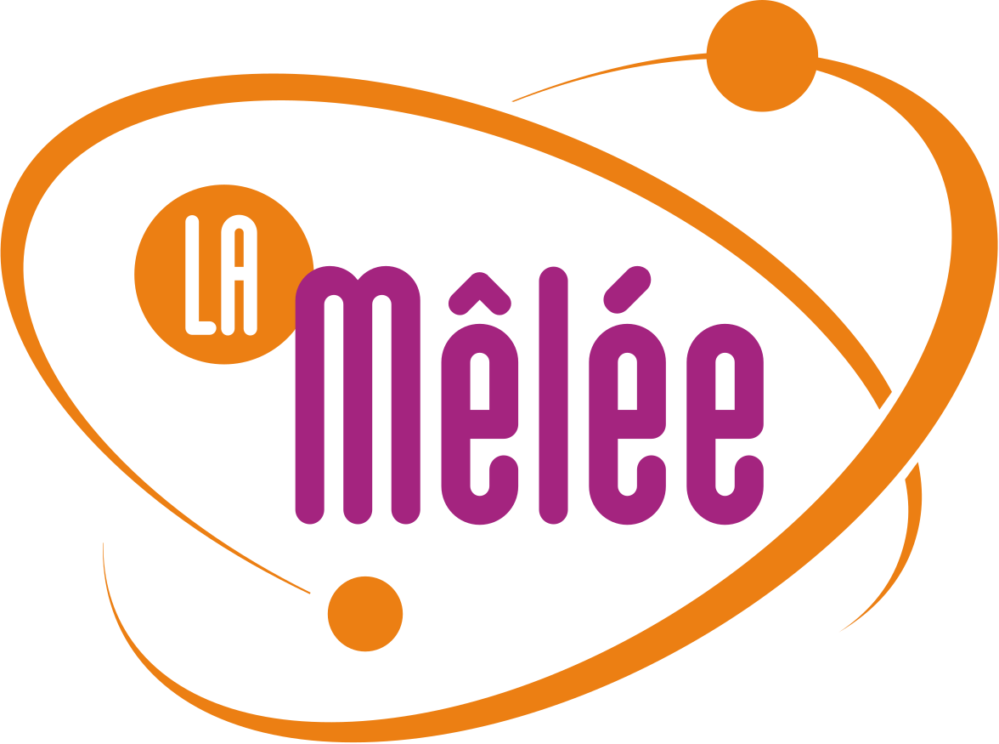
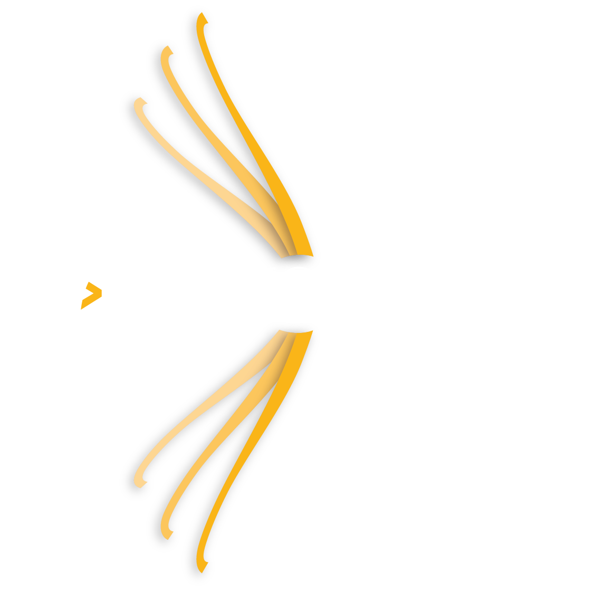
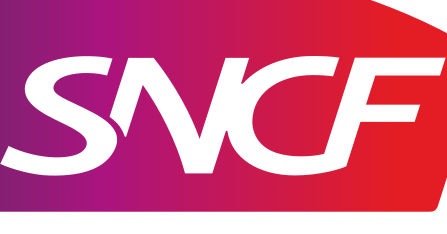
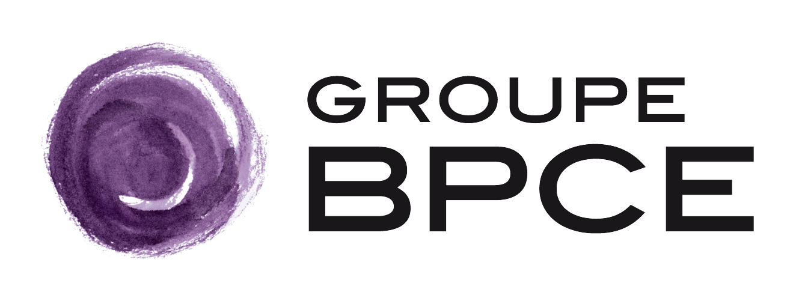

# Hackathon IA for Impact

**30 heures pour imaginer et prototyper des solutions d'IA à impact positif**

 

---

## Le hackathon

Le **Hackathon IA for Impact** est un concours collaboratif de 30 heures dédié à la création de
solutions innovantes répondant à des enjeux environnementaux, sociaux et économiques grâce à
l'intelligence artificielle.

Accompagnées par des mentors spécialisés en IA, innovation, design et stratégie, les équipes
travaillent sur des cas d'usage réels proposés par les organisations partenaires, puis présentent
leur prototype devant un jury d'experts. Les projets sont évalués selon leur **impact**, leur
**faisabilité**, leur **viabilité** et le **niveau d'aboutissement** du prototype.

- 📅 **Dates** : 9 & 10 octobre 2026
- 📍 **Lieu** : Toulouse INP-ENSEEIHT
- 🏆 **Cash prize** : 2 000 € pour les meilleures équipes

## Les défis

Chaque entreprise partenaire propose un défi. Toutes les ressources (énoncés, données, présentations)
sont disponibles dans le dossier [`challenges/`](challenges/).

| Entreprise | Défi | Dossier | Statut |
| --- | --- | --- | --- |
| **ENEDIS** | Optimiser le placement des ressources en situation de crise climatique | [`challenges/enedis/`](challenges/enedis/) | ✅ Disponible |
| **SNCF** | Dessine-moi une mobilité durable — voyage pédagogique en train liO | [`challenges/sncf/`](challenges/sncf/) | ✅ Disponible |
| **BPCE SI** | Du besoin au résultat, sans chercher — assistant conversationnel de confiance | [`challenges/bpce-si/`](challenges/bpce-si/) | ✅ Disponible |
| **Lallemand Plant Care** | Agent IA mondial de veille réglementaire et concurrentielle | [`challenges/lallemand/`](challenges/lallemand/) | ✅ Disponible |
| **Action Logement** | BâtIA — priorisation des rénovations et maintenance prédictive | [`challenges/action-logement/`](challenges/action-logement/) | ✅ Disponible |
| **iMSA** | Automatisation des contrôles des documents justifiant des dépenses de santé | [`challenges/imsa/`](challenges/imsa/) | ✅ Disponible |

## Déposer votre travail

Tout se passe dans le dossier [`submissions/`](submissions/). Chaque participant ou équipe dispose de
son propre dossier, et **seul ce dossier peut être modifié** par son auteur.

1. **Formez votre équipe** depuis l'[application des équipes](https://nneilime.github.io/Hackaton-IA4Impact/)
   (connexion GitHub, choix du défi, emails des membres). L'application crée votre dossier d'équipe
   et vous invite comme collaborateur.
2. Déposez-y votre code, vos notebooks, votre README de projet, vos slides… directement en **uploadant
   un `.zip`** depuis le site, ou en poussant vos fichiers avec git.
3. Ouvrez une **Pull Request** vers `main` pour soumettre votre travail.

Sans équipe, vous pouvez aussi travailler dans `submissions/<votre-pseudo-github>/`. La procédure
complète est décrite dans [`CONTRIBUTING.md`](CONTRIBUTING.md), et un modèle de description de
projet est fourni dans [`submissions/_template/`](submissions/_template/).

## Partenaires

**Événement organisé par**

**En partenariat avec**

**Sponsors & porteurs de défis**

<table>
  <tr>
    <td align="center" width="33%"> <b>Enedis</b></td>
    <td align="center" width="33%"> <b>SNCF</b></td>
    <td align="center" width="33%"> <b>BPCE Solutions informatiques</b></td>
  </tr>
  <tr>
    <td align="center" width="33%"> <b>Action Logement</b></td>
    <td align="center" width="33%"> <b>iMSA</b></td>
    <td align="center" width="33%"> <b>Lallemand Plant Care</b></td>
  </tr>
</table>

---

Hackathon IA for Impact · 9 & 10 octobre 2026 · Toulouse INP-ENSEEIHT

