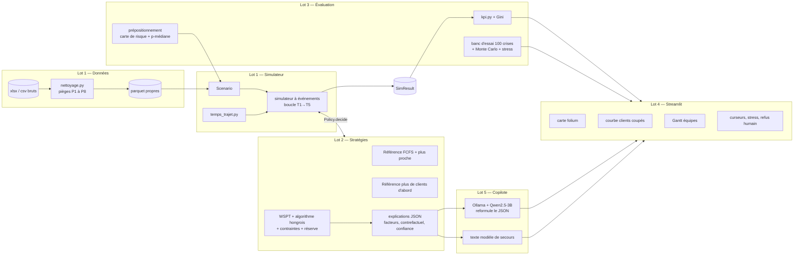

# Défi Enedis — Hackathon IA for Impact 2026 (La Mêlée)
## Plan d'équipe : architecture, tâches, outils, répartition (5 personnes × 5h)

> **Le défi :** quand plusieurs territoires sont touchés et que les équipes ne peuvent pas aller partout, où les placer et à quels incidents les envoyer pour rétablir le plus vite possible, **en sécurité**, avec une décision **explicable** ?
>
> **Notre réponse :** un copilote de crise en 3 étages.
> **PRÉVOIR** (carte de risque + incertitude) → **OPTIMISER** (règle de Smith (WSPT) + algorithme hongrois + p-médiane) → **EXPLIQUER** (facteurs chiffrés + LLM local qui ne fait que reformuler).
> L'outil recommande, le responsable métier décide.

---

## Sommaire

0. [À lire en 5 minutes](#0-à-lire-en-5-minutes)
1. [Ce que disent les données (pièges inclus)](#1-ce-que-disent-les-données-pièges-inclus)
2. [Le problème en clair (et la fonction objectif corrigée)](#2-le-problème-en-clair)
3. [Architecture](#3-architecture)
4. [Contrats d'interface (pour travailler en parallèle sans se bloquer)](#4-contrats-dinterface)
5. [Les algorithmes expliqués simplement](#5-les-algorithmes-expliqués-simplement)
6. [Outils (100 % open source, gratuits, sans GPU)](#6-outils)
7. [Lots et tâches détaillées](#7-lots-et-tâches-détaillées)
8. [Répartition et planning sur 5h](#8-répartition-et-planning-sur-5h)
9. [Hypothèses et limites (à recopier dans le README)](#9-hypothèses-et-limites)
10. [Indicateurs (KPI)](#10-indicateurs-kpi)
11. [Démo et pitch](#11-démo-et-pitch)
12. [Risques et plans B](#12-risques-et-plans-b)
13. [Glossaire](#13-glossaire)

---

## 0. À lire en 5 minutes

- **5 lots, 5 personnes, 5h chacune.** Un lot par personne, avec très peu de dépendances bloquantes.
- **Les contrats d'interface sont figés dans ce document (§4).** Chacun code contre ces contrats dès la première minute, avec des données factices si besoin, sans attendre les autres.
- **Points de synchronisation** (10 min chacun) : **H+2:00** (premiers branchements), **H+3:30** (intégration réelle), **H+4:15** (gel des fonctionnalités), **H+4:30 à 5:00** (répétition de la démo).
- **Règle d'or :** à H+4:15, on ne code plus de fonctionnalité. On corrige, on documente, on répète.
- **Priorité absolue (minimum à présenter) :**
  - simulateur + 2 stratégies de référence + notre stratégie ;
  - **courbe « clients coupés dans le temps », référence contre nous** ;
  - carte Streamlit.
  - Tout le reste est du bonus, classé par ordre de valeur.
- **Avant de commencer (15 min, tout le monde) :** installer l'environnement (§6.3). La personne P5 lance **tout de suite** le téléchargement du modèle LLM (≈ 2 Go).

---

## 1. Ce que disent les données (pièges inclus)

### 1.1 Les 4 fichiers

| Fichier | Contenu | Taille | Clé |
|---|---|---|---|
| `agents_v2.csv` | 18 sites opérationnels, `nb_equipes` par site | 18 lignes | `id_site` |
| `poste_v2.csv` | Postes : commune, département, lat/lon (WGS84) + Lambert 93, `nb_clients` (5 à 150), `poste_avec_client_sensible` (0/1) | 33 288 lignes | `id_poste` |
| `coupures_v2_100_crises.csv` | 100 crises simulées : `numero_crise`, `id_incident`, `id_poste`, `causeInterruption`, `dateHeureIncident`, `dureeDepannage` | 15 681 lignes | `id_incident` |
| `insee_v2.csv` | Référentiel des communes | ≈ 1 365 lignes | `code_insee` |

Relations : `coupures.id_poste → poste.id_poste` ; `poste.code_insee → insee.code_insee` ; distances calculées entre `agents.lat/lon` et `poste.lat/lon`.

### 1.2 Chiffres clés

- **63 équipes** sur **18 sites** (le LISEZ-MOI annonce 20 sites : c'est faux, le fichier en contient 18).
  - Haute-Garonne : 9 sites, 35 équipes. Ariège : 4 sites, 14 équipes. Gers : 5 sites, 14 équipes.
  - De 1 à 6 équipes par site (Laurencin, à Toulouse, en a 6).
- **Postes :** 2,58 M clients au total ; 1 664 postes sensibles (5,0 %).
- **Crises :** de 50 à 250 incidents (moyenne 157). Ils arrivent en **4 à 8h** (moyenne 5,9h).
- **Durées de dépannage :** 3 valeurs seulement. 2h (29 %), 4h (45 %), 8h (27 %). Moyenne ≈ 4,5h.
- **Causes :** à 70 % météo (tempête 31 %, branches 23 %, foudre 16 %).

### 1.3 Constat clé : toutes les crises sont saturées

- Charge moyenne d'une crise : 157 incidents × (4,5h de dépannage + ≈ 0,7h de trajet) ≈ **800 heures-équipe**.
- Pour 63 équipes, ça fait **≈ 13h de travail par équipe**. Pour la plus grosse crise (250 incidents) : **≈ 20h**.
- **Conséquence :** les contraintes de **temps de travail et de repos** limitent vraiment le résultat. Il faut les modéliser, sinon le démonstrateur n'est pas crédible pour Enedis.

### 1.4 Pièges à corriger (tâche T1.2)

| # | Piège | Correction |
|---|---|---|
| P1 | ~~Longitudes converties en dates par Excel~~ : **corrigé dans les versions CSV fournies** | Garde-fou conservé : contrôle de la zone géographique (lat 42,4–44,3, lon −0,5–2,4) |
| P2 | Tous les CSV sont lus en texte, puis typés explicitement | `float(str.replace(',', '.'))` (virgule décimale tolérée) |
| P3 | CSV des coupures : séparateur `;` + BOM UTF-8 | `pd.read_csv(sep=';', encoding='utf-8-sig')` |
| P4 | Date au format `JJ/MM/AAAA HH:MM` | `pd.to_datetime(..., dayfirst=True)` |
| P5 | `dureeDepannage` est du texte (`"4h"`) | `int(s.rstrip('h')) * 60`, en minutes |
| P6 | **5 incidents pointent vers des postes inexistants** (`POSTE_033289` à `POSTE_033298`) | **Les exclure et l'écrire dans le journal** (0,03 % des données). On n'invente pas de coordonnées |
| P7 | `code_insee` stocké en entier (`9001` au lieu de `09001`) | `str.zfill(5)` si on fait la jointure |
| P8 | **La fonction objectif est écrite « maximiser Σ Ni×Ti »** | C'est **minimiser** (voir §2). À dire au pitch |
| P9 | **43 postes sont touchés 2 fois dans la même crise** | Conservés et signalés (`rang_sur_poste`, `nb_incidents_poste_crise`). Le simulateur et les KPI ne doivent pas compter deux fois les clients si deux incidents sont ouverts en même temps sur le même poste |

### 1.5 Vérification déjà faite : la durée ne dépend pas de la cause

Répartition 2h/4h/8h ≈ 28 % / 45 % / 27 % **pour toutes les causes**.

- → **Inutile de faire du machine learning pour prédire les durées.** Les données sont aléatoires par construction.
- On traite la durée comme une **variable aléatoire** (Monte Carlo, §5.5). C'est plus honnête, et on l'explique au jury.

---

## 2. Le problème en clair

### 2.1 Les objets

- **Poste** : un point sur la carte, avec N clients, dont peut-être un client sensible.
- **Incident** : un poste tombe en panne à l'heure t₀ ; il faut une durée de dépannage d.
- **Équipe** : partie d'un site ; elle passe par les états `DISPONIBLE → TRAJET → CHANTIER → (RETOUR) → REPOS`.
- **Décision** : affecter l'équipe j à l'incident i, la garder en réserve, ou la prépositionner.

### 2.2 Fonction objectif (corrigée)

```
minimiser  Σ_i  N_i × T_i        (en clients·heures de coupure)

T_i = attente_i + trajet_i + dépannage_i     (de l'apparition à la résolution)
```

- **C'est un « minimiser »**, contrairement à ce qu'écrit l'énoncé. Maximiser reviendrait à faire durer les pannes.
- Cet indicateur est proche du critère B / SAIDI utilisé dans le secteur.
- **Version enrichie** (avec poids réglables dans l'interface) :

```
J = Σ_i N_i·T_i  +  α · Σ_{i sensible} N_i·T_i  +  pénalités (dépassement d'amplitude = interdit, pas pénalisé)
```

### 2.3 Contraintes (dures = jamais violées)

1. Une équipe traite **un seul incident à la fois**.
2. Un incident est résolu **seulement après trajet + dépannage complets**. Les clients sont rétablis à ce moment-là.
3. **Pas de réaffectation en cours de chantier** (sécurité : on n'abandonne pas un chantier ouvert).
4. **Amplitude de travail maximale par équipe : 12h**, puis **repos obligatoire de 11h**. Valeurs paramétrables (hypothèse H7).
5. On n'affecte un incident que si `trajet + dépannage ≤ amplitude restante`. Sinon l'équipe part en repos.

### 2.4 Nom du problème en recherche opérationnelle (à citer au pitch)

- *Dynamic Multi-Repairman Problem* pondéré. C'est proche d'un ordonnancement sur **machines parallèles** avec **temps de préparation qui dépendent de l'ordre** (ici, le trajet) et **dates d'arrivée** des tâches.
- C'est un problème NP-difficile → on utilise des heuristiques prouvées et une optimisation sur horizon glissant, pas un solveur exact sur toute la crise.

---

## 3. Architecture



**Principe central :** le simulateur **ne sait pas** quelle stratégie il exécute. Il appelle `policy.decide(etat)`.

- C'est ce qui permet de comparer les stratégies équitablement, sur les mêmes crises et avec les mêmes tirages aléatoires.

### 3.1 Arborescence du dépôt

```
enedis-crise-copilote/
├── README.md                    # Lot 5
├── requirements.txt             # Lot 1
├── config/
│   └── default.yaml             # vitesses, amplitude, repos, α, β, seed
├── data/
│   ├── raw/                     # fichiers fournis (non modifiés)
│   └── clean/                   # parquet générés (dans .gitignore)
├── src/crise/
│   ├── data/nettoyage.py        # T1.2
│   ├── models.py                # T1.3 contrats (§4)
│   ├── trajet.py                # T1.4
│   ├── simulateur.py            # T1.5, T1.7
│   ├── scenarios.py             # T1.8, T3.6 (stress)
│   ├── policies/
│   │   ├── base.py              # interface Policy
│   │   ├── baselines.py         # T1.6
│   │   └── wspt_hongrois.py     # T2.x
│   ├── explication.py           # T2.5
│   ├── kpi.py                   # T3.1
│   ├── prepositionnement.py     # T3.3, T3.4
│   ├── benchmark.py             # T3.5
│   └── copilote/
│       ├── llm.py               # T5.2
│       └── templates.py         # T5.3
├── app/
│   ├── Accueil.py               # Streamlit : salle de crise
│   └── pages/
│       ├── 2_Benchmark.py
│       ├── 3_Preparation.py
│       └── 4_Stress_tests.py
├── outputs/                     # résultats du banc d'essai (parquet, png)
└── tests/                       # pytest
```

---

## 4. Contrats d'interface

> **Figés au démarrage.** Toute modification passe par un message dans le canal de l'équipe. Avec ça, P2, P3, P4 et P5 peuvent coder **dès H+0:15** sur des données factices.
> **Unités :** temps en **minutes depuis le début de la crise** (entiers) ; distances en km ; coordonnées en WGS84.

### 4.1 Objets (`src/crise/models.py`)

```python
from dataclasses import dataclass, field
from enum import Enum

class EtatEquipe(str, Enum):
    DISPONIBLE = "disponible"
    TRAJET     = "trajet"
    CHANTIER   = "chantier"
    RETOUR     = "retour"      # retour base avant repos
    REPOS      = "repos"
    HORS_SERVICE = "hors_service"

class EtatIncident(str, Enum):
    NON_APPARU = "non_apparu"
    EN_ATTENTE = "en_attente"
    AFFECTE    = "affecte"      # équipe en route
    EN_COURS   = "en_cours"     # chantier
    RESOLU     = "resolu"

@dataclass
class Poste:
    id_poste: str
    commune: str
    departement: str
    lat: float
    lon: float
    nb_clients: int
    sensible: bool

@dataclass
class Site:
    id_site: str
    commune: str
    lat: float
    lon: float
    nb_equipes: int

@dataclass
class Incident:
    id_incident: str
    id_poste: str
    t_apparition: int          # min depuis début de crise
    duree_nominale: int        # min (120/240/480), ce que voit la stratégie
    duree_reelle: int          # min, ce que joue le simulateur (= nominale sans Monte Carlo)
    cause: str
    nb_clients: int
    sensible: bool
    lat: float
    lon: float
    etat: EtatIncident = EtatIncident.NON_APPARU
    id_equipe: str | None = None
    t_affectation: int | None = None
    t_arrivee: int | None = None
    t_resolution: int | None = None

@dataclass
class Equipe:
    id_equipe: str             # ex "SITE_04_E2"
    id_site: str               # base de rattachement
    lat: float                 # position courante
    lon: float
    etat: EtatEquipe = EtatEquipe.DISPONIBLE
    t_debut_service: int = 0   # début de l'amplitude en cours
    t_libre: int = 0           # date où elle redevient disponible
    id_incident: str | None = None

@dataclass
class Affectation:
    id_equipe: str
    id_incident: str
    explication: dict = field(default_factory=dict)   # voir §4.3

@dataclass
class EtatSimulation:          # ce que reçoit la stratégie
    t: int
    equipes_disponibles: list[Equipe]
    incidents_en_attente: list[Incident]
    toutes_equipes: list[Equipe]
    params: dict               # amplitude, repos, α, β, vitesses…
```

### 4.2 Interface stratégie (`src/crise/policies/base.py`)

```python
class Policy:
    nom: str = "abstraite"
    def decide(self, etat: EtatSimulation, trajet_min) -> list[Affectation]:
        """Appelée à chaque événement (incident apparu, équipe libérée).
        trajet_min(lat1, lon1, lat2, lon2) -> minutes. Renvoie les affectations à lancer maintenant.
        Ne doit JAMAIS proposer une affectation qui viole l'amplitude restante."""
        raise NotImplementedError
```

### 4.3 Format d'une explication (produit par le Lot 2, utilisé par les Lots 4 et 5)

```json
{
  "id_equipe": "SITE_08_E1",
  "id_incident": "INC_000123",
  "t": 95,
  "score": 41.7,
  "facteurs": {
    "nb_clients": 142, "sensible": true, "attente_min": 35,
    "trajet_min": 22, "duree_min": 240,
    "poids_sensible": 6.0, "poids_attente": 1.06
  },
  "contributions_pct": {"clients": 38, "sensible": 41, "attente": 3, "trajet": -6, "duree": -12},
  "alternative": {
    "id_incident": "INC_000140", "score": 30.2,
    "delta_clients_heures": 312
  },
  "meilleure_autre_equipe": {"id_equipe": "SITE_10_E2", "retard_min": 48},
  "confiance": 0.72,
  "limites": ["trajet estimé à vol d'oiseau × 1,3", "durée nominale 4h, réelle incertaine"]
}
```

### 4.4 Résultat d'une simulation (`SimResult`, produit par le Lot 1, utilisé par les Lots 3 et 4)

Quatre tables pandas, sauvegardables en parquet :

| Table | Colonnes | Sert à |
|---|---|---|
| `incidents` | id_incident, id_poste, lat, lon, nb_clients, sensible, commune, departement, t_apparition, t_affectation, t_arrivee, t_resolution, id_equipe, duree_reelle | KPI, carte |
| `activites` | id_equipe, type (`trajet`/`chantier`/`retour`/`repos`), t_debut, t_fin, id_incident, lat_dep, lon_dep, lat_arr, lon_arr | Gantt, position des équipes à l'instant t |
| `decisions` | t, id_equipe, id_incident, explication (JSON) | tableau des décisions, copilote |
| `serie` | t (tous les 30 min), clients_coupes, incidents_attente, equipes_occupees, equipes_repos | courbes, jauge de saturation |

+ métadonnées : `crise`, `strategie`, `seed`, `params`.

> **Position d'une équipe à l'instant t** : on cherche la ligne de `activites` qui contient t. Pendant un `trajet`, on fait une interpolation linéaire entre départ et arrivée. → L'interface n'a pas besoin de relancer la simulation pour animer la carte.

---

## 5. Les algorithmes expliqués simplement

### 5.1 Le simulateur à événements (boucle T1 → T5)

- **File d'événements** triée par date (`heapq`). Types d'événements :
  - `APPARITION(incident)` ;
  - `ARRIVEE(equipe)` : fin du trajet, début du chantier ;
  - `FIN_CHANTIER(equipe)` : incident résolu, clients rétablis ;
  - `FIN_REPOS(equipe)` ;
  - `INDISPO(equipe)` : stress test.
- **À chaque événement :**
  1. **T1** — Mettre à jour les incidents (apparus, résolus).
  2. **T2** — Lister les équipes disponibles et leur position. Celles dont l'amplitude est épuisée → `RETOUR` puis `REPOS`.
  3. **T3 + T4** — Appeler `policy.decide(...)`. Pour chaque affectation : créer `ARRIVEE` à `t + trajet` et `FIN_CHANTIER` à `t + trajet + durée_réelle`.
  4. **T5** — Quand un chantier finit : incident `RESOLU`, l'équipe reste sur place (`DISPONIBLE`) et on recommence.
- **Instantané tous les 30 min** pour la table `serie` (le pas de 30 min recommandé par Enedis).
- **Fin** : quand tous les incidents sont résolus.
- **Déterministe** à graine (seed) fixée → résultats reproductibles.
- **Pourquoi des événements plutôt qu'un pas fixe de 30 min ?** C'est plus précis (une équipe libérée à 14h07 repart à 14h07, pas à 14h30) et plus rapide. Le pas de 30 min sert seulement à l'affichage.

### 5.2 Temps de trajet

```
distance_km = haversine(A, B) × 1,3            # coefficient de détour routier
vitesse     = 35 km/h si la DESTINATION a une latitude < 43,05 (zone montagne : Ariège, Comminges sud, Luchon)
              55 km/h sinon (plaine)
trajet_min  = distance_km / vitesse × 60
```

- Calcul **vectorisé numpy** : matrice équipes × incidents en une seule opération.
- Stress test « routes coupées » : vitesse ÷ 3 dans une zone choisie.
- *Option, hors du temps imparti :* routage réel avec OSMnx sur l'extrait OpenStreetMap Occitanie. Lourd, à garder pour la conclusion du pitch.

### 5.3 La stratégie principale : WSPT + algorithme hongrois

**L'intuition, avec un exemple (1 équipe, trajet nul) :**

| Ordre | Calcul | Σ N·T |
|---|---|---|
| A d'abord (150 clients, 8h), puis B (50 clients, 2h) | 150×8 + 50×10 | **1 700** |
| B d'abord, puis A | 50×2 + 150×10 | **1 600** ✅ |

- Rapport N / durée : A = 150/8 = 18,75 ; B = 50/2 = 25 → on traite **B d'abord**.
- C'est la **règle de Smith (WSPT)**. Elle est **optimale** pour une seule équipe.
- Elle remplace l'intuition trompeuse « le plus gros poste d'abord ».

**Notre score** pour un couple (équipe j, incident i) :

```
score_ij = w_i / (trajet_ij + durée_i)

w_i = N_i × (1 + α · sensible_i) × (1 + β · attente_i_en_heures)
```

- `α` (curseur 0 à 20, **défaut 5**) : un poste sensible pèse 6 fois plus.
- `β` (curseur 0 à 0,5, **défaut 0,1**) : un incident qui attend depuis 10h voit son poids **doubler**.
  - → Les petits postes ruraux ne restent pas oubliés, ce qui répond à l'équité territoriale.
- **Infaisable** (amplitude dépassée, équipe hors service) → score = −∞.

**Affectation globale par l'algorithme hongrois :**

- Problème : avec plusieurs équipes libres en même temps, le glouton « chaque équipe prend son meilleur incident » fait des doublons et de mauvais choix croisés.
- L'**algorithme hongrois** (`scipy.optimize.linear_sum_assignment(-S)`) trouve l'appariement équipes ↔ incidents qui **maximise la somme des scores**. Il le fait en quelques millisecondes pour 63 × 250.
- La matrice peut être rectangulaire : plus d'incidents que d'équipes, ou l'inverse.

**Deux améliorations (v2, si le temps le permet) :**

1. **Anticipation** : on ajoute les équipes qui se libèrent dans les 30 prochaines minutes, avec leur position future.
   - Si l'une d'elles gagne, on « réserve » l'incident au lieu d'envoyer une équipe lointaine.
2. **Réserve anti-piège des 8h** :
   - S'il ne reste qu'une équipe disponible dans un rayon de 40 km et que l'incident proposé dure 8h sans être sensible, on la garde en réserve si des postes sensibles de la zone ne sont pas encore touchés.
   - Paramètre activable par l'interface.

**Stratégies de référence** (à battre) :

- **R1 — FCFS + plus proche** : incidents traités par ordre d'arrivée, avec l'équipe disponible la plus proche.
- **R2 — Plus de clients d'abord** : incident avec le plus grand N, avec l'équipe la plus proche. C'est la référence la plus dure, donc la plus crédible.

### 5.4 Explicabilité

Pour chaque affectation, le Lot 2 produit le JSON du §4.3 :

- **Facteurs** : les valeurs brutes qui entrent dans le score.
- **Contributions en %** : décomposition du logarithme du score.
  - `log score = log N + log(1+α s) + log(1+β a) − log(trajet+durée)`. Chaque terme, rapporté à la somme des valeurs absolues, donne un pourcentage.
  - Simple, exact, et lisible dans un graphique en barres.
- **Contrefactuel** : « si l'équipe allait sur la 2e meilleure option, coût estimé : `delta_clients_heures` ».
  - Estimation : `N_i × retard_i` (retard = temps avant que la meilleure autre équipe puisse prendre i) − gain sur l'alternative.
- **Confiance** (de 0 à 1) = `0,6 × marge + 0,4 × stabilité`.
  - `marge = (score1 − score2) / score1`.
  - `stabilité` = part des tirages Monte Carlo où la même décision reste la meilleure (sinon 0,5 par défaut).
- **Limites** : liste fixe d'hypothèses qui concernent cette décision.
- **Refus humain** : le responsable peut **refuser** une affectation ou **en forcer une autre**.
  - Le simulateur rejoue avec `forcees={équipe: incident}` et `interdites={(équipe, incident)}`, puis affiche l'écart de clients·heures.
  - Ça montre concrètement que l'outil recommande et que l'humain décide.

### 5.5 Incertitude (Monte Carlo)

- La stratégie voit la **durée nominale** (2/4/8h). Le simulateur joue une **durée réelle** :
  - `duree_reelle = nominale × LogNormale(μ=0, σ=0,3)`, bornée entre 0,5× et 2×.
  - `vitesse_reelle = vitesse × Normale(1 ; 0,15)`, bornée entre 0,6 et 1,3.
- 30 tirages par crise → **intervalle à 90 %** sur Σ N·T et sur la courbe des clients coupés (zone ombrée sur le graphique).
- Message au jury : « notre gain tient même quand les durées sont fausses de ±30 % ».

### 5.6 Prépositionnement (mode préparation)

1. **Séparation apprentissage/test** : crises 1 à 80 = apprentissage ; 81 à 100 = test.
   - **Sans cette séparation, le gain est truqué** (fuite de données, ou *data leakage*).
2. **Carte de risque** : sur les crises d'apprentissage, densité spatiale (KDE, de scikit-learn) des incidents, pondérée par `nb_clients × (1 + α·sensible)`. Affichée en carte de chaleur.
3. **Points de demande** : on agrège les postes touchés en **200 zones** (K-Means pondéré) → poids w_d.
4. **Points candidats** : les 18 sites + 20 points avancés (centres des zones de plus fort risque, éloignées des sites).
5. **Modèle de p-médiane avec capacité** (MILP, OR-Tools + solveur SCIP/CBC inclus) :

```
variables : n_k ∈ ℕ (équipes placées au point k), x_dk ∈ [0,1] (part de la zone d servie depuis k)
min   Σ_d Σ_k  w_d · trajet_dk · x_dk
s.c.  Σ_k x_dk = 1                         ∀d
      Σ_d w_d · x_dk ≤ capa · n_k           ∀k     (capa = Σw / 63 × 1,2)
      Σ_k n_k = 63 ;  n_k ≤ 8
```

   - 200 × 38 ≈ 7 600 variables : résolu **en quelques secondes sur CPU**.
6. **Comparaison sur les 20 crises de test** : (a) équipes à leurs sites ; (b) K-Means simple (63 centres) ; (c) p-médiane.
   - On affiche le gain de (c).
7. Les équipes prépositionnées partent du point avancé. Pour le repos, elles **rentrent à leur site d'origine**.

### 5.7 Équité territoriale

- **Coefficient de Gini** des temps de coupure moyens **par commune touchée**, pondéré par le nombre de clients.
  - 0 = tout le monde attend pareil ; 1 = très inégal.
- Indicateur complémentaire : **attente maximale** par département et **attente maximale d'un poste sensible**.
- Courbe de compromis (bonus) : on fait varier `β` → on trace Σ N·T en fonction du Gini.
  - → « Rendre la crise 15 % plus équitable coûte 2 % de clients·heures. » Cette décision revient à Enedis, et l'outil la rend visible.

### 5.8 Copilote IA (LLM local, encadré)

- **Le LLM ne décide rien et ne calcule rien.** Il reçoit le JSON d'explication (§4.3) et le **reformule** en 2 ou 3 phrases métier.
- **Garde-fou anti-hallucination :**
  - on extrait tous les nombres du texte généré (expression régulière) ;
  - s'il y en a un qui n'est pas dans le JSON → on jette le texte et on affiche le **texte modèle** (template).
- **Deux usages :**
  1. Fiche d'arbitrage d'une décision (clic sur une ligne du tableau).
  2. **Point de situation pour la préfecture** à l'instant t : clients coupés, rétablis, prévision de fin, zones en tension, postes sensibles en attente.
- **Démo sans risque** : les textes de la crise de démo sont **pré-générés et mis en cache** au démarrage. Le LLM tourne en direct uniquement pour les décisions modifiées par le jury.

---

## 6. Outils

### 6.1 Liste (tous open source, gratuits, CPU seulement)

| Besoin | Outil | Licence | Remarque |
|---|---|---|---|
| Langage | **Python 3.11+** | PSF | Windows / macOS / Linux |
| Environnement | `venv` + `pip` (ou **uv**, plus rapide) | MIT / Apache-2.0 | |
| Données | **pandas**, **numpy**, **pyarrow** (parquet) | BSD / Apache-2.0 | |
| Lecture Excel | **openpyxl** | MIT | facultatif (les données sont maintenant en CSV) |
| Configuration | **PyYAML** | MIT | `config/default.yaml` |
| Algorithme hongrois | **scipy** (`linear_sum_assignment`) | BSD | |
| Optimisation (MILP) | **OR-Tools** (`pywraplp` + SCIP/CBC inclus) | Apache-2.0 | aucun solveur à installer en plus |
| Clustering, KDE | **scikit-learn** | BSD | K-Means pondéré, `KernelDensity` |
| Parallélisme (banc d'essai) | **joblib** | BSD | utilise tous les cœurs du processeur |
| Interface | **Streamlit** | Apache-2.0 | |
| Carte | **folium** + **streamlit-folium** | MIT | fonds de carte OpenStreetMap / CARTO (gratuits) ; plugin `HeatMap` |
| Graphiques | **plotly** | MIT | courbes, Gantt (`px.timeline`), boxplots |
| LLM local | **Ollama** | MIT | fonctionne sur CPU, Windows inclus |
| Modèle LLM | **Qwen2.5-3B-Instruct** (quantifié Q4, ≈ 2 Go) | Apache-2.0 | ≈ 5 à 10 tokens/s sur un portable → ≈ 15 s par fiche. **Plan B** : `qwen2.5:1.5b` (≈ 1 Go, 2× plus rapide) |
| Client LLM | **ollama** (bibliothèque Python) | MIT | ou `requests` sur `http://localhost:11434` |
| Tests / qualité | **pytest**, **ruff** | MIT | |
| Versionnage | **git** + GitHub (dépôt public gratuit) | GPL / gratuit | |
| Diagrammes | **Mermaid** (affiché nativement par GitHub) | MIT | |
| Vidéo de secours | **OBS Studio** | GPL-2.0 | enregistrer la démo en cas de panne |
| Diapositives | **LibreOffice Impress** ou **Marp** | MPL / MIT | ou le gabarit fourni par Enedis |

> **Exclu volontairement :** API payantes (Gemini, OpenAI), GPU, OSRM/serveur de routage (trop lourd à monter en 5h), apprentissage par renforcement (aucune chance de converger en 5h, et opaque).

### 6.2 `requirements.txt`

```
pandas>=2.2
numpy>=1.26
pyarrow>=15
openpyxl>=3.1
pyyaml>=6
scipy>=1.12
ortools>=9.10
scikit-learn>=1.4
joblib>=1.3
streamlit>=1.35
folium>=0.16
streamlit-folium>=0.20
plotly>=5.20
ollama>=0.3
pytest>=8
ruff>=0.4
```

### 6.3 Installation (15 min, tout le monde, avant H+0:15)

```bash
git clone <url-du-depot> && cd enedis-crise-copilote
python -m venv .venv
# Windows : .venv\Scripts\activate     macOS/Linux : source .venv/bin/activate
pip install -r requirements.txt
# déposer les fichiers fournis dans data/raw/
python -m crise.data.nettoyage          # (dès que T1.2 est livrée) → data/clean/*.parquet
streamlit run app/Accueil.py
```

**P5 seulement** — LLM :

```bash
# installer Ollama : https://ollama.com (Windows/macOS/Linux)
ollama pull qwen2.5:3b        # ≈ 2 Go — À LANCER EN PREMIER
ollama pull qwen2.5:1.5b      # plan B
ollama run qwen2.5:3b "Bonjour"   # test
```

### 6.4 `config/default.yaml`

```yaml
seed: 42
trajet:
  coef_detour: 1.3
  vitesse_plaine_kmh: 55
  vitesse_montagne_kmh: 35
  lat_seuil_montagne: 43.05
travail:
  amplitude_max_min: 720      # 12h
  repos_min: 660              # 11h
score:
  alpha_sensible: 5.0
  beta_attente_par_h: 0.1
  anticipation_min: 30        # v2
  reserve_active: false       # v2
monte_carlo:
  n_tirages: 30
  sigma_duree: 0.3
  sigma_vitesse: 0.15
prepositionnement:
  crises_apprentissage: [1, 80]
  n_zones_demande: 200
  n_points_avances: 20
  max_equipes_par_point: 8
affichage:
  pas_instantane_min: 30
```

---

## 7. Lots et tâches détaillées

> Format : **ID — tâche** · durée estimée · *dépend de* · ✅ **fini quand** (critère de fin)

### LOT 1 — Données & simulateur (P1) · *le chemin critique*

| ID | Tâche | Durée | Dépend de | ✅ Fini quand |
|---|---|---|---|---|
| T1.1 | Créer le dépôt GitHub, l'arborescence §3.1, `requirements.txt`, `.gitignore`, `config/default.yaml`, inviter l'équipe | 15 min | — | les 4 autres ont cloné et lancé `pip install` |
| T1.2 | `nettoyage.py` : lecture des 3 fichiers, corrections P1 à P7, jointure coupures ↔ postes, export de `postes.parquet`, `sites.parquet`, `incidents.parquet` + journal (5 orphelins exclus) | 40 min | T1.1 | les contrôles passent : 63 équipes, 18 sites, Toulouse lon ≈ 1,42, 15 676 incidents |
| T1.3 | `models.py` : copier les contrats du §4 + `charger_scenario(numero_crise, params) → (sites, equipes, incidents)`. Les équipes sont créées à partir de `nb_equipes` (`SITE_04_E1`…) | 20 min | T1.2 | `charger_scenario("CRISE_027")` renvoie 63 équipes et 250 incidents |
| T1.4 | `trajet.py` : `trajet_min(lat1, lon1, lat2, lon2)` + version matricielle `matrice_trajet(equipes, incidents)`, règle montagne/plaine, multiplicateur de zone (stress) | 20 min | — | test : Foix → Toulouse ≈ 72 km à vol d'oiseau → ≈ 93 km routiers → ≈ 1h40 (destination en plaine) |
| T1.5 | `simulateur.py` : file d'événements, boucle T1→T5, appel de `policy.decide`, construction des 4 tables `SimResult` (§4.4), instantanés tous les 30 min | 75 min | T1.3, T1.4 | une crise entière tourne en moins de 2 s avec R1, tous les incidents sont résolus, aucune équipe sur 2 incidents à la fois (test) |
| T1.6 | `baselines.py` : R1 (FCFS + plus proche) et R2 (plus de clients d'abord) | 20 min | T1.5 | Σ N·T de R1 et R2 calculés sur CRISE_001 |
| T1.7 | Contraintes de travail dans le simulateur : amplitude, `RETOUR` à la base, `REPOS` 11h, événement `INDISPO` (équipe hors service à t), durées réelles ≠ nominales (pour le Monte Carlo) | 40 min | T1.5 | test : aucune activité au-delà de 12h d'amplitude ; une équipe hors service ne reçoit plus rien |
| T1.8 | Paramètres `forcees` / `interdites` (refus humain), `positions_initiales` (prépositionnement), `incidents_additionnels` (2e vague) | 25 min | T1.5 | le rejeu avec 1 affectation forcée fonctionne et modifie Σ N·T |
| T1.9 | Appui à l'intégration (H+3:30) + tests pytest + section « Simulateur » du README | 25 min | tout | `pytest` passe |
| **Total** | | **≈ 4h40** | | |

### LOT 2 — Moteur d'optimisation & explicabilité (P2)

| ID | Tâche | Durée | Dépend de | ✅ Fini quand |
|---|---|---|---|---|
| T2.1 | Lire §5.3 et §5.4, préparer un **jeu factice** : 3 équipes, 6 incidents, construits à la main avec les dataclasses du §4 | 15 min | contrats | jeu factice utilisable dans pytest |
| T2.2 | `wspt_hongrois.py` : calcul de `w_i` et de la matrice `S` (vectorisée numpy), infaisables à −1e9, `linear_sum_assignment(-S)`, on filtre les couples infaisables | 50 min | T2.1 | sur le jeu factice, le résultat est celui calculé à la main ; test de l'exemple A/B du §5.3 |
| T2.3 | Faisabilité : on n'affecte pas si `trajet + durée > amplitude restante` ; s'il n'y a aucun incident faisable, on ne propose rien (le simulateur envoie l'équipe en repos) | 20 min | T2.2 | test unitaire |
| T2.4 | **Branchement réel** avec le simulateur de P1 (H+2:00) : faire tourner CRISE_001 et comparer à R1 et R2 | 20 min | T1.5 | Σ N·T(WSPT) < Σ N·T(R2) < Σ N·T(R1) (sinon : déboguer le score) |
| T2.5 | `explication.py` : facteurs, contributions en % (décomposition du log), alternative + `delta_clients_heures`, meilleure autre équipe, confiance (marge), limites → JSON §4.3 joint à chaque `Affectation` | 60 min | T2.2 | chaque décision de CRISE_001 a un JSON valide ; échantillon relu à la main |
| T2.6 | v2 : **anticipation** (équipes libres dans moins de 30 min) + **réserve anti-piège des 8h**, désactivables dans la configuration | 45 min | T2.4 | gain mesuré (ou absence de gain, documentée) sur 10 crises d'apprentissage |
| T2.7 | **Réglage de α et β** : grille α ∈ {0, 2, 5, 10}, β ∈ {0, 0,05, 0,1, 0,2} sur les crises d'apprentissage (banc d'essai de P3) → choisir les valeurs par défaut et les justifier | 30 min | T3.5 | tableau des résultats dans `outputs/`, valeurs choisies dans la configuration |
| T2.8 | Section « Moteur & explicabilité » du README (formules, exemple A/B) | 20 min | — | relue par P5 |
| **Total** | | **≈ 4h20** (+ 40 min de marge) | | |

### LOT 3 — Évaluation, robustesse, prépositionnement (P3)

| ID | Tâche | Durée | Dépend de | ✅ Fini quand |
|---|---|---|---|---|
| T3.1 | `kpi.py` à partir d'un `SimResult` (§4.4) : Σ N·T, % rétablis à 2h/4h/8h, attente max des sensibles, Gini par commune, saturation (part du temps où 100 % des équipes sont occupées), utilisation, dépassements d'amplitude | 40 min | contrats | testé sur un `SimResult` factice |
| T3.2 | Séparation apprentissage/test (1 à 80 / 81 à 100) + fonction `courbe_clients_coupes(result)` | 10 min | — | |
| T3.3 | Carte de risque : KDE pondérée sur les crises d'apprentissage → grille + export pour la carte de chaleur folium | 30 min | T1.2 | image de la carte de chaleur dans `outputs/` |
| T3.4 | `prepositionnement.py` : 200 zones de demande (K-Means pondéré), 38 candidats, **MILP p-médiane avec capacité** sous OR-Tools (§5.6) + référence K-Means à 63 centres → `positions_initiales` | 60 min | T3.3 | solution en moins de 60 s, 63 équipes placées, carte des positions |
| T3.5 | `benchmark.py` : `lancer(crises, strategies, seeds, params, scenario)` parallélisé avec joblib → parquet des KPI + séries | 40 min | T1.5, T3.1 | 100 crises × 3 stratégies terminées en moins de 5 min |
| T3.6 | `scenarios.py` (stress) : S1 routes coupées (vitesse ÷ 3 en zone montagne) ; S2 30 % d'équipes hors service à H+3 ; S3 2e vague (crise suivante décalée de +6h) ; S4 **2 crises successives + 50 % d'équipes indisponibles après 48h** (critère du jury) ; S5 seulement 20 équipes | 40 min | T1.7, T1.8 | chaque scénario tourne avec les 3 stratégies |
| T3.7 | **Lancement du banc d'essai complet** (H+3:15) : 100 crises × {R1, R2, WSPT} × 5 graines Monte Carlo + prépositionnement sur les crises de test + 5 stress tests → `outputs/*.parquet` + figures plotly (boxplots, courbe avec bande 90 %) | 40 min | tout | figures prêtes pour P4 et pour le pitch ; **le chiffre « −X % » est connu** |
| **Total** | | **≈ 4h20** (+ 40 min de marge) | | |

### LOT 4 — Interface Streamlit « Salle de crise » (P4)

| ID | Tâche | Durée | Dépend de | ✅ Fini quand |
|---|---|---|---|---|
| T4.1 | Squelette multipage (§3.1), mise en page, `st.cache_data`, **générateur de `SimResult` factice** à partir des contrats §4.4 (30 incidents, 6 équipes au hasard sur la zone) | 30 min | contrats | l'application démarre avec les données factices |
| T4.2 | **Carte folium** : sites (icône dépôt), incidents colorés par état (gris = à venir, rouge = en attente, orange = affecté/en cours, vert = résolu ; taille ∝ clients ; contour violet = sensible), équipes à leur position interpolée, ligne équipe → incident ; **curseur de temps** (pas de 30 min) + bouton lecture | 60 min | T4.1 | l'animation fonctionne sur les données factices |
| T4.3 | Bandeau de KPI (`st.metric`) : clients coupés, rétablis, en attente, équipes occupées/en repos, Σ N·T, avec écart par rapport à la référence | 15 min | T4.1 | |
| T4.4 | **Courbe des clients coupés dans le temps : R1 contre R2 contre WSPT** (plotly), avec ligne verticale à t et bande 90 % du Monte Carlo si disponible | 25 min | T4.1 | |
| T4.5 | **Gantt des équipes** (`px.timeline`) : trajet / chantier / retour / repos | 20 min | T4.1 | |
| T4.6 | Tableau des décisions à l'instant t ; clic → panneau d'explication (barres de contributions, alternative, confiance, limites) + **texte du copilote** (P5) | 30 min | T4.1, format §4.3 | |
| T4.7 | Panneau latéral : choix de la crise, de la stratégie, curseurs α et β, bouton « Recalculer » (relance la simulation réelle) ; **boutons de stress** (routes coupées, −30 % d'équipes, 2e vague) ; **« Refuser / forcer »** sur une décision → rejeu avec `forcees`/`interdites` et écart affiché | 45 min | T1.8 | utilisé en démo sur des données réelles |
| T4.8 | Pages « Benchmark » (boxplots, tableau des KPI), « Préparation » (carte de chaleur + positions p-médiane contre sites), « Stress tests » (tableau des scénarios × stratégies) à partir de `outputs/` | 35 min | T3.7 | |
| T4.9 | Branchement réel (H+3:30), finitions, temps de chargement < 3 s (résultats pré-calculés en parquet) | 20 min | tout | parcours de démo complet sans erreur |
| **Total** | | **≈ 4h40** | | |

### LOT 5 — Copilote IA, documentation, pitch (P5) · *coordination*

| ID | Tâche | Durée | Dépend de | ✅ Fini quand |
|---|---|---|---|---|
| T5.1 | **H+0:00** : lancer `ollama pull` ; animer le lancement (15 min) ; ouvrir un tableau de suivi (issues GitHub ou simple liste) avec les tâches de ce document | 15 min | — | chacun sait quoi faire |
| T5.2 | `copilote/llm.py` : prompt système (rôle : « adjoint du responsable de crise Enedis, factuel, 3 phrases max, n'invente aucun chiffre ») + JSON §4.3 → texte ; température 0,2 ; délai max 30 s ; **vérification des nombres** (expression régulière) ; mise en cache sur disque | 50 min | format §4.3 | 10 JSON factices reformulés, 0 nombre inventé laissé passer |
| T5.3 | `copilote/templates.py` : texte modèle de secours (f-string) pour la fiche d'arbitrage + **point de situation préfecture** (à partir des KPI à t : clients coupés, rétablis, fin estimée, départements en tension, postes sensibles en attente) | 30 min | T3.1 | identique dans l'esprit au texte LLM, instantané |
| T5.4 | Pré-génération des textes pour la **crise de démo** (choisie avec P3 : une grosse crise multi-départements) | 15 min | T2.5 | cache prêt |
| T5.5 | **README** : objectif, captures, installation, exécution, architecture (diagramme du §3), hypothèses et limites (§9), résultats (chiffres de P3), garde-fous éthiques, pistes d'amélioration | 45 min | sections de P1 et P2 | un inconnu peut lancer le projet en 10 min |
| T5.6 | **Pitch** (5 min) : structure du §11, 6 à 8 diapositives, chiffres réels, capture de la courbe | 50 min | T3.7 | répété une fois seul, chronométré |
| T5.7 | **Script de démo** (§11.2) + **vidéo de secours** de 2 min avec OBS (H+4:15) | 25 min | T4.9 | vidéo enregistrée |
| T5.8 | Animer les points de synchronisation H+2:00, H+3:30, H+4:15 et la répétition H+4:30 | 30 min | — | |
| **Total** | | **≈ 4h20** (+ marge) | | |

---

## 8. Répartition et planning sur 5h

### 8.1 Qui fait quoi

| Rôle | Lot | Profil idéal |
|---|---|---|
| **P1** | Données & simulateur | La personne **la plus à l'aise en Python**. C'est le chemin critique |
| **P2** | Optimisation & explicabilité | Goût pour l'algorithmique et les maths |
| **P3** | Évaluation, robustesse, prépositionnement | Data scientist, à l'aise avec pandas et l'optimisation |
| **P4** | Interface Streamlit | Sensibilité front et dataviz |
| **P5** | Copilote IA, documentation, pitch, coordination | Vision d'ensemble, à l'aise à l'oral. **Suggestion : la cheffe de projet** |

### 8.2 Planning (H+0:00 = début de la session de 5h)

**Comment lire la grille :** une ligne = un créneau de 30 min ; une colonne = une personne. `(→ 0:55)` = la tâche se termine à cette heure, et la suivante démarre juste après. ⚠️ = tâche critique.

| Créneau | P1 · Données & simulateur | P2 · Optimisation | P3 · Évaluation | P4 · Interface | P5 · Copilote & pitch |
|---|---|---|---|---|---|
| **0:00 – 0:30** | T1.1 dépôt GitHub (→ 0:15)<br>T1.2 nettoyage | Installation (→ 0:15)<br>T2.1 jeu factice | Installation (→ 0:15)<br>T3.1 KPI | Installation (→ 0:15)<br>T4.1 squelette + factice | T5.1 lancement + `ollama pull` (→ 0:15)<br>T5.2 LLM encadré |
| **0:30 – 1:00** | T1.2 nettoyage (→ 0:55)<br>T1.3 modèles | T2.2 WSPT + hongrois | T3.1 KPI<br>T3.2 apprentissage/test | T4.1 (→ 0:45)<br>T4.2 carte animée | T5.2 LLM encadré |
| **1:00 – 1:30** | T1.3 modèles<br>T1.4 temps de trajet | T2.2 (→ 1:20)<br>T2.3 faisabilité | T3.2 (→ 1:05)<br>T3.3 carte de risque | T4.2 carte animée | T5.2 (→ 1:05)<br>T5.3 textes modèles |
| **1:30 – 2:00** | T1.4 (→ 1:35)<br>⚠️ T1.5 simulateur | T2.3 (→ 1:40)<br>T2.5 explications | T3.3 (→ 1:35)<br>T3.4 p-médiane | T4.2 (→ 1:45)<br>T4.3 bandeau KPI | T5.3 (→ 1:35)<br>T5.5 README |
| 🔄 **2:00** | **SYNC 1** — branchements (10 min) | | | | *anime* |
| **2:00 – 2:30** | ⚠️ T1.5 simulateur | T2.5 explications | T3.4 p-médiane | T4.4 courbe clients coupés<br>T4.5 Gantt équipes | T5.5 (→ 2:20)<br>T5.6 pitch |
| **2:30 – 3:00** | ⚠️ T1.5 (→ 2:50)<br>T1.6 stratégies de référence | T2.5 (→ 2:40)<br>T2.4 branchement réel (2:50) | T3.4 (→ 2:35)<br>T3.5 banc d'essai | T4.5 (→ 2:40)<br>T4.6 décisions + explication | T5.6 pitch |
| **3:00 – 3:30** | T1.6 (→ 3:10)<br>T1.7 travail / repos | T2.4 (→ 3:10)<br>T2.6 anticipation + réserve | T3.5 (→ 3:15)<br>T3.6 stress tests | T4.6 (→ 3:10)<br>T4.7 contrôles, stress, refus | T5.6 (→ 3:10)<br>T5.8 appui aux autres |
| 🔄 **3:30** | **SYNC 2** — intégration réelle (10 min) | | | | *anime* |
| **3:30 – 4:00** | T1.7 (→ 3:50)<br>T1.8 forçage, 2e vague | T2.6 (→ 3:50)<br>T2.7 réglage α / β | T3.6 (→ 3:45)<br>⚠️ T3.7 banc d'essai complet | T4.7 (→ 3:55)<br>T4.8 pages annexes | T5.4 pré-génération (→ 3:45)<br>T5.7 script de démo |
| **4:00 – 4:15** | T1.8 forçage | T2.7 réglage α / β | ⚠️ T3.7 banc d'essai complet | T4.8 / T4.9 finitions | T5.7 script de démo |
| 🧊 **4:15** | **GEL** — plus aucune nouvelle fonctionnalité | | | | *anime* |
| **4:15 – 4:30** | T1.9 tests + README | T2.8 README | T3.7 calcul en fond + chiffres du pitch | T4.9 finitions | T5.7 vidéo de secours (OBS) |
| 🎤 **4:30 – 5:00** | **Répétition de la démo + du pitch — toute l'équipe** | | | | *anime* |

> T2.7 et T3.7 peuvent finir pendant la répétition (le calcul tourne en fond). Le chiffre final du pitch est mis à jour à la dernière minute.

#### Agenda par personne (pour garder sa colonne sous les yeux)

**P1 · Données & simulateur**
- 0:00 – 0:15 · T1.1 dépôt GitHub
- 0:15 – 0:55 · T1.2 nettoyage des données
- 0:55 – 1:35 · T1.3 modèles + T1.4 temps de trajet
- 1:35 – 2:50 · ⚠️ T1.5 simulateur
- 2:50 – 3:10 · T1.6 stratégies de référence
- 3:10 – 3:50 · T1.7 temps de travail / repos
- 3:50 – 4:15 · T1.8 forçage, 2e vague
- 4:15 – 4:30 · T1.9 tests + README

**P2 · Optimisation & explicabilité**
- 0:00 – 0:15 · installation
- 0:15 – 0:30 · T2.1 jeu factice
- 0:30 – 1:20 · T2.2 WSPT + algorithme hongrois
- 1:20 – 1:40 · T2.3 faisabilité
- 1:40 – 2:40 · T2.5 explications (+ marge jusqu'à 2:50)
- 2:50 – 3:10 · T2.4 branchement sur le vrai simulateur
- 3:10 – 3:50 · T2.6 anticipation + réserve
- 3:50 – 4:15 · T2.7 réglage α / β
- 4:15 – 4:30 · T2.8 README

**P3 · Évaluation, robustesse, prépositionnement**
- 0:00 – 0:15 · installation
- 0:15 – 1:05 · T3.1 KPI + T3.2 séparation apprentissage/test
- 1:05 – 1:35 · T3.3 carte de risque
- 1:35 – 2:35 · T3.4 p-médiane
- 2:35 – 3:15 · T3.5 banc d'essai
- 3:15 – 3:45 · T3.6 stress tests
- 3:45 – 4:30 · ⚠️ T3.7 banc d'essai complet + chiffres du pitch

**P4 · Interface Streamlit**
- 0:00 – 0:15 · installation
- 0:15 – 0:45 · T4.1 squelette + données factices
- 0:45 – 1:45 · T4.2 carte animée
- 1:45 – 2:40 · T4.3 KPI + T4.4 courbe + T4.5 Gantt
- 2:40 – 3:10 · T4.6 décisions + explications
- 3:10 – 3:55 · T4.7 contrôles, stress, refus humain
- 3:55 – 4:30 · T4.8 pages annexes + T4.9 finitions

**P5 · Copilote IA, documentation, pitch**
- 0:00 – 0:15 · T5.1 lancement + `ollama pull`
- 0:15 – 1:05 · T5.2 LLM encadré
- 1:05 – 1:35 · T5.3 textes modèles
- 1:35 – 2:20 · T5.5 README
- 2:20 – 3:10 · T5.6 pitch
- 3:10 – 3:30 · T5.8 appui aux autres + préparation SYNC 2
- 3:30 – 3:45 · T5.4 pré-génération des textes
- 3:45 – 4:30 · T5.7 script de démo + vidéo de secours

**Tous** : 🔄 SYNC à 2:00 et 3:30 · 🧊 GEL à 4:15 · 🎤 répétition de 4:30 à 5:00

### 8.3 Ce qui doit être vérifié à chaque point de synchronisation

| Point | Vérification | Si ce n'est pas prêt |
|---|---|---|
| **H+0:15** | Tout le monde a l'environnement ; les contrats §4 sont lus ; `ollama pull` est lancé | P1 partage son poste ; on passe à l'étape suivante |
| **H+2:00** | P1 : `nettoyage` livré, simulateur au moins en version minimale (R1 tourne) ; P2 : WSPT passe le jeu factice ; P4 : carte animée sur données factices | P2 et P3 continuent sur données factices ; P5 aide P1 |
| **H+3:30** | WSPT tourne sur les 100 crises ; P4 affiche un vrai `SimResult` ; P3 lance le banc d'essai | **On abandonne** T2.6, T3.4 (prépositionnement) et le LLM en direct (on garde le texte modèle) |
| **H+4:15** | Gel. Parcours de démo complet ; vidéo de secours enregistrée | On présente la vidéo + les captures |

### 8.4 Règles git (pour ne pas se marcher dessus)

- Une branche par lot : `lot1-simu`, `lot2-optim`, `lot3-eval`, `lot4-ui`, `lot5-ia-doc`.
- **Chacun ne touche que ses fichiers** (arborescence §3.1). `models.py` (contrats) n'est modifié que par P1, après annonce.
- Fusion dans `main` (merge) **aux points de synchronisation** seulement, par la personne propriétaire du lot. `ruff check` + `pytest` avant.
- Les données brutes **ne vont pas dans git** si elles sont confidentielles : à vérifier avec Enedis. On garde `data/raw/` dans `.gitignore`.

---

## 9. Hypothèses et limites

| N° | Hypothèse | Pourquoi | Si elle est fausse | Comment on en tient compte |
|---|---|---|---|---|
| H1 | Trajet = distance à vol d'oiseau × 1,3 ; 55 km/h en plaine, 35 km/h en montagne (latitude < 43,05) | Pas de réseau routier fourni ; ordre de grandeur réaliste en conditions dégradées | Trajets faux de ±30 % | Monte Carlo sur la vitesse ; routage OSM en piste d'amélioration |
| H2 | Les 5 incidents orphelins sont exclus | On n'invente pas de coordonnées | 0,03 % des données | Journalisés |
| H3 | Pas de réaffectation en cours de chantier | Sécurité (chantier consigné) | — | Contrainte dure |
| H4 | Objectif = **minimiser** Σ N·T | Coquille dans l'énoncé | — | Dit au pitch |
| H5 | Client sensible = poids × (1 + α), α = 5 par défaut | Pas de règle métier fournie | Mauvais arbitrage santé / volume | **Curseur** + courbe de compromis : c'est la décision d'Enedis |
| H6 | La durée de dépannage ne dépend pas de la cause | Vérifié dans les données | — | Monte Carlo lognormal σ = 0,3 |
| H7 | Amplitude de 12h puis repos de 11h | Ordre de grandeur Code du travail ; les dérogations de crise existent | Capacité sous- ou surestimée | Paramétrable |
| H8 | Au début de la crise, toutes les équipes sont fraîches et à leur site (ou au point de prépositionnement) | Simplification | — | Scénario S4 (50 % après 48h) |
| H9 | Une équipe = toutes compétences (localisation + réalimentation + dépannage confondus) | Pas de données de compétences | Pas de spécialisation | Piste d'amélioration : phases séparées, groupes électrogènes |
| H10 | Pas de lien topologique entre postes (pas de « poche » réseau) | Non fourni | Une réparation pourrait en rétablir plusieurs | Piste d'amélioration |
| H11 | Instantanés tous les 30 min (recommandation Enedis), décisions à chaque événement | Précision + lisibilité | — | Paramétrable |
| H12 | Le LLM reformule sans décider ; un nombre absent du JSON fait jeter le texte | Pas d'hallucination dans une décision de crise | — | Garde-fou automatique |

**Limites à assumer au pitch :** données synthétiques, pas de topologie réseau, pas de réseau routier réel, compétences non modélisées, météo non prédite. L'outil est un **démonstrateur**.

---

## 10. Indicateurs (KPI)

| KPI | Définition | Où |
|---|---|---|
| **Σ N·T** (clients·heures) | Σ nb_clients × (t_resolution − t_apparition) / 60 | Indicateur n°1, écart en % par rapport à R1 et R2 |
| Courbe des clients coupés | Σ N des incidents apparus et non résolus, tous les 30 min | **Graphique phare du pitch** |
| % rétablis à 2h / 4h / 8h | Part des clients rétablis en moins de X h | Tableau |
| Attente max d'un poste sensible | max(t_affectation − t_apparition) parmi les sensibles | Sécurité, santé |
| Gini territorial | Gini pondéré des T moyens par commune | Équité |
| Saturation | % du temps où 100 % des équipes actives sont occupées | Jauge |
| Utilisation | temps chantier / temps de service | Efficacité |
| Dépassements d'amplitude | nombre (**doit valoir 0**) | Sécurité |
| Fin de crise | t du dernier rétablissement | Communication préfecture |

---

## 11. Démo et pitch

### 11.1 Structure du pitch (5 min)

1. **(30 s) Le problème** : 250 incidents en 8h, 63 équipes, ≈ 20h de travail par équipe. On ne peut pas tout faire tout de suite. **Qui passe en premier ?**
2. **(30 s) Ce qu'on a trouvé dans les données** : bug des longitudes, objectif écrit à l'envers, durées aléatoires. Ça prouve qu'on a lu les données sérieusement.
3. **(2 min) Démo en direct** (§11.2).
4. **(1 min) Les chiffres** : boxplot sur 100 crises, « −X % de clients·heures par rapport à la meilleure règle simple, intervalle à 90 % » ; stress tests ; gain du prépositionnement **sur des crises jamais vues**.
5. **(30 s) Confiance** : l'humain décide (bouton refuser), explications chiffrées, LLM encadré, hypothèses publiques, 100 % open source et CPU (sobriété).
6. **(30 s) Suite** : routage réel OSM, compétences, groupes électrogènes, branchement aux prévisions météo.

### 11.2 Script de démo (2 min)

1. Ouvrir la crise de démo → carte vide → lancer la lecture : les incidents apparaissent en rouge.
2. Mettre en pause à H+3 : saturation à 100 %. Montrer le Gantt.
3. Cliquer sur une décision → fiche du copilote : « équipe d'Auch envoyée sur… car poste sensible, 142 clients… ; aller sur l'autre option coûterait 312 clients·heures ; confiance 0,72 ».
4. **Refuser** cette décision → rejeu → « votre choix coûte +312 clients·heures ». L'humain reste maître de la décision.
5. Bouton **« routes coupées en Ariège »** → recalcul → la stratégie s'adapte.
6. Courbe finale : référence contre nous. **L'écart entre les deux courbes, ce sont des foyers rallumés plus tôt.**
7. Page « Préparation » : carte de risque + prépositionnement.

---

## 12. Risques et plans B

| Risque | Probabilité | Plan B |
|---|---|---|
| Simulateur en retard (chemin critique) | Moyenne | P5 vient aider P1 à H+2:00 ; abandon de T1.8 (2e vague) |
| WSPT ne bat pas R2 | Faible | Vérifier les unités (minutes/heures) et le signe de la matrice ; β = 0 ; si l'écart reste faible, **le dire** et mettre en avant la robustesse et l'explicabilité |
| LLM trop lent sur CPU | Moyenne | Modèle 1,5B ; textes pré-générés ; texte modèle de secours (toujours disponible) |
| MILP trop lent | Faible | Moins de zones (100) ; limite de temps de 30 s du solveur ; ou glouton |
| Carte folium lente | Moyenne | N'afficher que les incidents de la crise (≤ 250), jamais les 33 000 postes ; mise en cache |
| Wi-Fi du hackathon | Moyenne | Ollama + modèles téléchargés au début ; fonds de carte mis en cache ; vidéo de secours |
| Conflits git | Moyenne | Règles du §8.4 |

---

## 13. Glossaire

- **Σ N·T / clients·heures** : somme, pour chaque incident, du nombre de clients coupés × la durée de coupure. 100 clients coupés pendant 3h = 300 clients·heures.
- **WSPT (règle de Smith)** : *Weighted Shortest Processing Time*. On traite d'abord la tâche qui a le plus grand rapport poids / durée. Optimal pour une seule ressource.
- **Algorithme hongrois** : trouve le meilleur appariement entre deux ensembles (équipes ↔ incidents) qui maximise la somme des scores. Exact et très rapide.
- **Simulateur à événements discrets** : au lieu d'avancer minute par minute, on saute directement au prochain événement (arrivée, fin de chantier…).
- **Horizon glissant / anticipation** : on décide maintenant en regardant un peu l'avenir (équipes bientôt libres), puis on recommence au prochain événement.
- **p-médiane avec capacité** : choisir où placer des ressources pour minimiser le temps d'accès moyen pondéré, sans dépasser la capacité de chaque point.
- **MILP** : programme linéaire en nombres entiers, résolu par un solveur (ici SCIP/CBC inclus dans OR-Tools).
- **KDE** : estimation de densité par noyau ; transforme des points en carte de chaleur continue.
- **Monte Carlo** : on rejoue la même crise de nombreuses fois avec des durées et vitesses tirées au hasard, pour mesurer la robustesse.
- **Séparation apprentissage/test** : on règle les paramètres sur une partie des crises et on mesure sur les autres. Sinon on « triche » sans le vouloir (fuite de données, ou *data leakage*).
- **Coefficient de Gini** : mesure d'inégalité de 0 (égalité parfaite) à 1 (inégalité maximale).
- **Contrefactuel** : « que se passerait-il si on avait fait l'autre choix ? », chiffré.
- **Ollama** : outil gratuit pour faire tourner un LLM en local, sur CPU.
- **Quantification Q4** : compression du modèle (poids sur 4 bits) pour qu'il tienne en ≈ 2 Go de mémoire et tourne sur un portable.
