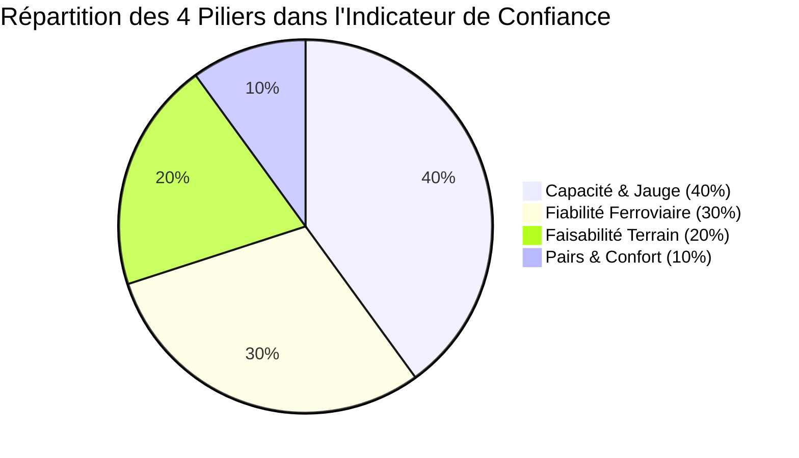

# 🧭 Copilote du Voyage Scolaire (TER liO) — Calculateur de l'Indicateur de Confiance

> **Hackathon « IA for Impact » (Édition 2026 — La Mêlée / INP-ENSEEIHT)**  
> **Défi SNCF Voyageurs / TER liO Occitanie : « Dessine-moi une mobilité durable »**  
> *Module algorithmique & décisionnel : Indice de Confiance Voyageur Scolaire (0 à 100)*

[](#)
[](#)
[](#)
[](#)
[](#)

---

## 📖 Sommaire

1. [Contexte et Problématique Métier](#1-contexte-et-problématique-métier)
2. [Qu'est-ce que l'Indicateur de Confiance ?](#2-quest-ce-que-lindicateur-de-confiance-)
3. [Architecture Décisionnelle : Les 4 Piliers & 8 Sous-Critères](#3-architecture-décisionnelle--les-4-piliers--8-sous-critères)
4. [Règles Métier d'Or, Vetos & Alertes](#4-règles-métier-dor-vetos--alertes)
5. [Analyse Approfondie des Données SNCF (Data Engineering)](#5-analyse-approfondie-des-données-sncf-data-engineering)
6. [Génération des Données Simulées & Cas Pièges de Démonstration](#6-génération-des-données-simulées--cas-pièges-de-démonstration)
7. [Spécification Technique & Structure du Résultat JSON](#7-spécification-technique--structure-du-résultat-json)
8. [Installation & Guide d'Utilisation](#8-installation--guide-dutilisation)
9. [Validation & Suite de Tests Automatisés (Pytest)](#9-validation--suite-de-tests-automatisés-pytest)
10. [Éco-conception & Sobriété Algorithmique](#10-éco-conception--sobriété-algorithmique)
11. [Feuille de Route & Intégration dans le Copilote Global](#11-feuille-de-route--intégration-dans-le-copilote-global)

---

## 1. Contexte et Problématique Métier

### Le défi SNCF Voyageurs
En région Occitanie, le train régional **TER liO** offre un maillage exceptionnel reliant métropoles, villes moyennes et territoires ruraux. Cependant, organiser une sortie scolaire pour une classe de 25 à 30 collégiens ou lycéens relève aujourd'hui du parcours du combattant pour les enseignants :
* **Recherche complexe** de destinations accessibles sans autocar privé ;
* **Inquiétude opérationnelle permanente** : peur des retards, des annulations de train, du manque de places assises, de la sécurité du cheminement piéton entre la gare et le musée ;
* **Processus archaïque** : formulaires papier, appels téléphoniques au centre de relation client SNCF, vérifications manuelles dans des fichiers Excel non synchronisés.

### La réponse : Le Copilote du Voyage Scolaire
Notre équipe a conçu un **Copilote digital** qui renverse la logique traditionnelle. Au lieu d'imposer à l'enseignant de chercher un horaire de train abstrait, **le copilote part de son projet pédagogique** (thème, niveau, effectif, ville de départ) pour lui recommander des itinéraires pertinents, rassurants et pré-réservables.

Au cœur de cette réassurance se trouve le présent composant : **l'Indicateur de Confiance**.

```
┌────────────────────────────────────────────────────────────────────────────────────────┐
│                        LE PARCOURS ENSEIGNANT DU COPILOTE                              │
├───────────────┬─────────────────────────────┬───────────────────────────┬──────────────┤
│ 1. Intention  │ 2. Recommandation IA        │ 3. Évaluation Confiance   │ 4. Action    │
│    Pédagogique│    Gare liO + Site Culturel │    Calculateur 0-100      │    Pose      │
│    (Thème,    │    Occitanie                │    Fiabilité, Jauge,      │    d'option  │
│    Effectif)  │                             │    Accès & Confort        │    anonyme   │
└───────────────┴─────────────────────────────┴───────────────────────────┴──────────────┘
```

---

## 2. Qu'est-ce que l'Indicateur de Confiance ?

L'**Indicateur de Confiance** est un score unique gradué de **0 à 100**, associé à une pastille tricolore d'alerte, qui quantifie la **sérénité opérationnelle** d'un voyage scolaire.

Il est évalué en temps réel pour chaque triplet décisionnel :
$$\text{Triplet} = [\text{Train TER liO} \;+\; \text{Trajet Gare} \rightarrow \text{Site Culturel} \;+\; \text{Effectif de la classe}]$$

### Les Trois Paliers de Sérénité

| Pastille | Score | Signification Métier | Décision pour l'Enseignant |
| :---: | :---: | :--- | :--- |
| 🟢 **Vert** | **85 – 100** | **Trajet optimal et fluide.** Conditions de circulation et d'accès idéales. | Pré-réservation vivement recommandée. |
| 🟠 **Orange** | **65 – 84** | **Trajet réalisable sous vigilance.** Présence d'aléas mineurs (marge serrée, bus requis, train chargé). | Validable en prenant connaissance des alertes. |
| 🔴 **Rouge** | **0 – 64** | **Trajet bloqué ou à haut risque.** Veto de sécurité, capacité dépassée ou suppressions chroniques. | Réservation bloquée. Alternative proposée. |

### La Philosophie : Zéro « Boîte Noire », 100 % Explicabilité
Contrairement aux algorithmes opaques de scoring, chaque calcul produit :
1. **Un message synthétique** en français clair expliquant la décision ;
2. **Le détail point par point des 4 piliers** et des 8 sous-critères ;
3. **La liste exhaustive des alertes** (points de vigilance non bloquants) ;
4. **La liste des vetos actifs** (motifs stricts de blocage) ;
5. **Le point faible identifié** (la dimension qui pénalise le plus le score pour guider l'amélioration).

---

## 3. Architecture Décisionnelle : Les 4 Piliers & 8 Sous-Critères

Le calcul repose sur une pondération équilibrée validée par les parties prenantes et les retours d'enseignants :



### Détail des Piliers et Sous-Critères

#### 1. 👥 Pilier Capacité & Jauge (Poids : 40 %)
*La jauge est le pilier le plus lourd : si la classe ne peut pas monter à bord sereinement, le voyage n'a pas lieu.*
* **Sous-critère Unique — Marge de places groupe** :
  * Plafond strict de **50 voyageurs groupe maximum par train** (Règle d'or SNCF).
  * Calcul : $\text{Total} = \text{Effectif classe} + \text{Places déjà sous option}$.
  * Jusqu'à 60 % de remplissage ($\le 30$ voyageurs) : Note maximale de **100/100**.
  * Entre 60 % et 100 % de remplissage : Note dégressive linéaire de **100 à 40/100**.
  * Si $\text{Total} > 50$ voyageurs : **Veto bloquant immédiat**, note de capacité = **0/100**.

#### 2. 🚆 Pilier Fiabilité Ferroviaire (Poids : 30 %)
*Mesure la robustesse historique du train liO à partir des circulations réelles de `Data_Hackathon.csv`.*
* **Régularité (40 %)** : Moyenne pondérée du taux de régularité du train par son nombre réel de circulations réalisées. Alerte si $< 85\,\%$.
* **Suppressions (25 %)** : Ratio réel $\frac{\text{Total suppressions}}{\text{Circulations réalisées}}$. Chaque pourcent de suppression inflige une pénalité de 5 points. Si $\ge 10\,\%$ : **Veto annulations chroniques**.
* **Stabilité de l'offre (15 %)** : Ratio $\frac{\text{Circulations réalisées}}{\text{Circulations prévues théoriques}}$. Alerte si $< 90\,\%$.
* **Fréquentation / Confort (20 %)** : Percentile d'affluence relative par rapport à l'ensemble du réseau liO Occitanie. Alerte « heure de pointe » si dans le quartile supérieur ($\ge 0.75$).

#### 3. 🚶 Pilier Faisabilité Terrain & Dernier Kilomètre (Poids : 20 %)
*Évalue la facilité du transit entre la gare d'arrivée et le site culturel d'activité.*
* **Accès dernier km (50 %)** :
  * Calcul de marche à vitesse de groupe d'élèves ($2{,}75\text{ km/h}$, soit $\approx 45{,}8\text{ m/min}$).
  * Si temps de marche $\le 20\text{ min}$ : Note maximale de **100/100**.
  * Si $> 20\text{ min}$ avec correspondance bus unique : Note de **85/100** (décote de 15 points, alerte bus).
  * Si $> 20\text{ min}$ sans aucun transport en commun : **Veto bloquant**, note = **0/100**.
* **Sécurité du cheminement (20 %)** :
  * Présence d'un trottoir ou accotement piéton sécurisé (`trottoir_ok = True`) : **100/100**.
  * Voie non sécurisée / pas de trottoir (`trottoir_ok = False`) : **Veto bloquant piéton**, note = **0/100**.
  * Statut inconnu (`trottoir_ok = None`) : Sous-critère ignoré (poids redistribué) + alerte de vigilance.
* **Marge horaire avant l'activité (30 %)** :
  * Temps de battement incompressible requis par l'enseignant (recompte des élèves, sanitaires, dépose des sacs).
  * $\text{Marge} = \text{Heure début activité} - (\text{Heure arrivée gare} + \text{Temps de transit})$.
  * Si $\ge 20\text{ min}$ : Note de **100/100**.
  * Entre 15 et 20 min : Note proportionnelle de 60 à 100/100 + alerte « marge serrée ».
  * Si $< 15\text{ min}$ : **Veto bloquant**, note = **0/100**.
  * Si aucun horaire n'est spécifié : Marge ignorée sans pénaliser la note.

#### 4. 🌟 Pilier Pairs & Confort Pédagogique (Poids : 10 %)
*Intègre l'expérience partagée par la communauté éducative et la logistique d'accueil sur site.*
* **Avis des pairs (50 %)** : Note moyenne convertie sur 100.
  * Déclenchement du badge **« Coup de cœur des enseignants »** si note $\ge 4{,}5/5$ et $\ge 3$ avis.
  * Si aucun avis disponible : Note neutre bienveillante de **70/100** sans alerte alarmiste.
* **Logistique de survie (25 %)** :
  * Espace pique-nique couvert : **+60 points**.
  * Consignes sécurisées pour les sacs d'élèves : **+40 points**.
* **Adéquation pédagogique (25 %)** :
  * Correspondance exacte entre le thème du projet de la classe et les thématiques du site culturel : **100/100**.
  * Hors-sujet : Note dégradée de **30/100** + alerte explicative.

---

## 4. Règles Métier d'Or, Vetos & Alertes

L'algorithme applique une hiérarchie stricte : **la sécurité physique et l'assurance d'embarquement prévalent sur toute moyenne statistique.**

```
                              ┌────────────────────────┐
                              │  Calcul Score Brut     │
                              │  Pondéré (0 à 100)     │
                              └───────────┬────────────┘
                                          │
                            Un Veto est-il actif ?
                                   /       \
                             OUI  /         \  NON
                                 v           v
                     ┌────────────────┐  ┌────────────────┐
                     │ Score plafonné │  │ Score préservé │
                     │   à 64 max     │  │                │
                     │  Couleur ROUGE │  │ Pastille selon │
                     │  TRAJET BLOQUÉ │  │ 85 / 65        │
                     └────────────────┘  └────────────────┘
```

### Table des Vetos Métier (Blocage Rouge Garanti)

| Veto | Condition Déclenchante | Justification Terrain |
| :--- | :--- | :--- |
| **Capacité insuffisante** | $\text{Effectif} + \text{Options} > 50$ | Protection des usagers quotidiens et risque de voyageurs laissés à quai. |
| **Suppressions chroniques** | Taux suppressions $\ge 10\,\%$ | Risque inacceptable d'annulation de sortie le matin même. |
| **Marche excessive sans bus** | Temps à pied $> 20\text{ min}$ sans bus | Fatigue des élèves, perte de temps sur l'activité pédagogique. |
| **Cheminement dangereux** | `trottoir_ok == False` | Sécurité routière des enfants sur départementale ou voie rapide. |
| **Marge horaire insuffisante** | Marge sur place $< 15\text{ min}$ | Impossibilité logistique de gérer le groupe avant le créneau réservé. |

---

## 5. Analyse Approfondie des Données SNCF (Data Engineering)

Le projet s'appuie sur deux bases de données officielles de SNCF Voyageurs Occitanie :

### 1. `Data_Hackathon.csv` (Historique d'exploitation 2026)
* **Volume** : 1 891 lignes, 18 colonnes.
* **Encodage & Séparateur** : `utf-8-sig` (présence du BOM `\ufeff`), séparateur point-virgule (`;`).
* **Granularité** : Mensuelle agrégée (1 ligne par train pour chaque mois de janvier à septembre 2026).
* **Pièges détectés et corrigés** :
  1. *Taux en chaînes de caractères avec virgule et `%`* (ex: `'63,20%'`) : parseur numérique résilient convertissant virgules et symboles.
  2. *Colonne `Taux SUPP` vide en l'absence de suppressions* : 714 lignes contiennent `NaN` car il y a eu 0 suppression. Faire une moyenne naïve de cette colonne gonflerait artificiellement le taux ! Notre calculateur recalcule le taux sur les compteurs réels : $\frac{\sum \text{Suppressions}}{\sum \text{Circulations réalisées}}$.
  3. *Taux de suppressions atypique supérieur à 100 %* : Le train 871476 affiche 22 suppressions pour 20 circulations réalisées (110 %). Notre fonction borne la valeur à 100.
  4. *Colonne résiduelle vide `Unnamed: 17`* : Décalage ignoré automatiquement.

### 2. `Détail desserte (Liste des trains groupes).csv` (Offre théorique quotidienne)
* **Volume** : 796 179 lignes, 7 colonnes, 766 numéros de circulation uniques.
* **Granularité** : Unitaire par arrêt de circulation pour chaque jour de circulation entre février et juin 2026.
* **Correspondance avec l'historique** :
  * **210 des 217 trains** de `Data_Hackathon.csv` sont présents dans la desserte, soit **96,77 % de recouvrement direct**.
  * Les 7 trains manquants correspondent à des lignes touristiques purement estivales (juillet-août sur Toulouse–Luchon et Cerbère–Avignon).
  * **Clé de liaison** : `Data_Hackathon['N° Train']` $\Longleftrightarrow$ `Détail desserte['Numéro de circulation']` (types entiers `int64` strictement alignés, sans espaces ni zéros superflus).

---

## 6. Génération des Données Simulées & Cas Pièges de Démonstration

Le script [`generer_donnees_simulees.py`](file:///E:/Mes%20docs%20et%20doss/school%20fr/M1%20MIAGE/Hackaton/indice-confiance/generer_donnees_simulees.py) produit dans le dossier `donnees_simulees/` un ensemble de données déterministe (graine fixe `42`) pour tester le comportement de l'indice :

```
donnees_simulees/
├── sites.csv       # 15 sites culturels d'Occitanie reliés aux gares réelles liO
├── avis.csv        # Notes moyennes et retours d'enseignants
└── options.csv     # 61 réservations simulées sur 30 trains réels
```

### Cas Pièges Délibérément Intégrés pour le Jury

| Cas Piège | Jeu de Données | Entité Concernée | Comportement Attendu de l'Algorithme |
| :--- | :--- | :--- | :--- |
| **Marche de 35 min sans bus** | `sites.csv` | `SITE_13` (Grotte de Bédeilhac, gare Foix) | Distance de 1 750 m ($35\text{ min}$ à $3\text{ km/h}$) et `bus_unique = False`. **Veto Faisabilité déclenché** $\rightarrow$ Score rouge $\le 64$. |
| **Chemin sans trottoir** | `sites.csv` | `SITE_14` (Fort Saint-Elme, gare Collioure) | `trottoir_ok = False` (route sinueuse). **Veto Sécurité piétonne** $\rightarrow$ Score rouge $\le 64$. |
| **Site sans avis d'enseignants** | `avis.csv` | `SITE_15` (Musée Ingres Bourdelle) | `nb_avis = 0` et note vide. **Aucun plantage**, attribution de la note neutre (70/100). |
| **Train presque plein (45 places)** | `options.csv` | Train `870004` au `2026-05-12` | 45 places déjà sous option. Pour une classe de 25 élèves : $45 + 25 = 70 > 50$. **Veto Capacité immédiat**. |
| **Garantie d'anonymat** | `options.csv` | Ensemble du fichier | **Aucun nom d'école ou d'établissement**. Respect strict du RGPD et du secret des réservations. |

---

## 7. Spécification Technique & Structure du Résultat JSON

### Signature Principale

```python
calculer_indice(
    train: dict,                # Profil synthétique du train
    site: dict,                 # Caractéristiques d'accès et logistique du site
    effectif: int,              # Nombre d'élèves + accompagnateurs (ex: 28)
    options_actives: int,       # Places déjà réservées par d'autres établissements
    theme_projet: str = None,   # Intention pédagogique (ex: "histoire", "sciences")
    heure_arrivee_gare: str = None,   # "HH:MM" ou minutes depuis minuit
    heure_debut_activite: str = None  # "HH:MM" ou minutes depuis minuit
) -> dict
```

### Exemple de Résultat Produit (Sérialisable JSON)

```json
{
  "score": 92,
  "couleur": "vert",
  "bloque": false,
  "vetos": [],
  "alertes": [
    "Marche proche de la limite (18 min)"
  ],
  "message": "Trajet réalisable, à surveiller : Marche proche de la limite (18 min)",
  "composantes": {
    "fiabilite": {
      "note": 94.2,
      "poids": 0.3,
      "points": 28.3,
      "details": {
        "regularite": 96.0,
        "suppressions": 97.5,
        "stabilite": 98.0,
        "frequentation": 82.0
      }
    },
    "faisabilite": {
      "note": 85.0,
      "poids": 0.2,
      "points": 17.0,
      "details": {
        "accessibilite": 85.0,
        "securite": 100.0,
        "marge": 100.0
      }
    },
    "capacite": {
      "note": 100.0,
      "poids": 0.4,
      "points": 40.0,
      "details": {
        "places": 100.0
      }
    },
    "pairs": {
      "note": 96.0,
      "poids": 0.1,
      "points": 9.6,
      "details": {
        "avis": 96.0,
        "logistique": 100.0,
        "adequation": 100.0
      }
    }
  },
  "point_faible": "faisabilite",
  "badge_coup_de_coeur": true
}
```

---

## 8. Installation & Guide d'Utilisation

### Prérequis
* Python 3.10 ou supérieur
* Environnement virtuel recommandé

### Installation Rapide

```bash
# Cloner le dépôt et se placer dans le dossier
cd indice-confiance

# Créer et activer l'environnement virtuel
python -m venv .venv
source .venv/bin/activate       # Sur Linux/macOS
.\.venv\Scripts\activate      # Sur Windows PowerShell

# Installer les dépendances
pip install pandas pytest
```

### Commandes Utiles

#### 1. Lancer la démonstration des 4 scénarios types
```bash
python indice_confiance.py
```

#### 2. Charger et analyser l'historique réel complet
```bash
python indice_confiance.py Data_Hackathon.csv
```
*Affiche la distribution statistique des 217 trains réels (quartiles de régularité, suppressions chroniques, taux de complétude).*

#### 3. Régénérer les données simulées
```bash
python generer_donnees_simulees.py
```

---

## 9. Validation & Suite de Tests Automatisés (Pytest)

Le code est rigoureusement couvert par 49 tests d'intégration et unitaires dans [`test_indice_confiance.py`](file:///E:/Mes%20docs%20et%20doss/school%20fr/M1%20MIAGE/Hackaton/indice-confiance/test_indice_confiance.py), garantissant la conformité stricte au cahier des charges :

```bash
pytest -v
```

### Synthèse des 49 Tests Validés (100 % Réussite)

```text
test_poids_piliers_somment_a_un_et_conformes_au_cadrage ............ PASSED
test_poids_des_sous_criteres_somment_a_un .......................... PASSED
test_capacite_et_seuils_du_cadrage ................................. PASSED
test_cas_ideal_est_vert ............................................ PASSED
test_bus_necessaire_donne_alerte_sans_blocage ...................... PASSED
test_frontieres_des_couleurs ....................................... PASSED
test_capacite_depassee_bloque_et_rouge ............................. PASSED
test_capacite_exactement_50_n_est_pas_bloquee ...................... PASSED
test_capacite_51_bloque ............................................ PASSED
test_conversion_marche ............................................. PASSED
test_marche_longue_sans_bus_est_un_veto ............................ PASSED
test_marche_longue_avec_bus_applique_une_decote_sans_veto .......... PASSED
test_absence_de_trottoir_est_un_veto ............................... PASSED
test_trottoir_inconnu_n_est_pas_un_veto_mais_une_alerte ............ PASSED
test_heure_en_minutes .............................................. PASSED
test_marge_confortable ............................................. PASSED
test_marge_insuffisante_est_un_veto ................................ PASSED
test_marge_de_12_minutes_est_deja_trop_courte ...................... PASSED
test_la_capacite_pese_plus_que_tout_le_reste ....................... PASSED
test_marge_serree_donne_une_alerte_sans_veto ....................... PASSED
test_sans_horaires_la_marge_n_est_pas_evaluee_et_les_poids ......... PASSED
test_moyenne_ponderee_ignore_les_none .............................. PASSED
test_suppressions_chroniques_sont_un_veto .......................... PASSED
test_train_instable_ou_de_pointe_donne_des_alertes ................. PASSED
test_badge_coup_de_coeur ........................................... PASSED
test_absence_d_avis_donne_note_neutre .............................. PASSED
test_logistique_de_survie .......................................... PASSED
test_adequation_pedagogique ........................................ PASSED
test_score_toujours_entre_0_et_100 ................................. PASSED
test_un_veto_ne_donne_jamais_orange_ou_vert ........................ PASSED
test_plus_d_options_ne_peut_pas_ameliorer_le_score ................. PASSED
test_resultat_serialisable_en_json_avec_les_bonnes_cles ............ PASSED
test_les_points_des_piliers_somment_au_score ....................... PASSED
test_le_message_explique_un_blocage ................................ PASSED
test_aucun_detail_d_options_des_autres_ecoles ...................... PASSED
test_chargement_format_reel_trois_trains ........................... PASSED
test_regularite_ponderee_par_les_circulations_realisees ............ PASSED
test_taux_de_suppression_calcule_sur_les_compteurs_pas_sur_la_col .. PASSED
test_taux_de_suppression_superieur_a_100_est_plafonne .............. PASSED
test_train_sans_suppression_a_un_taux_nul .......................... PASSED
test_stabilite_de_l_offre .......................................... PASSED
test_percentile_de_frequentation ................................... PASSED
test_colonne_parasite_finale_ne_gene_pas_et_l_axe_est_conserve ..... PASSED
test_variante_du_symbole_numero_et_taux_en_fraction ................ PASSED
test_un_profil_charge_alimente_le_calcul ........................... PASSED
test_chargement_desserte_et_heure_d_arrivee ........................ PASSED
test_heure_d_arrivee_introuvable_renvoie_none ...................... PASSED
test_trains_eligibles_et_filtre .................................... PASSED
test_horaire_de_la_desserte_alimente_la_marge ...................... PASSED

============================= 49 passed in 1.65s ==============================
```

---

## 10. Éco-conception & Sobriété Algorithmique

Dans le cadre des critères d'évaluation du hackathon **« IA for Impact »**, une attention particulière a été portée au **numérique responsable** :
* **Zéro inférence LLM superflue pour le scoring** : Le calcul de l'indice est un algorithme déterministe en Python pur qui s'exécute en **moins de 0,5 milliseconde par trajet**.
* **Sobriété énergétique** : L'IA générative du copilote est réservée à la compréhension du langage naturel de l'enseignant et à la suggestion culturelle ; la validation opérationnelle et le scoring restent mathématiques, instantanés et décarbonés.
* **Complexité maîtrisée** : Chargement indexé par dictionnaire de profils ($O(1)$ par requête), limitant l'empreinte mémoire et CPU.

---

## 11. Feuille de Route & Intégration dans le Copilote Global

Le présent module constitue la **Tâche 1** validée du défi SNCF.

* [x] **Tâche 1 : Moteur de Calcul & Agrégation** (Terminé et testé à 100 %).
* [ ] **Tâche 2 : Composant UI/UX de l'Indicateur** :
  * Jauge circulaire colorée animée (0-100) en SVG/CSS.
  * Barres de progression détaillant les 4 composantes.
  * Tiroir d'explicabilité (« Pourquoi cette note ? »).
  * Affichage des badges (« Coup de cœur des enseignants ») et messages alternatifs en cas de blocage.
* [ ] **Intégration API** : Exposition via un endpoint FastAPI dans le backend `IA_Impact_projet/backend/` :
  `GET /api/trains/{id}/confiance?site_id=...&effectif=...`

---

*Développé avec passion pour le Hackathon IA for Impact 2026 — Équipe Défi SNCF TER liO Occitanie.*
