<div align="center">

# iMSA Sentinel

**Contrôle automatisé des justificatifs de dépenses de santé**

Rapprochement bordereau CERFA 12278 (image) ↔ facture structurée B2 (TXT) · 15 zones encadrées · 22 contrôles · preuves à l'appui · 100 % local

**Version 3.0** — plus simple, plus fiable : un parcours unique *dossier → écart → preuve → décision*


**[Guide d'une page](docs/GUIDE_1_PAGE.md)** · [📘 Tutoriel détaillé (PDF)](docs/TUTORIEL_iMSA_Sentinel.pdf) · [Rapport 3.0](docs/RAPPORT_V3.md) · [Diagnostic](docs/DIAGNOSTIC_V3.md) · [Les 15 zones](docs/ZONES.md) · [Résultats réels](docs/RESULTATS.md) · [Test à l'aveugle](docs/TEST_AVEUGLE.md) · [Architecture](docs/ARCHITECTURE.md) · [Rapport technique 2.0](docs/RAPPORT_TECHNIQUE_V2.md)

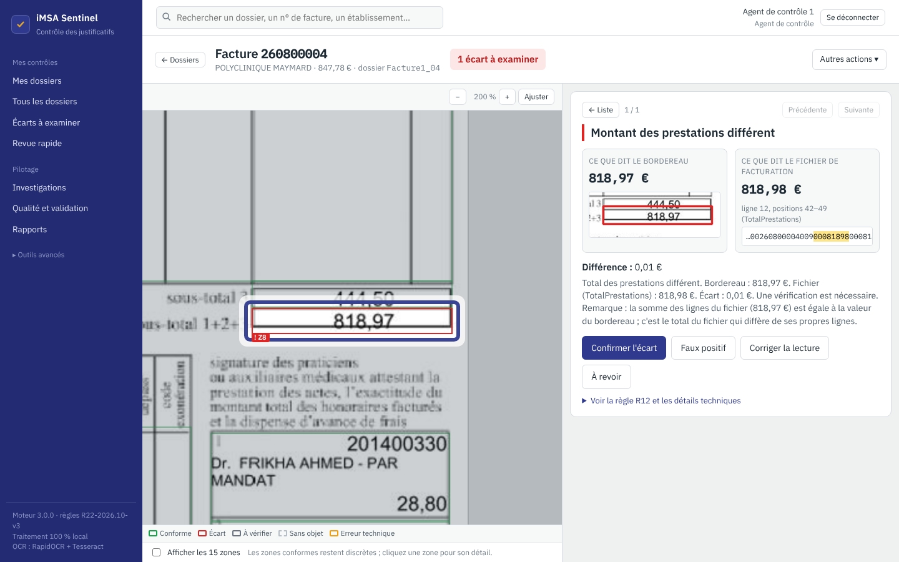

<sub>Mode simple : l'écart est encadré en rouge sur le bordereau ; à droite, ce que dit le bordereau (agrandissement réel), ce que dit le fichier (ligne 12, positions 42‑49 surlignées), la différence et les trois décisions possibles.</sub>

</div>

---

> [!IMPORTANT]
> **Une anomalie est un écart documentaire constaté, pas une fraude démontrée.** L'application ne calcule aucune « probabilité de fraude » et n'extrapole aucune économie. La décision reste toujours celle de l'agent.

## Sommaire

- [Le défi](#le-défi)
- [Ce que fait iMSA Sentinel](#ce-que-fait-imsa-sentinel)
- [Nouveautés de la version 3.0](#nouveautés-de-la-version-30)
- [Les 15 zones du bordereau](#les-15-zones-du-bordereau)
- [Aperçu](#aperçu)
- [Installation](#installation)
- [Premier lancement](#premier-lancement)
- [Utilisation en 5 minutes](#utilisation-en-5-minutes)
- [Comment ça marche](#comment-ça-marche)
- [Les 22 contrôles](#les-22-contrôles)
- [Résultats sur le corpus fourni](#résultats-sur-le-corpus-fourni)
- [L'application n'a pas « appris » les réponses](#lapplication-na-pas-appris-les-réponses)
- [Sécurité et confidentialité](#sécurité-et-confidentialité)
- [Tests](#tests)
- [Structure du projet](#structure-du-projet)
- [Limites connues](#limites-connues)
- [Documentation](#documentation)

## Le défi

Pour chaque hospitalisation en clinique, la caisse reçoit deux documents qui doivent dire la même chose :

| Document | Format | Contenu |
|---|---|---|
| **Bordereau de facturation** | image JPG (CERFA 12278 / S 3404), 15 zones | ce qui a été signé par l'établissement et les praticiens |
| **Facture structurée** | fichier TXT « B2 » à positions fixes | ce qui est réellement facturé et payé |

Aujourd'hui un agent compare les deux à la main, ligne par ligne. Le cahier des charges définit **22 contrôles** : identifiants, n° GHS, prestations présentes d'un seul côté, sous-totaux, signatures, code CERFA…

## Ce que fait iMSA Sentinel

- **Lit les deux documents** : parseur B2 aux positions exactes du cahier des charges ; OCR local du bordereau (3 mises en page reconnues, recalage automatique, double lecture par deux moteurs avec vote).
- **Applique les 22 contrôles** et attribue à chacun un statut explicite : `CONFORME`, `ANOMALIE`, `NON_VERIFIABLE`, `NON_APPLICABLE` ou `ERREUR_TECHNIQUE`. Si la lecture est douteuse, le contrôle est déclaré non vérifiable, jamais conforme par défaut.
- **Montre la preuve** : la zone de l'image et les positions du fichier sont surlignées côte à côte, avec les valeurs confrontées, l'écart mesuré, la formulation du cahier des charges et la convention retenue.
- **Encadre les 15 zones du bordereau** selon leur résultat, directement sur l'image (voir ci-dessous).
- **Laisse décider l'agent** : confirmer, déclarer un faux positif (motif obligatoire), corriger ou valider une lecture OCR (l'original est conservé ; les 22 contrôles et les 15 zones sont recalculés), transmettre, commenter. Les décisions sont prises règle par règle, horodatées, signées et annulables.
- **Revue rapide** : les anomalies défilent une par une, avec la zone annoncée et des raccourcis clavier configurables.
- **Regroupe les alertes** en pistes de vérification formulées au conditionnel (même GHS, fichier décalé, code différent…).
- **Compare deux bordereaux** zone par zone : identique, différence purement graphique ou différence documentaire.
- **Importe ou simule** : dépôt de nouveaux dossiers, ou copie d'un dossier avec une valeur du TXT modifiée. Les copies sont privées, analysées par le moteur réel et exclues des statistiques.
- **Pilote l'activité** (gestionnaire) :
  - matrice des 15 zones et indicateurs avec dénominateurs ;
  - montants confirmés règle par règle, sans double comptage ;
  - temps de revue actif mesuré ;
  - qualité mesurée, avec effectifs ;
  - centre des conventions AMB-01 à AMB-08 ;
  - journal d'audit.
- **Exporte** : rapport PDF ou JSON par dossier, CSV de tous les résultats, manifeste SHA-256 du corpus.

## Nouveautés de la version 3.0

**Plus simple.**
- **Mode simple par défaut.** Le résultat du dossier est donné en une phrase, puis chaque écart s'affiche avec ses deux preuves (l'agrandissement réel du bordereau et la ligne du fichier surlignée) et trois décisions possibles. Les zones conformes restent discrètes.
- **Navigation en trois espaces** : Mes contrôles, Pilotage, Outils avancés.
- **Libellés métier**, par exemple « À vérifier manuellement » au lieu de `NON_VERIFIABLE`.
- Le **mode expert** (22 contrôles, lectures OCR, fichier complet) reste disponible en un clic.

**Plus fiable.**
- **Audit des 76 résultats** en anomalie ou à vérifier ([diagnostic](docs/DIAGNOSTIC_V3.md)) : 12 étaient faux, tous dans `Facture2_06`. La cause était un caractère inséré dans le fichier B2. Elle est corrigée dans le parseur, par un **réalignement démontré** par 4 vérifications internes au fichier ; le bordereau n'est jamais utilisé pour ce choix.
- **Redressement des scans inclinés** (prévu jusqu'à ±6°, testé de -5° à +5°) et **ajustement de l'échelle** (marges, redimensionnement). Sur 36 copies transformées de bordereaux, la version 3.0 ne produit **aucune fausse anomalie**. La version 2.0 en produisait 30 sur les mêmes copies ([rapport 3.0](docs/RAPPORT_V3.md#42-recalage-et-lecture-sur-copies-transformées)).
- **Fiabilité géométrique locale** : un champ ou un tableau mal localisé donne « à vérifier », jamais une anomalie ni une conformité.
- **R01** : la lecture littérale (12278*0) et la convention (12278*01 accepté) sont toujours affichées. La décision de la MSA peut être enregistrée et le moteur l'applique.
- **Référentiel de validation humaine** : verdict, cause, validateur, double revue. La précision et le rappel ne sont calculés que sur les validations humaines.

**Plus sûr.**
- Le **n° d'assuré est masqué côté serveur** dans toutes les vues transversales, les exports et le journal d'audit.
- Le **corpus et les lectures OCR ne sont plus versionnés** : vous déposez l'archive autorisée dans `data/`.
- Matrice des exigences [juridiques](docs/CONFORMITE_JURIDIQUE.md), sans aucune certification revendiquée.

## Les 15 zones du bordereau

En ouvrant un dossier, l'agent voit les zones du bordereau encadrées. En mode simple, les écarts et les doutes sont mis en avant et les zones conformes restent discrètes ; la case « Afficher les 15 zones » ou le mode expert montrent tout :

| Couleur | Statut | Signification |
|---|---|---|
| 🟩 vert `#16A34A` | Conforme | tous les contrôles applicables de la zone sont conformes, sans incertitude |
| 🟥 rouge `#DC2626` | Écart (anomalie) | au moins un contrôle en écart (indicateur « contrôles également incertains » si un autre est douteux) |
| ⬛ gris `#6B7280` | À vérifier manuellement | lecture douteuse, ou conformité qui ne repose que sur une lecture isolée |
| ⬜ gris clair en pointillés | Non applicable | aucun contrôle ne s'applique à ce dossier (par exemple, pas d'actes exécutés) |
| 🟧 orange `#F59E0B` | Erreur technique | un contrôle n'a pas pu s'exécuter |

- Les encadrements suivent le zoom. Ils sont cliquables, avec une infobulle, une icône et un focus clavier, et une légende reste affichée.
- Un clic sur une zone la cadre et ouvre sa **fiche** : motif de la couleur, contrôles associés, lectures OCR, données TXT surlignées, lignes de tableau (Z6, Z7, Z10), exécutants (Z9), cases de signature (Z11, Z14), action recommandée et traçabilité.
- Navigation : `[` et `]`, Échap pour revenir à la vue d'ensemble.
- La couleur est calculée une seule fois par le serveur. On retrouve la même dans la visionneuse, la liste des dossiers, la revue rapide, la matrice de supervision et le rapport PDF.

Correspondance zone ↔ règles, géométrie et règles de statut : [`docs/ZONES.md`](docs/ZONES.md).

## Aperçu

| | |
|---|---|
| 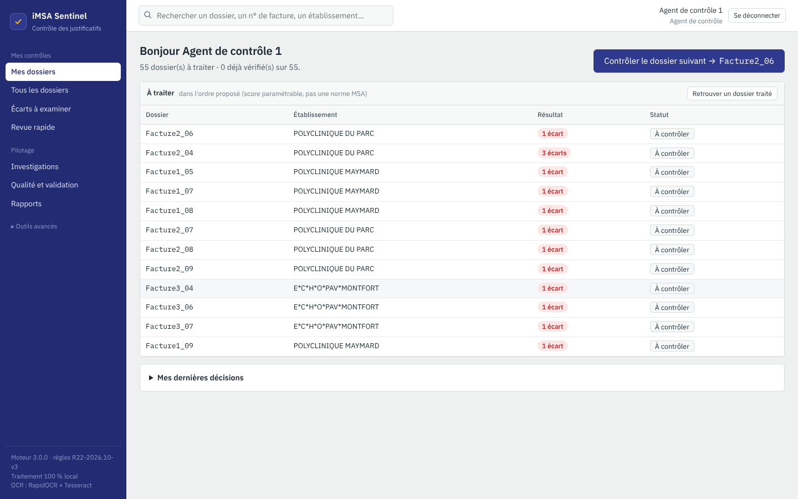<br><sub>**Mes dossiers** : une action principale, le dossier suivant</sub> | 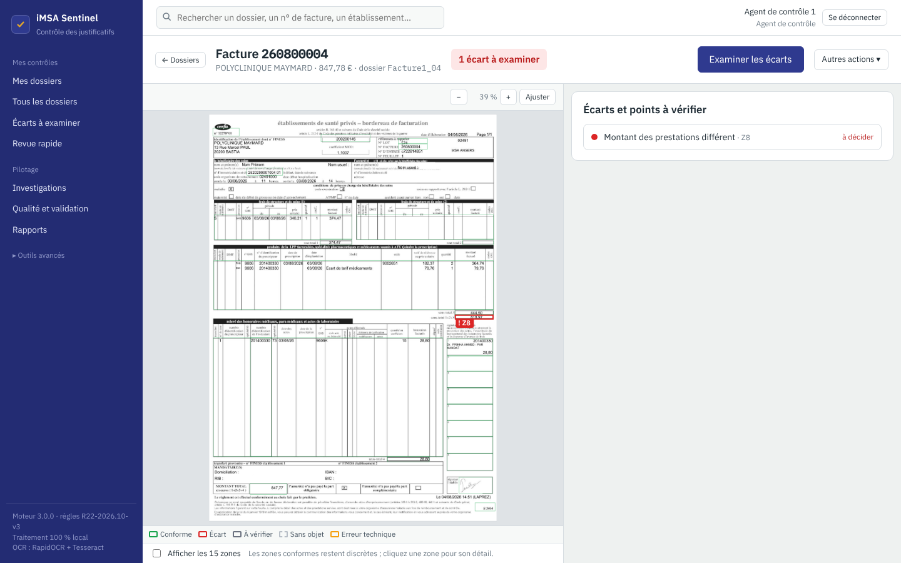<br><sub>**Le dossier** : le résultat en une phrase, l'écart en rouge, les zones conformes discrètes</sub> |
| 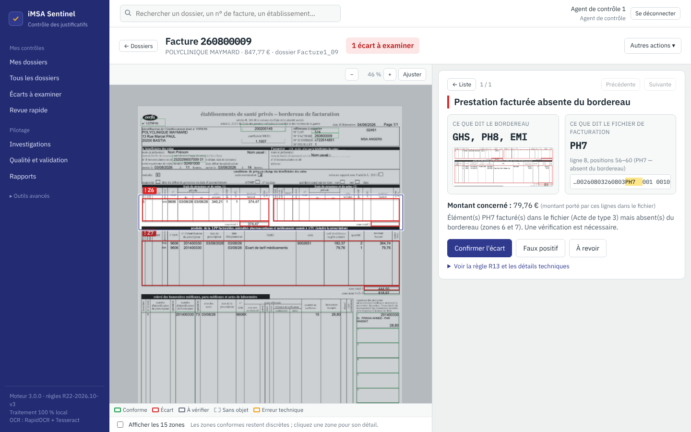<br><sub>**Prestation facturée absente** : `PH7` (ligne 8 du fichier) n'apparaît pas sur le bordereau</sub> | 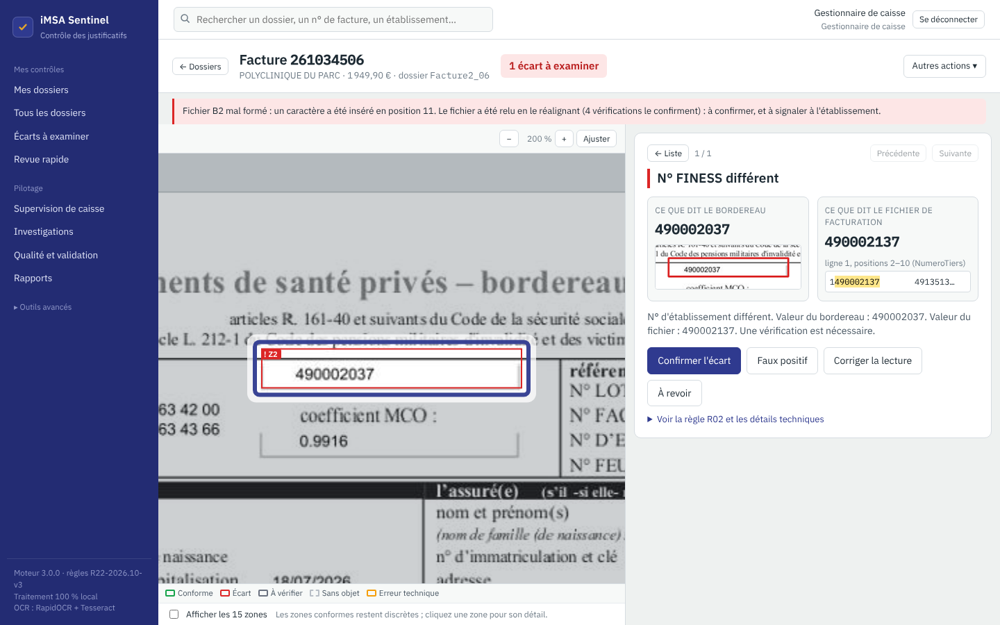<br><sub>**Fichier mal formé** : réalignement démontré, 1 écart réel au lieu de 11 faux</sub> |
| 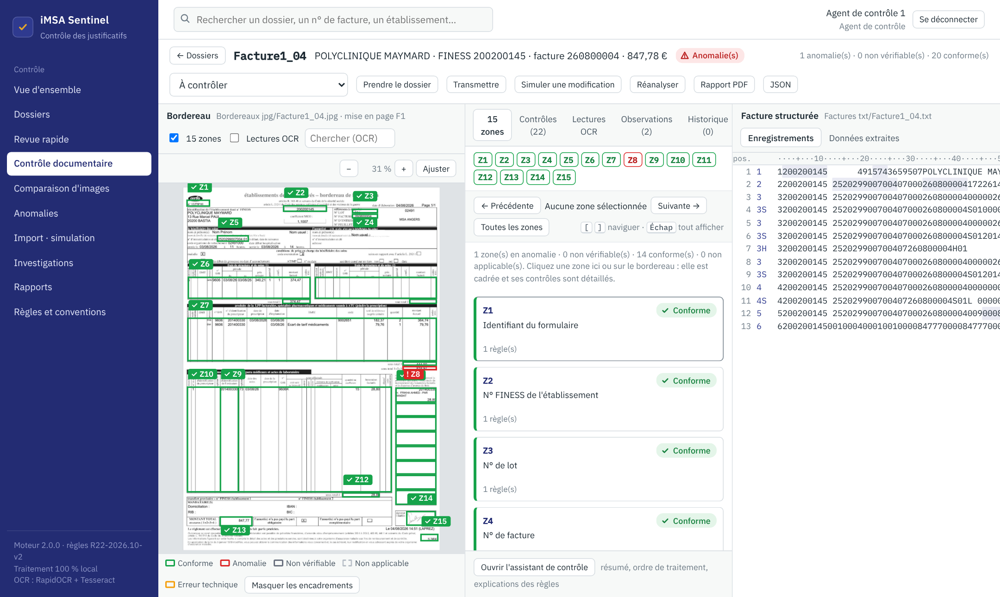<br><sub>**Mode expert** : les 15 zones encadrées selon leur résultat</sub> | 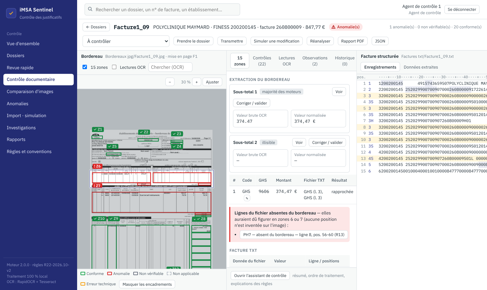<br><sub>**Mode expert, zone 6 ligne par ligne**</sub> |
| 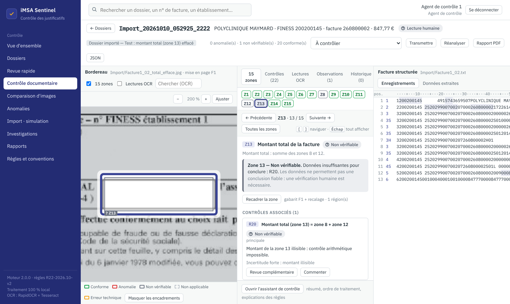<br><sub>**Zone grise** : montant total effacé, R20 non vérifiable plutôt que deviné</sub> | 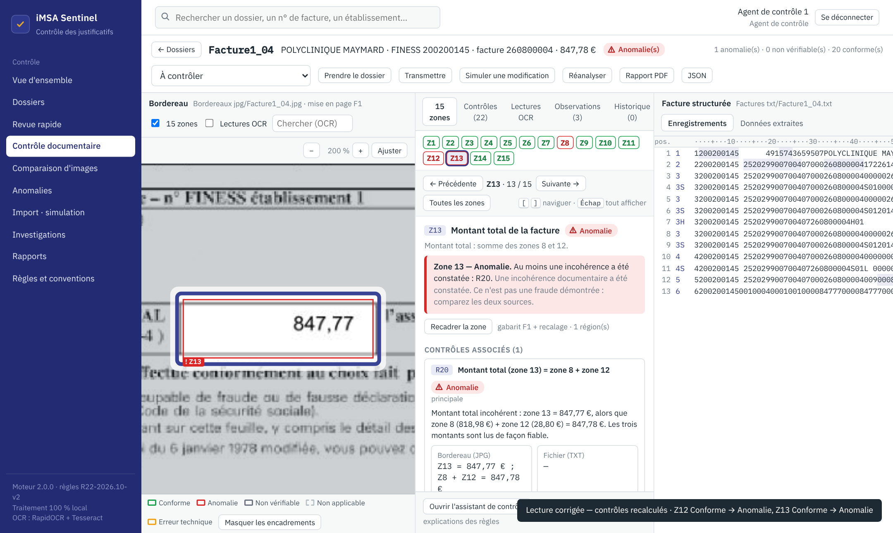<br><sub>**Correction** : les zones dont la couleur change sont annoncées</sub> |
| 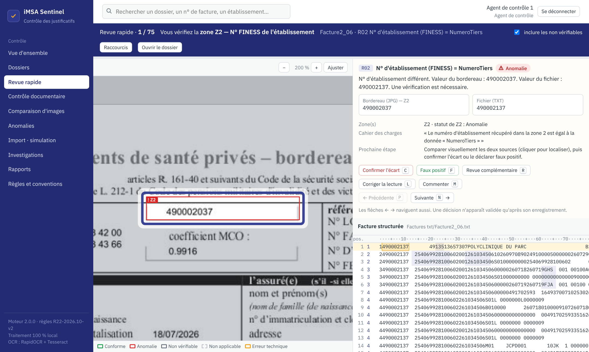<br><sub>**Revue rapide** : une anomalie après l'autre, raccourcis clavier</sub> | 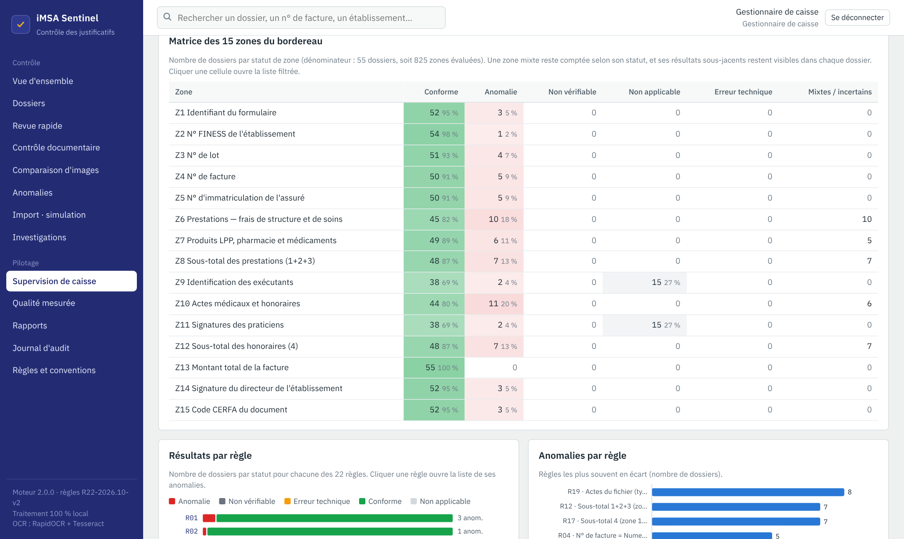<br><sub>**Supervision** : matrice des 15 zones sur tous les dossiers</sub> |
| 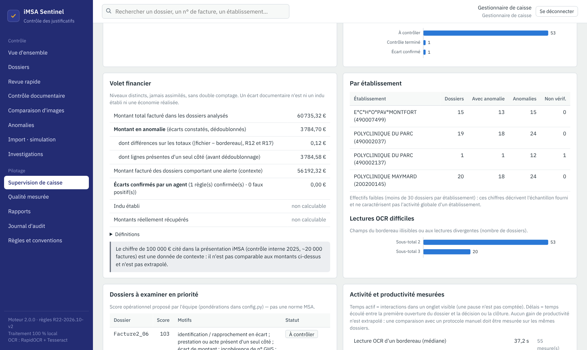<br><sub>**Volet financier** : montants confirmés règle par règle, sans extrapolation</sub> | 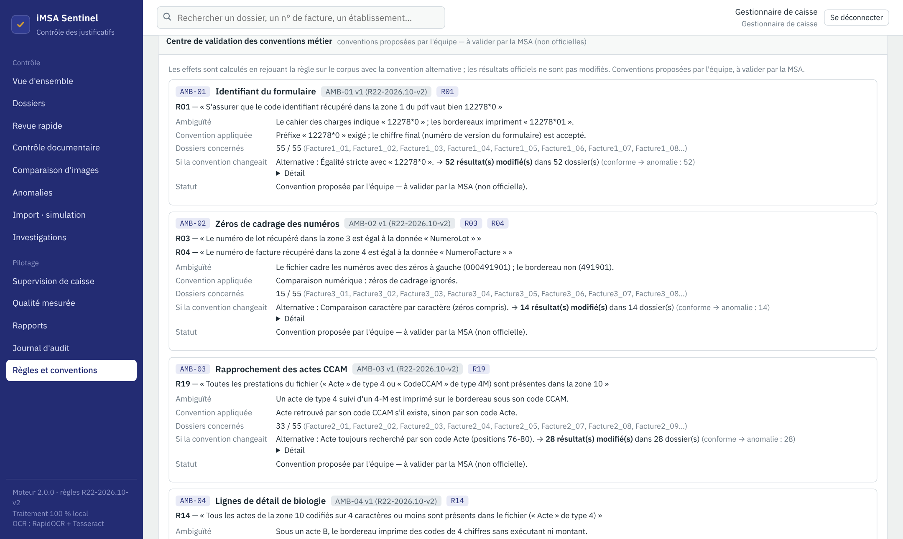<br><sub>**Conventions** : effet calculé d'un changement d'interprétation</sub> |

## Installation

### Prérequis

- **Python 3.10 à 3.13** (3.12 recommandé) — sous Windows, cocher « Add python.exe to PATH » à l'installation.
- Connexion Internet **uniquement pendant l'installation** (téléchargement des bibliothèques). L'application fonctionne ensuite hors ligne.
- Facultatif mais recommandé : **Tesseract OCR 5**, second moteur de lecture. Avec les deux moteurs, le test à l'aveugle donne 17 cas sur 17 exacts.

### Windows

```bat
git clone https://github.com/<votre-compte>/imsa-sentinel.git
cd imsa-sentinel
INSTALLER.bat     :: une seule fois : environnement .venv, bibliothèques, Tesseract (via winget)
LANCER.bat        :: démarre l'application et ouvre le navigateur
```

Ou, sans ligne de commande : télécharger le ZIP du dépôt, le décompresser, puis double-cliquer `INSTALLER.bat` et `LANCER.bat`.

### macOS / Linux

```bash
git clone https://github.com/<votre-compte>/imsa-sentinel.git
cd imsa-sentinel
# Tesseract (facultatif) : brew install tesseract   |   sudo apt install tesseract-ocr
./lancer.sh       # crée .venv au premier lancement, installe, puis démarre
```

L'application s'ouvre sur **http://127.0.0.1:8000**. Si le port 8000 est occupé, le premier port libre suivant est utilisé et affiché dans la console.

### Installation manuelle

```bash
python -m venv .venv
source .venv/bin/activate          # Windows : .venv\Scripts\activate
pip install -r requirements.txt
cd backend
python -m sentinel.cli serve       # options : --host, --port
```

## Premier lancement

1. **Déposez l'archive autorisée `General-main.zip` dans le dossier `data/`.** Elle contient des documents de santé et n'est donc pas dans le dépôt. Sans elle, l'application démarre quand même : elle affiche un message, et les imports restent possibles.
2. Au premier démarrage, l'archive est extraite de façon sécurisée (originaux en lecture seule, empreintes SHA-256), chaque bordereau est lu par OCR, puis les 22 contrôles sont appliqués aux 55 dossiers. **La première lecture prend de 10 à 30 minutes** selon le PC. Les lectures sont ensuite gardées en cache local, et les démarrages suivants sont immédiats. Si vous disposez du fichier `donnees-locales` (archive et cache), décompressez-le à la racine du projet pour éviter cette attente.
3. L'écran **« Première mise en service »** demande de créer le compte administrateur. Vous choisissez le mot de passe : aucun mot de passe n'est codé en dur.
4. Facultatif : cochez **« Mode démonstration »** pour créer aussi les comptes `agent1`, `agent2`, `superviseur` et `auditeur`, avec le même mot de passe. La case est décochée par défaut et n'existe pas en production (`SENTINEL_MODE=production`).

| Compte | Rôle | Peut… |
|---|---|---|
| `agent1`, `agent2` | Agent de contrôle | examiner, décider, corriger une lecture, transmettre |
| `superviseur` | Gestionnaire de caisse | tout ce que fait l'agent, plus affecter, prioriser, clôturer, superviser |
| `auditeur` | Auditeur | tout consulter, sans rien modifier |
| *(votre compte)* | Administrateur technique | comptes, synchronisation, recalcul forcé, sauvegardes, purge des métadonnées |

## Utilisation en 5 minutes

> Le guide pas à pas illustré se trouve dans le **[tutoriel PDF](docs/TUTORIEL_iMSA_Sentinel.pdf)**.

1. Se connecter en `agent1`. **Mes dossiers** affiche le bouton **Contrôler le dossier suivant**.
2. Ouvrir `Facture1_04` : « 1 écart à examiner ». La zone 8 est encadrée en rouge.
3. **Examiner les écarts** : 818,97 € sur le bordereau (agrandissement réel), 818,98 € dans le fichier (ligne 12, positions 42‑49 surlignées). Différence : 0,01 €.
4. Décider : **Confirmer l'écart**, **Faux positif** (motif obligatoire), **À revoir**, ou **Corriger la lecture** si l'OCR s'est trompé. L'écart suivant s'ouvre tout seul.
5. **Terminer le contrôle**, puis **Dossier suivant**.
6. Se connecter en `superviseur` : **Supervision de caisse**, **Qualité et validation** (référentiel humain, précision, rappel), journal d'audit.

**Tester sans fichier** : menu **Autres actions → Mode expert → Simuler une modification** (par exemple NumeroLot `925` → `999` sur `Facture3_13`). Une copie privée est analysée, et l'original reste intact.

**Tester avec vos propres fichiers** : **Outils avancés → Imports et simulations**. Déposez un bordereau (JPG/PNG) et sa facture TXT. Astuce : copiez `Facture1_02.txt`, changez un chiffre du total (ligne de type 5, positions 42 à 49) et déposez-le avec `Facture1_02.jpg` : l'écart R12 doit apparaître.

## Comment ça marche

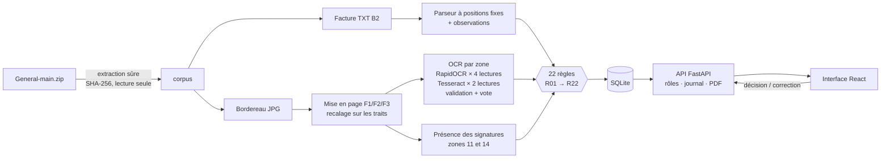

- **Le TXT** est lu caractère par caractère aux positions du cahier des charges (`ligne[début-1:fin]`), sans `strip()` global, avec les montants en centimes entiers et les identifiants conservés en chaînes. Aucune ligne n'est perdue. Les lignes trop courtes, les débuts de facture répétés et les décalages de positions sont signalés en *observations*.
- **Le bordereau** :
  - la mise en page est identifiée par corrélation de la carte des traits du formulaire, puis recalée ;
  - les traits sont effacés par inpainting ;
  - chaque champ et chaque cellule est lu plusieurs fois par deux moteurs. Les lectures sont normalisées et validées par le format attendu (FINESS à 9 chiffres, code CCAM `AAAA999`, montant…), puis soumises à un vote où l'accord de **deux moteurs différents** prime ;
  - le niveau d'accord (`concordant`, `majoritaire`, `divergent`, `illisible`, `vide`) est conservé avec toutes les lectures.
- **Les règles** sont déterministes :
  - une valeur lue de façon divergente, ou une **égalité entre lectures contradictoires**, donne `NON_VERIFIABLE`. L'application ne choisit jamais la lecture qui « arrange » le fichier ;
  - le total R20 n'utilise que des valeurs fiables, sans essayer de combinaisons ;
  - les rapprochements de codes se font occurrence par occurrence.
- **Les 15 zones** sont localisées à partir des gabarits et du recalage, indépendamment de l'OCR : une zone vide ou illisible reste encadrée.
- **Cache et réanalyse** : le cache OCR est lié à l'image, au code d'extraction et aux moteurs (écriture atomique, contrôle d'intégrité). Un résultat est recalculé dès que le TXT, l'image, les règles ou le code changent.
- **Les signatures** : seule leur *présence* est détectée, jamais leur authenticité.

## Les 22 contrôles

<details>
<summary><b>Afficher la liste complète (R01 → R22)</b></summary>

| # | Groupe | Contrôle |
|---|---|---|
| R01 | A. Identification | Identifiant du formulaire (CERFA 12278*0) |
| R02 | A. Identification | N° d'établissement (FINESS) = NumeroTiers |
| R03 | A. Identification | N° de lot = NumeroLot |
| R04 | A. Identification | N° de facture = NumeroFacture |
| R05 | A. Identification | N° d'assuré (13 premiers caractères) = NumeroAssure |
| R06 | B. Frais de structure et de soins | Présence d'une prestation GHS avec son numéro |
| R07 | B. Frais de structure et de soins | N° GHS du bordereau = NumeroGH (type 3, prestation GHS) |
| R08 | B. Frais de structure et de soins | Prestations de la zone 6 (avec montant) présentes dans le fichier |
| R09 | B. Frais de structure et de soins | NumeroGH des actes de type 3 = NumeroGH de l'acte GHS |
| R10 | C. LPP, pharmacie, médicaments | NumeroGH des actes de type 3 (LPP) = n° GHS de la zone 6 |
| R11 | C. LPP, pharmacie, médicaments | Prestations de la zone 7 présentes dans le fichier |
| R12 | D. Récapitulatif | Sous-total 1+2+3 (zone 8) = TotalPrestations |
| R13 | D. Récapitulatif | Prestations du fichier présentes en zone 6 ou 7 |
| R14 | E. Honoraires | Actes de la zone 10 codés sur ≤ 4 caractères présents dans le fichier |
| R15 | E. Honoraires | Actes CCAM (7 caractères) de la zone 10 présents dans le fichier |
| R16 | E. Honoraires | NumeroGH des enregistrements 4-S = n° GHS de la zone 6 |
| R17 | E. Honoraires | Sous-total 4 (zone 12) = TotalHonoraires |
| R18 | E. Honoraires | Signatures des exécutants (zone 11) |
| R19 | E. Honoraires | Actes du fichier (type 4 / 4-M) présents en zone 10 |
| R20 | F. Conclusion | Montant total (zone 13) = zone 8 + zone 12 |
| R21 | F. Conclusion | Signature du directeur de l'établissement (zone 14) |
| R22 | F. Conclusion | Code CERFA (zone 15) = S3404 |

Les points où le cahier des charges laisse une ambiguïté (AMB‑01 à AMB‑08) sont présentés dans le **centre des conventions** (écran « Règles et conventions »). Pour chacun : la convention retenue et l'effet calculé d'une autre interprétation, sur le corpus. Exemple : le texte demande `12278*0`, alors que les bordereaux impriment `12278*01`.

</details>

## Résultats sur le corpus fourni

Moteur 3.0.0, règles R22‑2026.10‑v3. Ces chiffres sont reproductibles avec `python -m sentinel.cli stats`. Par rapport à la version 2.0, **seuls les 13 résultats de `Facture2_06` ont changé** (fichier mal formé, voir le [diagnostic](docs/DIAGNOSTIC_V3.md)) ; les 1 197 autres statuts sont identiques, comparés un par un après le recalcul complet de l'OCR.

| Indicateur | Valeur |
|---|---:|
| Dossiers (paires bordereau JPG + facture TXT) | **55** |
| Contrôles exécutés | **1 210** |
| Dossiers avec au moins une anomalie | **50** |
| Dossiers sans écart | 5 |
| Résultats en anomalie (contrôles) | 64 (75 en version 2.0) |
| Dossiers avec un contrôle à vérifier | 0 (1 en version 2.0) |
| Erreurs techniques | 0 |
| Rapprochements ambigus signalés | 1 (`Facture2_04`) |
| Zones encadrées (55 × 15) | 825 |

Quelques constats réels (des écarts documentaires, pas des fraudes) :

- `Facture1_09` : acte `PH7` facturé dans le fichier mais absent du bordereau (**R13**), soit 79,76 € portés par des lignes présentes d'un seul côté.
- `Facture1_04` : sous-total 818,97 € sur le bordereau, 818,98 € dans le fichier (**R12**).
- `Facture1_01` : case de signature du praticien 201400330 vide (**R18**). `Facture2_05` : signature du directeur absente (**R21**).
- `Facture2_06` : un caractère a été **inséré en position 11** sur toutes les lignes du fichier. Le réalignement est démontré par 4 vérifications internes ; seul le FINESS diffère réellement (**R02**), et le défaut du fichier est signalé.
- `Facture2_04` : le bordereau porte le n° de facture et le n° d'assuré de **`Facture2_03`**. Le rapprochement est signalé **ambigu**, et l'autre dossier est nommé.

Le détail par règle et par dossier se trouve dans [`docs/RESULTATS.md`](docs/RESULTATS.md).

## L'application n'a pas « appris » les réponses

Rien n'est entraîné sur le corpus et aucun résultat n'est stocké par dossier. Chaque dépôt est relu et recontrôlé. Le cache OCR n'est utilisé que si l'image est identique octet pour octet (empreinte SHA‑256) et que le code d'extraction n'a pas changé. Ce qui vient du corpus, c'est la connaissance **du formulaire** (l'emplacement des 15 zones), comme un agent qui sait où regarder sur un CERFA.

Pour le prouver, `scripts/test_aveugle.py` fabrique **17 dossiers absents du corpus** et les analyse sans cache :

- documents authentiques agrandis, décalés, retournés ou floutés : ils ne doivent produire **aucune** alerte ;
- bordereaux falsifiés : valeurs réécrites, signatures et cachets effacés ;
- factures TXT modifiées autrement que dans les données fournies.

| Configuration | Résultat |
|---|---|
| RapidOCR + Tesseract (recommandée) | **17 / 17 exacts** : toutes les falsifications détectées, aucune fausse alerte |
| RapidOCR seul | aucune fausse alerte, toutes les falsifications détectées ; 6 cas demandent une vérification humaine supplémentaire |

Résultats relancés avec la version 3.0 et un OCR recalculé sans cache.

```bash
python scripts/test_aveugle.py      # depuis la racine, environnement activé ; NO_TESS=1 pour RapidOCR seul
```

Le détail est dans [`docs/TEST_AVEUGLE.md`](docs/TEST_AVEUGLE.md).

## Sécurité et confidentialité

- **Traitement 100 % local** : aucune API externe ; l'OCR utilise des modèles embarqués et fonctionne hors ligne. Aucun document de santé ne quitte la machine.
- **Extraction ZIP protégée** : chemins absolus, `..`, liens symboliques, taille et nombre de fichiers sont contrôlés. Les originaux sont en lecture seule et identifiés par SHA‑256.
- **Comptes** :
  - aucun mot de passe codé en dur ;
  - mots de passe hachés avec scrypt et sel ;
  - jetons de session aléatoires stockés hachés, cookie `HttpOnly` et `SameSite=Strict`.
- **Rôles** : un agent ne voit que les dossiers non affectés et les siens. Les dossiers qu'il importe ou simule restent privés, et ce contrôle est fait par le serveur. La clôture est réservée au gestionnaire.
- **Production** : `SENTINEL_MODE=production` interdit les comptes de démonstration. Les comptes se gèrent avec `create-admin` et `reset-password`, dont la saisie est masquée et n'apparaît jamais dans le journal.
- **Sauvegardes** : copie SQLite vérifiée (empreinte et intégrité). La restauration crée d'abord une sauvegarde de sécurité, et une purge est toujours précédée d'une sauvegarde.
- **Corrections** : seules les cibles d'une liste blanche sont acceptées, et chaque valeur est validée par le serveur.
- **Traçabilité** : connexions, consultations, décisions, corrections et exports sont journalisés. Une correction OCR conserve toujours la valeur d'origine.
- **Données sensibles** : le n° d'assuré n'apparaît que dans le dossier. Il est **masqué côté serveur** dans la liste des écarts, la revue, les exports CSV, les regroupements et le journal d'audit (masqué dès l'écriture).
- **Corpus hors dépôt** : `data/General-main.zip` et `data/cache/` ne sont pas versionnés (voir `.gitignore`).

## Tests

```bash
cd backend
python -m pytest -q tests        # Windows : TESTS.bat
```

Les **125 tests** (tous réussis) couvrent :

- le parseur sur les 55 fichiers : aucune ligne perdue, positions, zéros initiaux, sous-types, **réalignement démontré d'un fichier décalé**, refusé si le décalage n'est pas démontré ;
- le moteur de règles :
  - statuts, normalisations, rapprochement par occurrence ;
  - égalités et divergences de lecture → à vérifier ;
  - R20 sur valeurs fiables ;
  - **R01 : lecture littérale et convention** ;
  - **décision de convention appliquée** ;
- la **géométrie** : champ ou tableau mal localisé → à vérifier ; redressement de -5° à +5° ; ajustement de l'échelle ; mise en page reconnue malgré des marges ou un scan assombri ;
- la sécurité du ZIP (archives malveillantes refusées) ;
- un instantané de régression des résultats réels ;
- les 15 zones, le cache OCR, les montants sans double comptage, les corrections ;
- les droits, la simulation, les traitements, les sauvegardes ;
- le **masquage du n° d'assuré** dans les vues globales, l'export CSV et le journal ;
- le **référentiel de validation** (double revue, désaccord, revue assistée exclue).

Hors pytest :

| Script (depuis la racine) | Vérifie |
|---|---|
| `python scripts/e2e_parcours_simple.py --user superviseur --password …` | navigateur réel, mode simple, sur les 55 dossiers : résultat annoncé, liste des écarts, deux valeurs et agrandissement chargé pour chaque écart, zones conformes discrètes ; parcours chronométré des 5 tâches essentielles |
| `python scripts/e2e_zones.py --user agent1 --password …` | navigateur réel, mode expert, 825 entrées : 15 encadrements, couleur = statut serveur, clic, zoom, clavier, mise à jour après correction |
| `python scripts/test_robustesse.py` | copies transformées (rotations -5° à +5°, luminosité, compression, réduction, marges, décalage) : champs faux, contrôles à vérifier, fausses anomalies |
| `python scripts/diagnostic_anomalies.py` | une fiche par anomalie (lectures par moteur, TXT, positions, géométrie, agrandissement) dans `data/diagnostic/` |
| `python scripts/test_aveugle.py` | 17 dossiers fabriqués hors corpus |
| `python scripts/snapshot_corpus.py` | non-régression des 1 210 résultats |

### Commandes utiles

| Commande (dans `backend/`) | Effet |
|---|---|
| `python -m sentinel.cli serve` | lance l'application |
| `python -m sentinel.cli extract --force` | ré-exécute l'OCR des 55 bordereaux (de 7 à 36 s par image sur un poste à 2 cœurs, environ 18 min au total) |
| `python -m sentinel.cli analyze` | ré-applique les 22 règles à tous les dossiers |
| `python -m sentinel.cli stats` | affiche les résultats par règle |
| `python -m sentinel.cli sync` | synchronise le corpus : sources nouvelles, modifiées ou disparues |
| `python -m sentinel.cli cache` | état du cache OCR (valide, obsolète, corrompu) |
| `python -m sentinel.cli backup` | sauvegarde vérifiée de la base |
| `python -m sentinel.cli restore <fichier>` | restauration (sauvegarde de sécurité préalable) |
| `python -m sentinel.cli reset-password <compte>` | nouveau mot de passe (saisie masquée) — en cas d'oubli, inutile de supprimer la base |
| `python -m sentinel.cli create-admin` | crée un administrateur (saisie masquée) |

## Structure du projet

```
imsa-sentinel/
├── INSTALLER.bat · LANCER.bat · TESTS.bat · lancer.sh
├── requirements.txt
├── backend/
│   ├── sentinel/
│   │   ├── corpus.py        extraction sûre du ZIP, manifeste SHA-256, appariement
│   │   ├── b2parser.py      parseur B2 à positions fixes + observations
│   │   ├── ocr/             gabarits, mises en page, recalage, lecture multiple, signatures
│   │   ├── rules.py         22 règles, politique d'incertitude, rapprochement
│   │   ├── zones.py         les 15 zones : géométrie, statut, fiche
│   │   ├── pipeline.py      orchestration, clé d'analyse, corrections humaines, priorisation
│   │   ├── ocrcache.py      cache OCR versionné, atomique, vérifié
│   │   ├── corrections.py   liste blanche et validation des corrections
│   │   ├── finance.py       montants par niveau, décisions par règle
│   │   ├── jobs.py          traitements en arrière-plan, verrous
│   │   ├── backup.py        sauvegarde et restauration
│   │   ├── triage.py        regroupements d'alertes
│   │   ├── conventions.py   centre des conventions AMB-01 à AMB-08
│   │   ├── validation.py    référentiel de validation humaine, matrice de confusion
│   │   ├── privacy.py       masquage du n° d'assuré dans les vues globales
│   │   ├── imports.py       dépôt de nouveaux dossiers
│   │   ├── compare.py       comparaison image ↔ image
│   │   ├── api.py           API FastAPI, rôles, journal d'audit
│   │   ├── reports.py       rapports PDF / JSON, export CSV
│   │   ├── assistant.py     assistant déterministe ancré dans le dossier
│   │   ├── db.py            SQLite (comptes, sessions, décisions, audit)
│   │   └── cli.py           ligne de commande
│   ├── static/              interface compilée (servie par FastAPI)
│   └── tests/               125 tests automatisés
├── frontend/                sources React + TypeScript (Vite)
├── scripts/                 test à l'aveugle, test d'interface des 15 zones, non-régression, tutoriel PDF, export
├── data/                    (local, non versionné)
│   ├── General-main.zip     corpus autorisé, à déposer vous-même
│   └── cache/ocr/           lectures OCR en cache, recréées automatiquement
└── docs/
    ├── TUTORIEL_iMSA_Sentinel.pdf
    ├── GUIDE_1_PAGE.md · RAPPORT_V3.md · DIAGNOSTIC_V3.md · REPONSE_CRITIQUES.md · CONFORMITE_JURIDIQUE.md · PROTOCOLE_MESURES.md
    ├── ZONES.md · ARCHITECTURE.md · GUIDES.md · RESULTATS.md · TEST_AVEUGLE.md · RAPPORT_TECHNIQUE_V2.md
    └── images/              captures d'écran
```

Non versionnés : `data/General-main.zip`, `data/cache/`, `data/corpus/`, `data/imports/`, `data/backups/`, `data/sentinel.db`, `data/diagnostic/`, `data/test_robustesse/`.

Pour modifier l'interface (Node.js 18 ou plus) :

```bash
cd frontend && npm install && npm run build     # compile vers backend/static
```

## Limites connues

- **Mises en page** : seules les trois mises en page de bordereau du corpus sont reconnues, et il n'existe pas d'éditeur de gabarits. Un autre modèle est signalé « non reconnu » : ses zones ne sont pas localisées et ses contrôles d'image passent en non vérifiable.
- **Inclinaison** : redressement testé jusqu'à ±5° sur des copies de 3 bordereaux du corpus ; au-delà, ou sur une page déformée, les zones mal localisées passent « à vérifier ».
- **Vérité terrain** : le référentiel de validation humaine existe, mais il est encore vide. Précision et rappel restent « indisponibles » tant que des validateurs humains n'ont pas statué. La revue assistée par IA des 76 résultats n'est jamais comptée.
- **Interface** : simplifiée et testée par un parcours automatisé, mais **pas encore testée avec des agents** (protocole prêt).
- **Productivité** : le temps de revue actif est mesuré, mais aucun gain par rapport à une revue manuelle n'a été mesuré ni annoncé.
- **Signatures** : la détection porte sur la *présence* d'un tracé ou d'un cachet, jamais sur l'authenticité.
- **Priorisation** : le score de priorité est un paramétrage proposé (`config.py`), pas une norme MSA.
- **Volet financier** : les montants récupérés sont « non calculables », faute de données de recouvrement.
- **Historique Git** : le corpus et le cache OCR ne sont plus versionnés, mais les **anciens commits les contiennent encore**. Leur suppression demande une réécriture d'historique, à décider par l'équipe (procédure dans le [rapport 3.0](docs/RAPPORT_V3.md#7-historique-git--procédure-proposée-non-exécutée)).
- **Captures de la documentation** : elles montrent des bordereaux du corpus, sur lesquels le n° d'assuré est imprimé. Il faut les flouter avant toute publication hors du défi.
- **Production** : l'application **n'est pas prête pour une production institutionnelle**. Il manque encore la validation métier des conventions, la validation humaine des résultats, les tests utilisateurs, l'AIPD et l'homologation de sécurité.

## Documentation

| Document | Contenu |
|---|---|
| [Guide d'une page](docs/GUIDE_1_PAGE.md) ([PDF](docs/GUIDE_1_PAGE.pdf)) | le parcours essentiel : dossier → écart → preuve → décision |
| [Rapport 3.0](docs/RAPPORT_V3.md) | comparaison 2.0 / 3.0, tests et preuves, métriques par niveau, limites |
| [Diagnostic des faux positifs](docs/DIAGNOSTIC_V3.md) | causes vérifiées, Facture2_06, cas revérifiés |
| [Réponse aux critiques](docs/REPONSE_CRITIQUES.md) | critique par critique : corrigée, partielle, validation externe… |
| [Exigences juridiques](docs/CONFORMITE_JURIDIQUE.md) | RGPD, HDS, eIDAS, IA : à valider, aucune certification revendiquée |
| [Protocoles de mesure](docs/PROTOCOLE_MESURES.md) | test d'utilisabilité et mesure du gain de temps (prêts, non réalisés) |
| [📘 Tutoriel détaillé (PDF)](docs/TUTORIEL_iMSA_Sentinel.pdf) | guide illustré du mode expert, dont « Contrôler les 15 zones du bordereau, pas à pas » |
| [Les 15 zones](docs/ZONES.md) | correspondance zone ↔ règles, géométrie, statut, interface, vérification |
| [Architecture](docs/ARCHITECTURE.md) | audit des données, modèle, extraction, moteur de règles, sécurité |
| [Guides](docs/GUIDES.md) | guide agent, guide gestionnaire, parcours de démonstration jury |
| [Résultats](docs/RESULTATS.md) | résultats réels par règle et par dossier |
| [Test à l'aveugle](docs/TEST_AVEUGLE.md) | 17 dossiers fabriqués hors corpus |
| [Rapport technique 2.0](docs/RAPPORT_TECHNIQUE_V2.md) | corrections, fonctionnalités, tests, résultats, limites, recommandations |

---

<div align="center">
<sub>Projet réalisé pour le défi iMSA du Hackathon IA for Impact. Données : corpus fourni par les organisateurs, utilisé exclusivement à des fins de démonstration.</sub>
</div>
