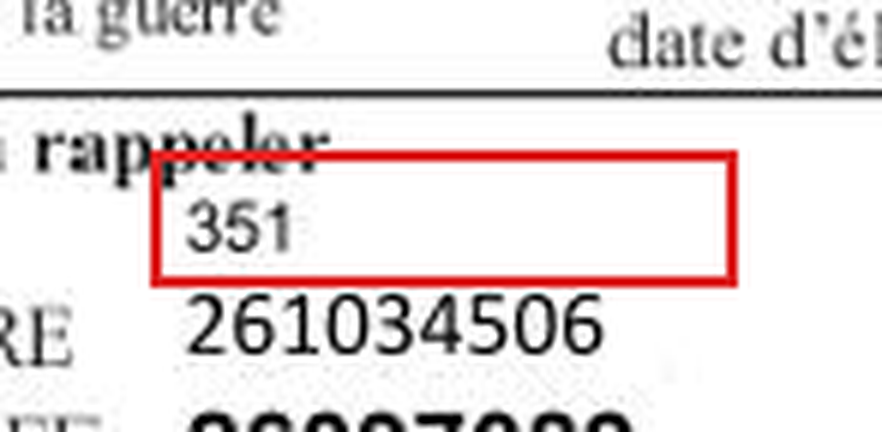
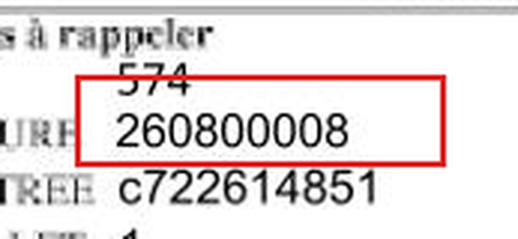

# Rapport de diagnostic des fausses anomalies — iMSA Sentinel 3.0

10 octobre 2026. Point de départ : version 2.0, avec 75 résultats en anomalie et 1 contrôle non vérifiable sur 55 dossiers (1 210 contrôles).

**Conclusion : 12 des 76 résultats examinés étaient faux. Ils se trouvaient tous dans un seul dossier, Facture2_06, et avaient une seule cause : un caractère blanc inséré dans le fichier B2 (FP-B2).** La cause est corrigée dans le parseur, et non dans l'affichage. Les 64 autres résultats correspondent à de vraies différences entre les deux documents. Ce point repose sur une revue assistée par IA : il **doit être confirmé par un validateur humain** dans l'écran « Qualité et validation ».

## 1. Méthode

1. **Outil de diagnostic** (`scripts/diagnostic_anomalies.py`). Il produit, pour chaque résultat en anomalie ou à vérifier :
   - la règle, la zone, la valeur retenue sur le bordereau et les lectures de chaque moteur (RapidOCR, Tesseract) ;
   - la valeur du TXT, avec sa ligne et ses positions, et les appariements de prestations ;
   - la convention appliquée, la géométrie (boîtes, recalage) et le rapprochement des documents ;
   - un **agrandissement de la région** du bordereau ;
   - la revue humaine, si elle existe.

   Sortie : `data/diagnostic/` (local et non versionné, car il contient des extraits de documents de santé).
2. **Examen visuel de chaque agrandissement**, comparé à la ligne du TXT, pour les 76 résultats.
3. **Contrôle croisé du fichier.** Chaque TXT est comparé à un fichier de référence de la même famille, sans écart. Cela met en évidence ce qui diffère réellement d'un fichier à l'autre (par exemple, le TotalPrestations de Facture1_04 vaut 81898 alors que les autres champs portent 81897).
4. **Vérification des hypothèses de cause**, dans le code, en mesurant leur effet :

| Cause supposée | Vérification | Constat sur le corpus |
|---|---|---|
| FP-GEO, mauvaise localisation | écart entre chaque trait d'ancrage attendu et le trait réel, sur les 55 images | écart maximal de **1,5 px** ; aucun champ ni tableau mal localisé |
| FP-OCR, caractère mal reconnu | agrandissements comparés à la valeur retenue (38 valeurs) | **0 erreur** : chaque valeur retenue correspond à ce qui est imprimé |
| FP-TABLE, lignes fusionnées ou ignorées | contrôles structurels ajoutés en 3.0, examen des 25 agrandissements de tableaux | aucune ligne fusionnée ni ignorée |
| FP-B2, lecture du fichier | comparaison aux fichiers de la même famille | **Facture2_06 : caractère inséré en position 11** (12 résultats faux) |
| FP-PAIR, appariement | appariements occurrence par occurrence | aucun appariement erroné constaté |
| FP-NORM, normalisation | zéros de cadrage, montants en centimes | aucune erreur constatée |
| FP-RULE, logique métier | 22 règles relues contre leur formulation | aucune erreur constatée |
| FP-CONVENTION | R01 : 12278*0 ou 12278*01 | 3 anomalies R01 réelles selon **les deux** interprétations (22278*01, 12280*01, 12279*01). 52 autres résultats dépendent d'une décision de la MSA, désormais affichée et enregistrable |
| FP-CACHE, donnée obsolète | clé du cache = image + code d'extraction ; clé d'analyse = sources, versions, code et décisions | aucune donnée obsolète dans le moteur. En revanche, **l'interface pouvait rester en cache dans le navigateur** (capture de l'utilisateur sur l'ancienne interface) : corrigé, la page n'est plus mise en cache |
| FP-UI, résultat mal affiché | test en navigateur réel des 825 zones (couleur = statut serveur) et du parcours simple sur les 55 dossiers, relancé avec le code final | aucun écart d'affichage (825 / 825, 64 écarts ouverts, 0 erreur) |

## 2. Cause confirmée : Facture2_06 (FP-B2)

**Constat.** Dans les 44 lignes du TXT, un caractère blanc a été inséré en position 11, juste après le n° FINESS. Tous les champs placés après cette position sont lus un caractère trop loin. Extrait de la ligne de début de facture (le n° d'assuré est masqué ici) :

```
Facture2_05  2490002037 2540••••••••5020012610345051026097089…
Facture2_06  2490002137  2540••••••••6020012610345061026097…   ← blanc inséré en position 11
```

Aux positions officielles, la version 2.0 lisait donc :

| Donnée | Lecture 2.0 (positions officielles) | Bordereau | Lecture réalignée (3.0) |
|---|---|---|---|
| NumeroLot (20-22) | 135 | 351 | **351** |
| NumeroFacture (30-38) | 126103450 | 261034506 | **261034506** |
| Actes de type 3 | 9GHS, 00000, 9FJA | GHS, FJA | **GHS, FJA** |
| TotalPrestations | 900 101,32 € | 1 013,22 € | **1 013,22 €** |
| TotalHonoraires | 200 093,66 € | 936,68 € | **936,68 €** |
| NumeroTiers (2-10, avant le blanc) | 490002137 | 490002037 | 490002137 : **anomalie réelle** |



**Gravité : élevée.**
- 11 fausses anomalies et 1 faux « non vérifiable ».
- Des montants absurdes (plus de 900 000 €) étaient lus dans le fichier. Ils n'entraient toutefois pas dans le volet financier, déjà protégé en 2.0.
- Le dossier passait en tête des priorités pour de mauvaises raisons.

**Fonction responsable.** `b2parser.parse_b2` lit aux positions du cahier des charges. En 2.0, le décalage n'était qu'une observation (`DECALAGE_POSITIONS`) et les règles s'appliquaient aux positions officielles.

**Solution retenue** (`b2parser.detect_insertion`) :

1. **Détecter l'écart structurel.** Les marqueurs de sous-type (2-S, 3-S, 4-S…) se trouvent une position trop loin.
2. **Démontrer le point d'insertion** par au moins **trois vérifications indépendantes, internes au fichier**, qui échouent sur le fichier tel quel et réussissent une fois le caractère retiré. Pour Facture2_06, elles sont quatre :
   - marqueurs à leur place officielle (25 lignes) ;
   - codes d'actes commençant par une lettre ;
   - dates de prestation valides ;
   - somme des prestations égale au TotalPrestations.

   **Le bordereau n'intervient jamais** dans ce choix : on ne cherche pas la lecture qui concorde.
3. **Condition impérative.** Le caractère retiré ne doit couper aucun identifiant (n° d'assuré et n° de facture entièrement numériques). Sinon, le réalignement est refusé (test `test_decalage_non_demontre_reste_une_simple_observation`).
4. **Conserver la ligne d'origine** (`raw_original`). Le surlignage dans le fichier pointe les positions d'origine.
5. **Présenter la lecture comme une interprétation** :
   - alerte de dossier « Fichier B2 mal formé… à confirmer, et à signaler à l'établissement » ;
   - note sur chaque contrôle concerné ;
   - regroupement d'alertes dédié ;
   - priorité augmentée, avec ce motif.
6. **Ne pas masquer le défaut du fichier** : l'observation `FICHIER_REALIGNE` est de niveau « alerte ».

**Résultat sur Facture2_06** : 1 anomalie (R02, FINESS) et 1 alerte de structure, au lieu de 12 anomalies, dont 11 fausses, et 1 faux « non vérifiable ».

**Limites.** Seule l'insertion d'un **blanc unique, au même endroit dans toutes les lignes**, est réalignée. Tout autre défaut (caractère non blanc, positions variables, suppression) reste une simple observation, et les contrôles s'appliquent alors aux positions officielles.

## 3. Cas revérifiés sur les documents originaux

| Dossier | Résultat | Vérification | Conclusion |
|---|---|---|---|
| Facture1_04 R12 | 818,97 € sur le bordereau, 818,98 € dans le fichier | Le bordereau imprime 818,97 (agrandissement). Dans le fichier, TotalPrestations (42-49) vaut 81898, alors que le champ suivant (50-57) et la somme des lignes valent 81897. | **Écart réel.** Le fichier est incohérent en interne ; l'explication le signale |
| Facture1_09 R13 | PH7 facturé, absent du bordereau | Zone 6 : 1 ligne (GHS) ; zone 7 : 2 lignes (PH8, EMI), soit 3 lignes lues sur 3 imprimées. Le TXT contient une prestation PH7 de plus (ligne 8). | **Écart réel.** Segmentation correcte |
| Facture2_04 R01, R04, R05 | 12280*01 ; n° de facture et n° d'assuré différents | Le bordereau porte le n° de facture (261034503) et le n° d'assuré de **Facture2_03** | **Écarts réels** (document non homologue). Nouveau signal « Bordereau d'un autre dossier ? » |
| Facture1_01 R18, Facture2_05 R21 | signature absente | Cases vides sur les agrandissements | **Absence apparente réelle.** Seule la présence est contrôlée, jamais l'authenticité |
| Facture1_08 R04 | 260800008 / 268800008 | L'agrandissement montre 260800008 | **Écart réel.** Les deux valeurs ne diffèrent que d'un caractère souvent confondu (0/8) : un avertissement invite l'agent à regarder ce chiffre |
| R01 (55 dossiers) | convention « préfixe 12278*0 » | Les bordereaux impriment 12278*01, sauf 3 | Les 2 interprétations sont affichées. **Décision de la MSA requise** |



## 4. Ce qui n'a pas pu être établi

- **Faux négatifs sur le corpus.** Aucun écart manqué n'a été constaté sur les cas examinés, mais aucune annotation humaine exhaustive ne permet de l'affirmer. L'échantillon de conformes du référentiel de validation est prévu pour le mesurer.
- **Revue humaine.** La revue de ce rapport a été faite avec l'assistant IA. Elle est chargée dans l'application comme « revue assistée, à confirmer » et **n'entre dans aucune métrique**.
