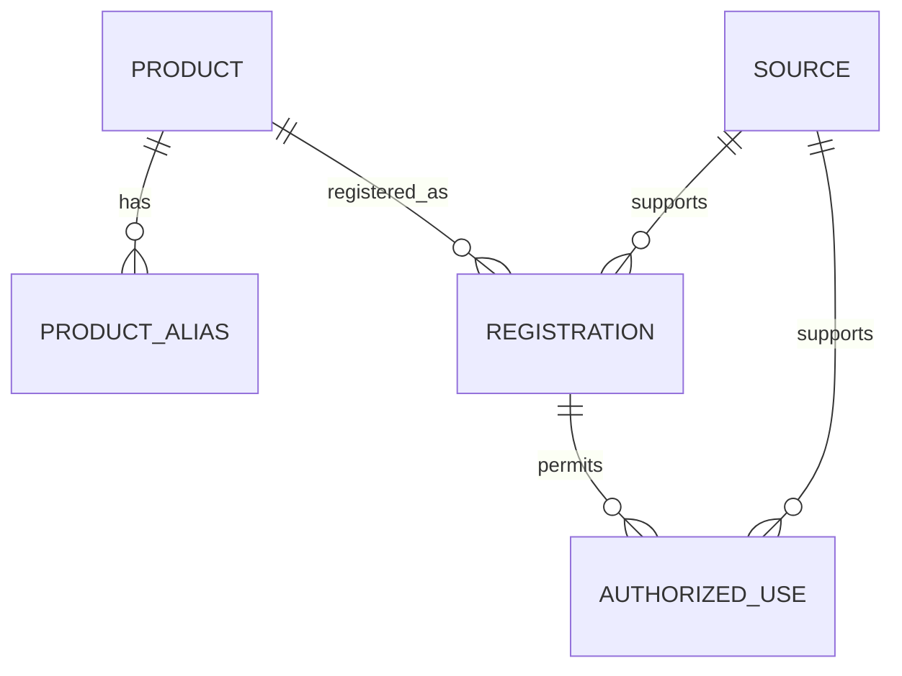

# Canonical data model

## Principles
- Separate product identity, market registration and authorized use.
- Preserve original and normalized values.
- Keep source evidence on every regulatory record.
- Treat sister-product matching as a reviewable hypothesis.
- Keep validation state independent from AI confidence.

Every registration and use returned to a user must identify the source, direct URL when available, collection timestamp and validation status.
