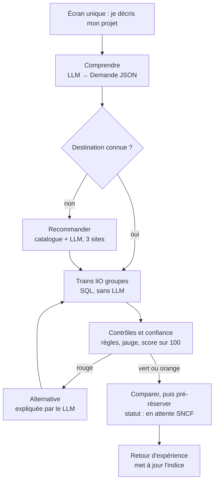
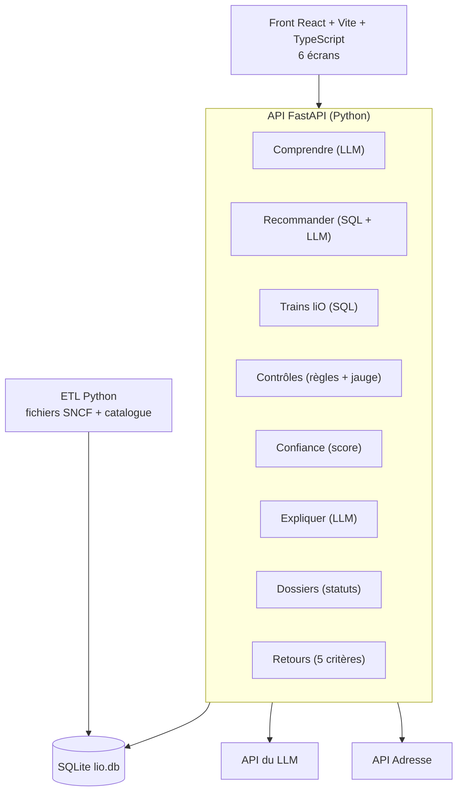

# Architecture du copilote liO

Version corrigée du schéma « Archi Brouillon ». Elle remplace le parcours de `livrables/04-parcours-utilisateur.md`. Le contrat d'API de `livrables/03-cahier-des-charges.md` reste valable.

## Les 5 règles d'architecture

1. **Un seul écran d'entrée.** Que le prof connaisse sa destination ou non, il donne les mêmes informations. La destination est un champ facultatif, et tout aboutit à un seul objet `Demande`.
2. **Le LLM n'intervient qu'à 3 endroits** : comprendre la demande, recommander des sites, expliquer le résultat. Les trains, les contrôles et le score sont du code classique : un LLM pourrait inventer un horaire ou une place libre.
3. **Pas d'API SNCF à appeler.** Les fichiers SNCF sont chargés une fois dans notre base SQLite par un script Python (ETL). Chercher des trains, c'est faire une requête SQL en local.
4. **Le résultat n'est jamais un simple OK/KO.** C'est un score de confiance vert, orange ou rouge, avec son explication. Une alternative repasse par les mêmes contrôles avant d'être montrée.
5. **On ne réserve jamais : on demande.** L'écran final dit « Demande transmise, confirmation en attente », jamais « Bravo, c'est réservé ».

## Le parcours



## L'architecture technique



## Les appels d'un parcours complet

| Étape | Route | Module | LLM ? |
|---|---|---|---|
| Le prof décrit son projet | `POST /api/demande/analyser` | Comprendre (+ API Adresse pour la gare) | Oui |
| Il ne sait pas où aller | `POST /api/destinations` | Recommander : filtre SQL du catalogue, puis le LLM classe 3 sites | Oui |
| Il choisit un site | `POST /api/trajets` | Trains liO → Contrôles → Confiance → Expliquer | Oui, pour l'explication seulement |
| Il pré-réserve | `POST /api/pre-reservations` | Dossiers | Non |
| Il revient après le voyage | `POST /api/retours` | Retours | Non |

## Arborescence du code

```text
frontend/                  Mohamed
  src/pages/               MonProjet, OuAller, CommentYAller, Comparer, PreReserver, Retour
  src/components/          Jauge, Pastille, IndiceConfiance
  src/api.ts               appels à l'API et types du contrat
backend/
  app/main.py              routes FastAPI                          Mohamed (squelette)
  app/schemas.py           contrat d'API en Pydantic               Mohamed + Taj
  app/llm.py               les 3 appels au LLM, sortie JSON        Khalil
  app/services/
    comprendre.py          texte → Demande, lieu → gare            Khalil
    recommander.py         catalogue → 3 sites                     Taha
    trains.py              recherche SQL des trains                Taj
    controles.py           règles R1 à R10 et jauge                Taj
    confiance.py           score sur 100 et son détail             Taj (+ fiabilité de Grégorie)
    dossiers.py            statuts et références                   Taj
    retours.py             retour d'expérience                     Taha
  etl/build_db.py          fichiers SNCF + catalogue → lio.db      Hamza
data/                      fichiers SNCF et lio.db, jamais commités
```

## Ce qu'on ne fait pas

Pas de comptes utilisateurs (un e-mail suffit), pas de paiement, pas d'appel en direct à la SNCF, pas de « compagnon de voyage » avant que le parcours complet marche. La démo tourne en local, avec une vidéo de secours.
