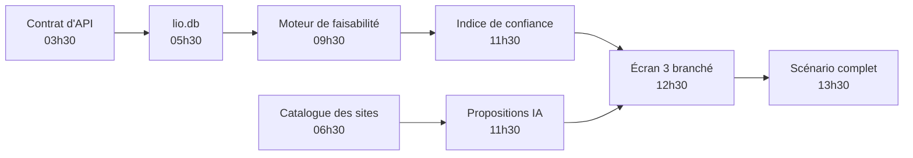

# Plan de nuit : 3h00 → 15h30

**Le principe :** un seul parcours complet et fiable, celui du [scénario de démo](README.md#le-scénario-de-démo), plutôt que dix fonctionnalités à moitié finies. La fiche de cadrage demande « un parcours complet, de la description du projet à la pré-réservation » (pitch, diapo 6).

## Qui dort quand

Chaque personne dort environ 3 heures. À tout moment, au moins un profil data et un profil IA sont éveillés. Tout le monde est là pour les 6 dernières heures.

| Créneau | Dorment | Éveillés | Data éveillé | IA éveillé |
|---|---|---|---|---|
| 03h30 → 06h30 | Grégorie, Khalil, Taj | Mohamed, Hamza, Taha | Hamza | Taha |
| 06h30 → 07h00 | personne (passation) | tout le monde | | |
| 07h00 → 09h30 | Mohamed, Hamza, Taha | Grégorie, Khalil, Taj | Grégorie, Taj | Khalil, Taj |
| 09h30 → 15h30 | personne | tout le monde | | |

Pourquoi cet ordre : Hamza produit la base de données et Taha le catalogue des sites pendant que Taj et Khalil dorment. Taj et Khalil se réveillent au moment où ils en ont besoin. Mohamed dort pendant que les briques backend se construisent, puis il les branche à son réveil.

## Vue d'ensemble

```mermaid
gantt
    title Nuit du 9 au 10 octobre : rendu 15h30
    dateFormat HH:mm
    axisFormat %H:%M

    section Mohamed (full stack)
    Kickoff et contrat d'API            :crit, m1, 03:00, 03:30
    Squelette front et back + mocks     :crit, m2, 03:30, 05:00
    Écrans 1 et 2 sur mocks             :m3, 05:00, 07:00
    Sommeil                             :done, m4, 07:00, 09:30
    Écrans 3 et 4                       :crit, m5, 09:30, 11:30
    Écran 5 et retour d'expérience      :m6, 11:30, 12:30
    Branchement des vraies API          :crit, m7, 12:30, 13:30
    Démo et vidéo de secours            :m8, 13:30, 15:30

    section Hamza (data)
    Kickoff                             :h1, 03:00, 03:30
    Pipeline vers lio.db                :crit, h2, 03:30, 05:30
    Requête trains entre deux gares     :crit, h3, 05:30, 06:30
    Sommeil                             :done, h4, 07:00, 09:30
    Options simulées et correspondances :h5, 09:30, 11:00
    Tests du scénario                   :h6, 11:00, 13:30
    Pitch                               :h7, 13:30, 15:30

    section Grégorie (data)
    Kickoff                             :g1, 03:00, 03:30
    Sommeil                             :done, g2, 03:30, 06:30
    Table de fiabilité des trains       :crit, g3, 07:00, 08:30
    Analyses et graphiques pour le jury :g4, 08:30, 11:00
    Slides data                         :g5, 11:00, 13:00
    Pitch                               :g6, 13:00, 15:30

    section Khalil (IA)
    Kickoff                             :k1, 03:00, 03:30
    Sommeil                             :done, k2, 03:30, 06:30
    Brique IA 1 comprendre la demande   :crit, k3, 07:00, 09:30
    Brique IA 3 expliquer et alternative:k4, 09:30, 11:30
    Saisie vocale et évaluation         :k5, 11:30, 13:00
    Tests et pitch                      :k6, 13:00, 15:30

    section Taha (IA)
    Kickoff                             :t1, 03:00, 03:30
    Catalogue des sites culturels       :crit, t2, 03:30, 06:30
    Sommeil                             :done, t3, 07:00, 09:30
    Brique IA 2 proposer destinations   :crit, t4, 09:30, 11:30
    Questionnaire retour d'expérience   :t5, 11:30, 12:30
    Slides et pitch                     :t6, 12:30, 15:30

    section Taj (IA et data)
    Kickoff et contrat d'API            :crit, j1, 03:00, 03:30
    Sommeil                             :done, j2, 03:30, 06:30
    Moteur de faisabilité et jauge      :crit, j3, 07:00, 09:30
    Indice de confiance                 :crit, j4, 09:30, 11:30
    Intégration et tests                :crit, j5, 11:30, 13:30
    Questions techniques et pitch       :j6, 13:30, 15:30
```



## Points de synchronisation

| Heure | Durée | Qui | Ordre du jour |
|---|---|---|---|
| **03h00** | 30 min | Tous | Lire le README et ce plan. Trancher les 3 décisions. Figer le contrat d'API ([03-cahier-des-charges.md §8](03-cahier-des-charges.md)). Ajouter `data/` au `.gitignore`. |
| **06h30** | 30 min | Tous | Passation : ceux qui vont dormir présentent leur note, ceux qui se réveillent reprennent. Hamza remet `lio.db` à Taj et Grégorie. |
| **09h30** | 15 min | Tous | État des lieux. Premier passage de bout en bout, même avec des mocks. |
| **12h00** | 15 min | Tous | Le scénario de démo passe-t-il en entier ? Sinon, on applique les coupes ci-dessous. |
| **13h00** | — | Tous | **Gel des fonctionnalités** : à partir de là, uniquement des corrections et du polissage. |
| **13h30** | — | Tous | **Gel du code.** Démo, vidéo de secours, slides, répétitions. |
| **15h15** | 15 min | Tous | Dernière vérification, puis rendu à 15h30. |

## Tâches par personne

### Mohamed : dev full stack

| Début | Fin | Tâche | Livrable | Dépend de |
|---|---|---|---|---|
| 03h00 | 03h30 | Kickoff, contrat d'API figé avec Taj | Contrat validé | — |
| 03h30 | 05h00 | Squelette du front (React + Vite + Tailwind, couleurs liO) et du back (FastAPI) qui renvoie les mocks du contrat | Le projet démarre en une commande | Contrat |
| 05h00 | 07h00 | Écran 1 « Mon projet » et écran 2 « Où aller ? » sur les mocks | 2 écrans navigables | Squelette |
| 07h00 | 09h30 | Sommeil | Note de passation | — |
| 09h30 | 11h30 | Écran 3 « Comment y aller ? » (jauge, pastilles, indice détaillé) et écran 4 « Comparer » | 2 écrans | Mocks, puis API de Taj |
| 11h30 | 12h30 | Écran 5 « Pré-réserver » et écran 6 « Retour d'expérience » | 2 écrans | — |
| 12h30 | 13h30 | Remplacement des mocks par les vraies API, corrections | Le scénario passe en entier | Taj, Khalil, Taha |
| 13h30 | 15h30 | Démo en direct, vidéo de secours enregistrée | Vidéo + démo stable | Gel du code |

### Hamza : data

| Début | Fin | Tâche | Livrable | Dépend de |
|---|---|---|---|---|
| 03h00 | 03h30 | Kickoff | — | — |
| 03h30 | 05h30 | Pipeline : « Liste des trains groupes », « Détail desserte » (réutiliser `xlsx_to_csv.py`), `Data_Hackathon.csv` et `gares.json`, chargés dans `lio.db` selon [05-mcd-mld.md](05-mcd-mld.md) | `lio.db` + dictionnaire de données | Fichiers du drive |
| 05h30 | 06h30 | Fonction « trains groupes directs entre la gare A et la gare B pour un jour type, avec horaires » + contrôles qualité | Fonction testée sur Foix → Toulouse | `lio.db` |
| 06h30 | 07h00 | Passation à Taj et Grégorie | Note de passation | — |
| 07h00 | 09h30 | Sommeil | — | — |
| 09h30 | 11h00 | Options simulées d'autres groupes pour le scénario (marquées « simulé »). Bonus : trajets avec une correspondance | Table `positionnement` remplie | — |
| 11h00 | 13h30 | Tests du scénario et de 3 variantes, appui à l'intégration | Liste des bugs corrigés | API de Taj |
| 13h30 | 15h30 | Antisèche des questions data du jury, pitch | Antisèche | — |

### Grégorie : data

| Début | Fin | Tâche | Livrable | Dépend de |
|---|---|---|---|---|
| 03h00 | 03h30 | Kickoff | — | — |
| 03h30 | 06h30 | Sommeil | — | — |
| 06h30 | 07h00 | Passation | — | — |
| 07h00 | 08h30 | Table `fiabilite_train` tirée de `Data_Hackathon.csv` : régularité, suppressions, respect de l'emport, fréquentation, minutes perdues | Table livrée à Taj | `lio.db` |
| 08h30 | 11h00 | Les 5 analyses pour le jury ([06-data-pipeline-eda.md](06-data-pipeline-eda.md)) | 5 graphiques en PNG, avec une phrase de conclusion chacun | `lio.db` |
| 11h00 | 13h00 | Slides data du pitch, avec captures de la carte existante (`visualisation/`) | Slides | Graphiques |
| 13h00 | 15h30 | Répétitions du pitch | — | — |

### Khalil : IA

| Début | Fin | Tâche | Livrable | Dépend de |
|---|---|---|---|---|
| 03h00 | 03h30 | Kickoff | — | — |
| 03h30 | 06h30 | Sommeil | — | — |
| 06h30 | 07h00 | Passation | — | — |
| 07h00 | 09h30 | **Brique IA 1, « Comprendre la demande »** : texte libre → JSON du contrat, avec une question de relance quand un champ manque. Lieu de départ → gare la plus proche (API Adresse + `gares.json`) | Endpoint `POST /api/demande/analyser` + 10 demandes de test | Contrat |
| 09h30 | 11h30 | **Brique IA 3, « Expliquer »** : l'explication de l'indice et la phrase « pas assez fiable, voici pourquoi, voici une alternative ». L'IA reformule des chiffres déjà calculés, elle ne calcule rien | Fonction appelée par l'API de Taj | Indice de Taj |
| 11h30 | 13h00 | Saisie vocale avec l'API Web Speech du navigateur (bonus), évaluation des réponses sur les 10 demandes | Micro fonctionnel, taux de bonnes réponses | Écran 1 |
| 13h00 | 15h30 | Tests des prompts, partie IA du pitch (frugalité, garde-fous) | — | — |

### Taha : IA

| Début | Fin | Tâche | Livrable | Dépend de |
|---|---|---|---|---|
| 03h00 | 03h30 | Kickoff | — | — |
| 03h30 | 06h30 | **Catalogue de 25 à 40 sites culturels** proches d'une gare liO, en commençant par le Moyen Âge (scénario de démo), puis 2 ou 3 autres thèmes. Colonnes dans [05-mcd-mld.md](05-mcd-mld.md). Sources : DATAtourisme, base Mérimée, Musées de France, sites officiels. **Rien d'inventé** : une case reste vide si l'information est introuvable | `catalogue_sites.csv` | — |
| 06h30 | 07h00 | Passation | Note de passation | — |
| 07h00 | 09h30 | Sommeil | — | — |
| 09h30 | 11h30 | **Brique IA 2, « Proposer des destinations »** : filtre du catalogue (thème, niveau, gares atteignables), puis le LLM classe 3 sites et rédige l'intérêt pédagogique | Endpoint `POST /api/destinations` | Catalogue, Khalil |
| 11h30 | 12h30 | Questionnaire de retour d'expérience (5 critères) et règle de prise en compte dans l'indice | Formulaire + règle | — |
| 12h30 | 15h30 | Slides (le récit) et pitch | Slides | — |

### Taj : IA et data

| Début | Fin | Tâche | Livrable | Dépend de |
|---|---|---|---|---|
| 03h00 | 03h30 | Kickoff, contrat d'API figé avec Mohamed | Contrat validé | — |
| 03h30 | 06h30 | Sommeil | — | — |
| 06h30 | 07h00 | Passation : récupère `lio.db` | — | Hamza |
| 07h00 | 09h30 | **Moteur de faisabilité** : trains aller et retour pour un site, contrôles R1 à R10, jauge (50 moins les options) | Endpoint `POST /api/trajets` | `lio.db`, fonction de Hamza |
| 09h30 | 11h30 | **Indice Confiance Voyageur Scolaire** : formule, détail par critère, seuils, recherche d'une alternative | Indice intégré à `/api/trajets` | `fiabilite_train` de Grégorie |
| 11h30 | 13h30 | Intégration avec Mohamed, tests du scénario | Scénario complet | Tout |
| 13h30 | 15h30 | Questions techniques du jury, pitch | — | — |

## Le chemin critique

Si l'une de ces étapes prend du retard, tout le reste glisse :



## Si on est en retard : ce qu'on coupe, dans cet ordre

1. Les trajets avec correspondance : on garde seulement les trains directs.
2. La saisie vocale : on la montre en maquette dans le pitch.
3. L'écran « Comparer » : il devient un simple tableau en bas de l'écran 3.
4. Le lien entre le retour d'expérience et l'indice : on montre le formulaire, et on explique le mécanisme à l'oral.
5. La brique IA 3 : l'explication devient un texte à trous rempli par des règles.

**On ne coupe jamais** les pastilles, la jauge, l'indice expliqué et les statuts de pré-réservation. Ce sont les briques que la fiche demande explicitement.

**Plan B si l'API du LLM tombe pendant la démo :** un mode « démo » qui rejoue les réponses enregistrées du scénario, et la vidéo de secours.

## Modèle de note de passation

À poster dans le canal de l'équipe avant d'aller dormir :

```text
Passation — [prénom] — [heure]
Fait : ...
Reste à faire : ...
Où sont les fichiers : ...
Bloquant ou à savoir : ...
```
