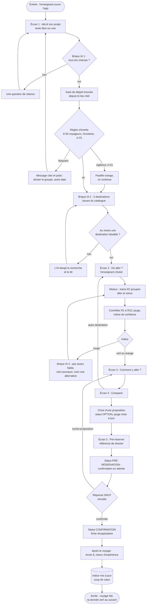

# Parcours utilisateur

Le schéma de parcours de l'équipe n'était pas joint. Ce document part donc du parcours en 10 étapes de la fiche (§14, p. 9). Si votre schéma est différent, comparez-le aux problèmes listés ci-dessous.

## Les trous du parcours en 10 étapes

| # | Problème | Étape concernée | Correction |
|---|---|---|---|
| 1 | Rien n'est prévu quand la demande est incomplète | 1 → 2 | L'IA pose **une** question de relance, puis continue |
| 2 | Rien n'est prévu quand les règles d'entrée échouent : moins de 6 ou plus de 50 voyageurs, établissement hors Occitanie, date à moins de 21 jours | 2 | Message clair et piste de sortie (diviser le groupe, changer de date) |
| 3 | Rien n'est prévu quand aucune destination n'est faisable | 3 | L'IA élargit la recherche (thème voisin, autre gare de départ proche) et le dit |
| 4 | Rien n'est prévu quand la jauge est insuffisante ou le train peu fiable | 5 → 6 | « Pas assez fiable, voici pourquoi, voici une alternative » : train suivant, autre jour, autre site |
| 5 | La comparaison arrive après le choix de la destination, sans retour en arrière | 4 → 8 | L'enseignant peut revenir aux destinations depuis l'écran de comparaison |
| 6 | Le parcours s'arrête à « il pré-réserve » : la sortie de l'utilisateur n'est pas définie | 9 → 10 | Référence de dossier, fiche récapitulative, statut suivi, réponse SNCF (confirmation ou contre-proposition) |
| 7 | Le passage de OPTION à PRÉ-RÉSERVATION n'apparaît pas | 9 | Choisir une proposition pose une OPTION (la jauge des autres groupes en tient compte). Envoyer la demande la fait passer en PRÉ-RÉSERVATION |

## Parcours corrigé

## Ce qu'on montre en démo

Le chemin du [scénario](README.md#le-scénario-de-démo) passe par ces branches : la relance (si on retire les accompagnateurs de la phrase), la vigilance orange, la jauge rouge avec alternative, puis la pré-réservation et le retour d'expérience. Les autres branches (aucune destination faisable, contre-proposition SNCF) sont codées si le temps le permet, sinon expliquées à l'oral avec ce schéma.
