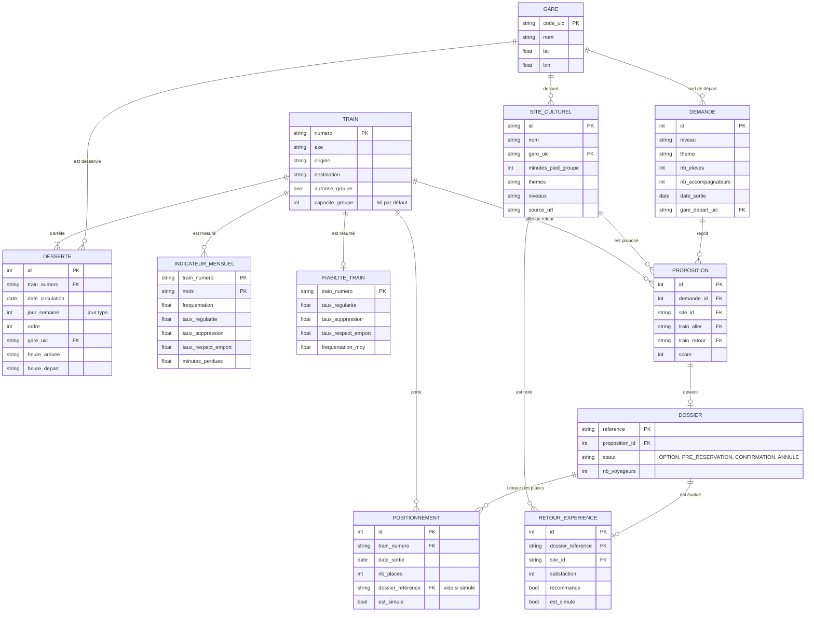

# MCD et MLD

## MCD



**Trois choix de modélisation à connaître :**

- **La jauge n'est pas stockée, elle est calculée.** Places disponibles = 50 − somme des `nb_places` de `positionnement` pour ce train et cette date. Les options simulées d'autres groupes sont des lignes avec `est_simule = 1` et sans dossier.
- **Le jour type** (`jour_semaine`) permet de répondre pour une date de novembre avec la grille de février à juin (décision 1 du README).
- **Les données simulées sont marquées** (`est_simule`) pour ne jamais les présenter comme réelles, conformément à la règle « aucune disponibilité inventée ».

## MLD

| Table | Clé primaire | Clés étrangères | Rempli par |
|---|---|---|---|
| `gare` | `code_uic` | — | Hamza, depuis `gares.json` |
| `train` | `numero` | — | Hamza, depuis « Liste des trains groupes » |
| `desserte` | `id` | `train_numero` → `train`, `gare_uic` → `gare` | Hamza, depuis « Détail desserte » |
| `indicateur_mensuel` | (`train_numero`, `mois`) | `train_numero` → `train` | Hamza, depuis `Data_Hackathon.csv` |
| `fiabilite_train` | `train_numero` | `train_numero` → `train` | Grégorie, calculée depuis `indicateur_mensuel` |
| `site_culturel` | `id` | `gare_uic` → `gare` | Taha, depuis `catalogue_sites.csv` |
| `demande` | `id` | `gare_depart_uic` → `gare` | L'API, à chaque recherche |
| `proposition` | `id` | `demande_id` → `demande`, `site_id` → `site_culturel`, `train_aller` et `train_retour` → `train` | L'API de Taj |
| `dossier` | `reference` | `proposition_id` → `proposition` | L'API, à l'option |
| `positionnement` | `id` | `train_numero` → `train`, `dossier_reference` → `dossier` | L'API, et Hamza pour les options simulées |
| `retour_experience` | `id` | `dossier_reference` → `dossier`, `site_id` → `site_culturel` | L'API, et Taha pour les retours simulés |

Script SQLite prêt à l'emploi (testé) :

```sql
CREATE TABLE gare (
  code_uic TEXT PRIMARY KEY,
  nom      TEXT NOT NULL,
  lat      REAL,
  lon      REAL
);

CREATE TABLE train (
  numero          TEXT PRIMARY KEY,
  axe             TEXT,
  origine         TEXT,
  destination     TEXT,
  autorise_groupe INTEGER NOT NULL DEFAULT 0,  -- 1 si présent dans « Liste des trains groupes »
  capacite_groupe INTEGER NOT NULL DEFAULT 50
);

CREATE TABLE desserte (
  id               INTEGER PRIMARY KEY,
  train_numero     TEXT    NOT NULL REFERENCES train(numero),
  date_circulation TEXT    NOT NULL,           -- AAAA-MM-JJ
  jour_semaine     INTEGER NOT NULL,           -- 1 = lundi ... 7 = dimanche
  ordre            INTEGER NOT NULL,
  gare_uic         TEXT    NOT NULL REFERENCES gare(code_uic),
  heure_arrivee    TEXT,                       -- HH:MM
  heure_depart     TEXT                        -- HH:MM
);
CREATE INDEX idx_desserte_gare ON desserte (gare_uic, jour_semaine);
CREATE INDEX idx_desserte_train ON desserte (train_numero, date_circulation);

CREATE TABLE indicateur_mensuel (
  train_numero            TEXT NOT NULL REFERENCES train(numero),
  mois                    TEXT NOT NULL,       -- AAAA-MM
  circulations_theoriques INTEGER,
  circulations_realisees  INTEGER,
  frequentation           REAL,
  nb_retards              INTEGER,
  taux_regularite         REAL,
  nb_suppressions         INTEGER,
  taux_suppression        REAL,
  taux_respect_emport     REAL,
  nb_incidents            INTEGER,
  nb_trains_impactes      INTEGER,
  nb_ventes               INTEGER,
  minutes_perdues         REAL,
  PRIMARY KEY (train_numero, mois)
);

CREATE TABLE fiabilite_train (
  train_numero        TEXT PRIMARY KEY REFERENCES train(numero),
  taux_regularite     REAL,
  taux_suppression    REAL,
  taux_respect_emport REAL,
  frequentation_moy   REAL,
  minutes_perdues_moy REAL,
  nb_mois             INTEGER
);

CREATE TABLE site_culturel (
  id                  TEXT PRIMARY KEY,        -- ex. toulouse-saint-sernin
  nom                 TEXT NOT NULL,
  commune             TEXT,
  lat                 REAL,
  lon                 REAL,
  gare_uic            TEXT NOT NULL REFERENCES gare(code_uic),
  minutes_pied        INTEGER,                 -- temps individuel mesuré
  minutes_pied_groupe INTEGER,                 -- minutes_pied × 1,3 + 5
  acces_urbain        TEXT,                    -- ligne de bus ou tram, si besoin
  minutes_urbain      INTEGER,
  themes              TEXT,                    -- séparés par des ;
  niveaux             TEXT,                    -- ex. 6e;5e;4e
  activites           TEXT,
  horaires            TEXT,
  capacite_accueil    INTEGER,
  source_url          TEXT NOT NULL
);

CREATE TABLE demande (
  id                 INTEGER PRIMARY KEY,
  texte_brut         TEXT,
  niveau             TEXT,
  theme              TEXT,
  nb_eleves          INTEGER,
  nb_accompagnateurs INTEGER,
  date_sortie        TEXT,
  heure_depart_min   TEXT,
  heure_retour_max   TEXT,
  lieu_depart        TEXT,
  lieu_lat           REAL,
  lieu_lon           REAL,
  gare_depart_uic    TEXT REFERENCES gare(code_uic),
  email              TEXT,
  cree_le            TEXT
);

CREATE TABLE proposition (
  id             INTEGER PRIMARY KEY,
  demande_id     INTEGER NOT NULL REFERENCES demande(id),
  site_id        TEXT    NOT NULL REFERENCES site_culturel(id),
  train_aller    TEXT    NOT NULL REFERENCES train(numero),
  train_retour   TEXT    NOT NULL REFERENCES train(numero),
  score          INTEGER,
  niveau         TEXT,                         -- vert, orange ou rouge
  details_json   TEXT,
  explication_ia TEXT
);

CREATE TABLE dossier (
  reference      TEXT PRIMARY KEY,             -- ex. LIO-2026-000123
  proposition_id INTEGER NOT NULL UNIQUE REFERENCES proposition(id),
  statut         TEXT NOT NULL
                 CHECK (statut IN ('OPTION', 'PRE_RESERVATION', 'CONFIRMATION', 'ANNULE')),
  nb_voyageurs   INTEGER NOT NULL,
  cree_le        TEXT,
  maj_le         TEXT
);

CREATE TABLE positionnement (
  id                INTEGER PRIMARY KEY,
  train_numero      TEXT    NOT NULL REFERENCES train(numero),
  date_sortie       TEXT    NOT NULL,
  nb_places         INTEGER NOT NULL,
  dossier_reference TEXT REFERENCES dossier(reference),  -- vide pour un groupe simulé
  est_simule        INTEGER NOT NULL DEFAULT 0
);

CREATE TABLE retour_experience (
  id                INTEGER PRIMARY KEY,
  dossier_reference TEXT UNIQUE REFERENCES dossier(reference),
  site_id           TEXT NOT NULL REFERENCES site_culturel(id),
  satisfaction      INTEGER,                   -- 1 à 5
  adaptation_train  INTEGER,                   -- 1 à 5
  acces_gare_site   INTEGER,                   -- 1 à 5
  confiance         INTEGER,                   -- 1 à 5
  recommande        INTEGER,                   -- 1 = coup de cœur
  commentaire       TEXT,
  est_simule        INTEGER NOT NULL DEFAULT 0,
  cree_le           TEXT
);
```

Requête de la jauge :

```sql
SELECT 50 - COALESCE(SUM(nb_places), 0) AS places_disponibles,
       COUNT(*)                         AS groupes_positionnes
FROM positionnement
WHERE train_numero = :train AND date_sortie = :date;
```
