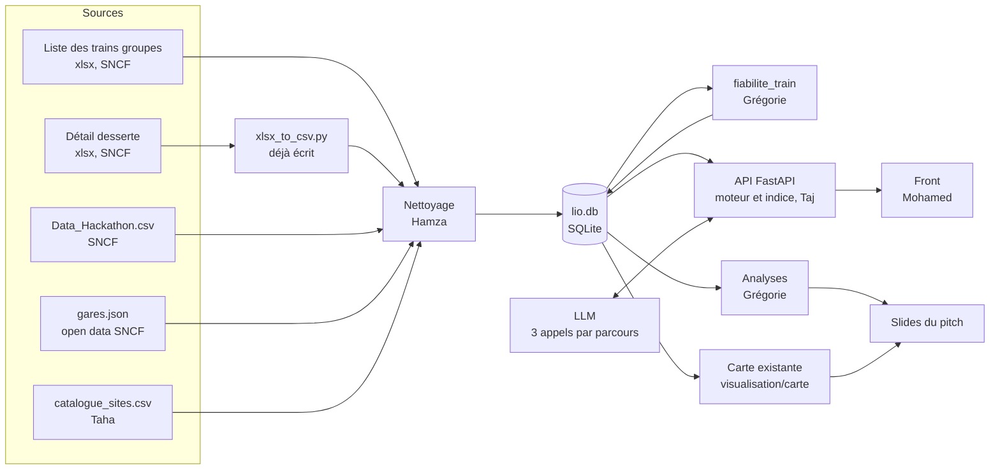

# Pipeline de données et exploration pour le jury

## Le flux

## Nettoyage (Hamza)

| Étape | Pourquoi |
|---|---|
| Numéros de train en texte, sans espaces | C'est la clé de jointure entre les 3 fichiers SNCF. Un `"871234"` contre `871234.0` casse tout |
| Codes UIC sur 8 caractères | Comme le fait déjà `build_data.py` pour joindre les gares |
| Heures au format `HH:MM`, dates au format `AAAA-MM-JJ`, calcul de `jour_semaine` | Recherche par jour type |
| Taux tous ramenés sur 0 à 100 | Les fichiers peuvent mélanger 0,95 et 95 % |
| `autorise_groupe = 1` pour chaque train de la liste des trains groupes | Règle R1 |

**Contrôles qualité à faire tourner et à noter dans le dictionnaire de données :**

- Trains de la liste des trains groupes absents de la desserte, et l'inverse.
- Arrêts sans coordonnées (`geocode_missing.py` aide déjà).
- Doublons sur (train, date, ordre).
- Mois sans aucune circulation, à exclure des moyennes.

## Table `fiabilite_train` (Grégorie, livrée à Taj à 8h30)

Une ligne par train groupe : moyennes sur tous les mois disponibles de la régularité, du taux de suppression, du taux de respect de l'emport, de la fréquentation et des minutes perdues, plus le nombre de mois utilisés. Si un train a moins de 2 mois de données, on le signale : l'indice affichera « peu d'historique ».

## Les 5 analyses à montrer au jury

Le jury attend un vrai travail d'exploration (Notes : « Data ≠ solution simple, EDA ++++ »). Chaque graphique a pour titre sa conclusion, en une phrase.

| # | Question | Graphique | Ce que ça apporte au pitch |
|---|---|---|---|
| 1 | Quels axes sont les plus sûrs pour un groupe ? | Barres horizontales : régularité moyenne par axe, triées | Justifie le critère « régularité » de l'indice |
| 2 | Y a-t-il des mois à éviter ? | Courbe : taux de suppression par mois depuis janvier 2026 | Montre que l'indice tient compte du risque de suppression |
| 3 | La plage 9h-16h est-elle vraiment plus calme ? | Barres : fréquentation moyenne selon l'heure de départ du train (jointure desserte et indicateurs) | Relie les données à la règle des heures creuses (annexes 1 et 2) |
| 4 | Quels trains recommander en premier ? | Nuage de points : régularité contre respect de l'emport, un point par train groupe, les 10 meilleurs nommés | Le « top des trains sûrs » que l'IA privilégie |
| 5 | Que peut-on visiter en train liO ? | Carte : gares desservies par des trains groupes et sites culturels à 20 min à pied ou moins (réutiliser `visualisation/carte`) | Le message « faire découvrir l'Occitanie autrement » de la fiche |

Livrables : 5 PNG lisibles sur un vidéoprojecteur (gros textes, une seule couleur d'accent), plus une phrase de conclusion par graphique pour les slides.
