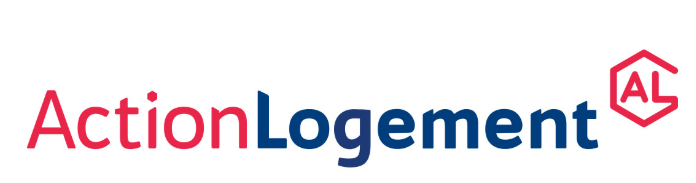

# Direction artistique du front

Plan du 10 octobre 2026. Base : logo Action Logement fourni par l'utilisateur. Les couleurs ci-dessous sont extraites de cette image et complétées pour l'interface ; elles ne constituent pas une charte graphique officielle obtenue auprès de l'entreprise.

## Intention

**Une application métier lumineuse, calme et soignée, avec une identité Action Logement immédiatement reconnaissable.** La qualité visuelle vient de la hiérarchie, des espacements et de composants cohérents. Les dossiers restent faciles à parcourir même lorsqu'ils contiennent beaucoup d'informations.

Le logo fourni reste intact, avec ses proportions et son fond blanc. La navigation et les en-têtes reposent sur des surfaces blanches. Le nom de travail du module est « BâtIA · Prévention » ; il peut être remplacé sans modifier l'organisation du produit.

## Palette proposée

| Rôle | Couleur | Usage |
| --- | --- | --- |
| Bleu de marque | `#003D7C` | Boutons principaux, navigation active, liens et titres forts |
| Rose rouge de marque | `#E92549` | Touches d'identité, petits repères graphiques et accents décoratifs |
| Rose rouge soutenu | `#C81D3E` | Texte d'accent ou bouton secondaire lorsque le contraste l'exige |
| Fond général | `#F5F7FB` | Toile de fond des pages |
| Surface | `#FFFFFF` | Navigation, tableaux, fiches et formulaires |
| Bleu très clair | `#EAF1FA` | Sélection, onglet actif, information contextuelle |
| Rose très clair | `#FDEDF1` | Accent doux et fond de repère |
| Texte principal | `#182B43` | Contenu et titres courants |
| Texte secondaire | `#52657B` | Métadonnées et aide à la lecture |
| Bordure | `#DEE5EF` | Séparateurs et contours légers |
| Vert de statut | `#1E694B` sur `#EAF5EF` | Action réalisée ou constat enregistré |
| Ambre de statut | `#875A0A` sur `#FFF4DC` | Élément à vérifier ou action en attente |

Les couleurs de marque ne remplacent pas les statuts métier. Un classement élevé ne doit pas transformer toute la ligne en alarme rouge. Les badges possèdent un libellé visible ; les tableaux restent majoritairement neutres.

Le contraste mesuré entre le bleu extrait et le blanc est d'environ 10,72:1 ; entre le rose extrait et le blanc, 4,35:1. Le second est inférieur au seuil de 4,5:1 pour le texte courant décrit par le [W3C](https://www.w3.org/WAI/WCAG22/Understanding/contrast-minimum.html). Le logo reste inchangé ; utiliser la variante soutenue pour le petit texte concerné. Vérifier les combinaisons réellement affichées lors de l'implémentation.

## Composition

- Navigation latérale blanche d'environ 240 px sur grand écran, logo posé sur blanc, trois entrées principales : À examiner, Actions, Équipements.
- État actif avec fond bleu très clair, texte bleu et repère discret. Le rose est utilisé ponctuellement pour l'identité du module.
- En-tête de page simple : titre, courte indication de contexte et action utile. Aucun bandeau « mode hackathon ».
- Accès secondaire « Données » pour la date de référence, l'horizon, la couverture et la méthode du classement. Ces informations restent accessibles dans la fiche du score.
- Contenu sur fond doux, marges de 24 à 32 px sur grand écran, cartes et tableaux bien alignés. Garder une densité suffisante pour comparer plusieurs équipements.
- Fiche détaillée avec identité en haut, synthèse des éléments utiles, puis chronologie et preuves. Actions regroupées dans une zone facile à retrouver.
- Sur téléphone : navigation compacte, contenu sur une colonne, lignes de liste adaptées et formulaire de retour terrain confortable.

## Typographie et composants

Police sans empattement lisible : Inter si une copie locale est disponible, sinon la pile système `Segoe UI, Arial, sans-serif`. Ne pas dépendre du chargement d'une police distante pour le fonctionnement.

Titres de page autour de 28 px, titres de section de 18 à 20 px, corps de 14 à 16 px. Les dates, références et valeurs numériques restent lisibles ; utiliser des chiffres à largeur constante pour les colonnes de comparaison.

Rythme d'espacement de 4/8/12/16/24/32 px. Coins arrondis modérés : environ 10 px pour les contrôles, 14 px pour les cartes. Ombres discrètes sur les éléments superposés ; bordures légères pour structurer les tableaux.

Bouton principal bleu avec texte blanc ; bouton secondaire sobre ; lien d'action explicite. Une action principale par zone de décision. Icônes simples accompagnées d'un texte lorsque leur sens n'est pas évident.

La chronologie distingue visuellement un remplacement par une frontière et un libellé. Les preuves sont présentées en blocs courts avec date, source et ouverture du détail. Les alertes de données sont spécifiques : « Date de pose estimée », « Rattachement à confirmer », « Score non disponible ».

Transitions courtes, de l'ordre de 150 à 200 ms, pour les ouvertures et changements d'état. Respecter la préférence de réduction des animations. Le focus clavier reste visible ; les textes importants ne sont pas accessibles uniquement au survol.

## Trois vues à dessiner d'abord

1. **À examiner** : titre, compteurs utiles, recherche et filtres, liste principale, accès à la fiche.
2. **Fiche équipement** : identité, rang et horizon, facteurs disponibles, chronologie, preuves et préparation d'inspection.
3. **Actions** : liste par état, responsable, date souhaitée ou confirmée, réexamen et retour de visite.

L'écran Équipements réutilise les composants de liste et la même fiche. Le résultat attendu est une famille d'écrans cohérente plutôt qu'une direction graphique différente pour chaque page.
