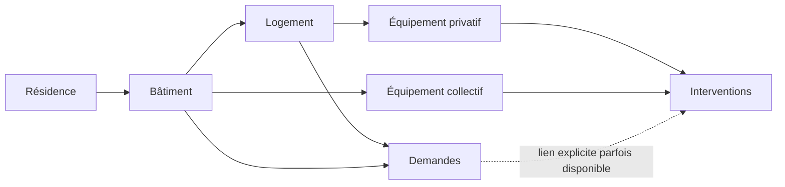

# Guide des données pour la prévention des pannes

## Lecture recommandée

Les [consignes](sources_lisibles/LISEZ-MOI_BatIA.md) définissent le contrat du défi. Le [dictionnaire extrait](sources_lisibles/xlsx_DICTIONNAIRE.csv) décrit chaque colonne et son équivalent dans les outils métier. Les [hypothèses](sources_lisibles/xlsx_HYPOTHESES.csv) distinguent faits transposés, statistiques agrégées et fabrication fictive. Le [notebook en texte](sources_lisibles/BatIA_notebook_demarrage.md) montre le chargement et les baselines, avec les limites détaillées dans l'[audit](AUDIT_DONNEES.md).

Les CSV originaux, dans `DATA 2 _le kit étudiants/BatIA_Kit_Hackathon/donnees/`, sont en UTF-8, séparateur virgule, avec une ligne d'en-tête. Conserver les identifiants comme texte et convertir explicitement les nombres et dates. Les codes postaux, adresses et noms de locataires ne sont pas nécessaires au défi et ne sont pas présents dans ce kit.

## Les grains et les jointures

| Table | Une ligne représente | Clé / rattachement |
| --- | --- | --- |
| 01_residences | Une résidence | `residence_id` |
| 02_batiments | Un bâtiment ou une cage | `batiment_id`, vers `residence_id` |
| 03_logements | Un logement | `logement_id`, vers bâtiment et résidence |
| 04_equipements | Un emplacement fonctionnel | `equipement_id`, vers bâtiment, résidence et logement éventuel |
| 05_demandes_locataires | Une demande | `demande_id`, localisation, **aucune clé équipement** |
| 06_interventions | Un passage technicien | `intervention_id`, vers `equipement_id`, demande liée éventuelle |
| 07_commandes | Un bon de commande avec facturation éventuelle | `commande_id`, vers logement et résidence, **aucune clé équipement** |
| 09_prestataires | Un prestataire | `prestataire_id` |



Ce schéma décrit les rattachements utiles, sans promettre une attribution certaine des demandes. Même les demandes de parties communes ont un logement renseigné dans ce jeu : lire aussi `parties` et `motif`.

Le code métier n'est pas une famille d'appareil : `MUPPR` est partagé par cinq familles. La clé des motifs de demandes est `(motif, parties)` et non le motif seul.

**Éviter les jointures qui multiplient les événements.** Joindre directement les demandes et interventions brutes d'un même logement produit toutes leurs combinaisons. Agréger chaque source à son grain utile avant rapprochement et vérifier la cardinalité des jointures. La table finale doit garder une ligne par équipement et par date de référence.

## Sémantique des champs déterminants

| Champ / groupe | Sens et précaution |
| --- | --- |
| `dans_perimetre_prediction` | Filtre officiel de la soumission. 1 285 Oui, 2 932 Non |
| `famille`, `duree_vie_reference_ans` | Famille et durée hypothétique de référence. L'âge relatif est âge / référence |
| `date_pose` | Pose du matériel en place fin 2025. À reconstruire pour un backtest antérieur |
| `date_pose_precedente` | Une pose précédente, sans historique complet des toutes premières poses |
| `nb_remplacements_2018_2025` | Cumul fin 2025. Recalculer à partir des événements pour une date passée |
| `origine_date_pose` | Niveau de preuve de la pose actuelle. Peut changer avec un remplacement futur |
| `sous_contrat_entretien` | Couverture contractuelle. Influence l'observation des commandes et le périmètre PDF |
| `visite_annuelle_prevue` | Entretien annuel prévu pour cette famille. Non ne signifie pas visite manquée |
| `type_intervention` | Entretien préventif, dépannage ou remplacement : distinguer leurs rôles |
| `gravite` | Renseignée pour les dépannages. Arrêt total définit la cible, même si la réparation réussit |
| `resultat` | Absence, anomalie, RAS, réparé, second passage ou remplacement nécessaire |
| `demande_id_liee` | Lien explicite parfois disponible. Ne pas exiger qu'il soit présent pour reconnaître une panne |
| `date_creation`, `date_cloture` | Ouverture et fermeture avec heures. Une clôture future ne peut pas servir au backtest |
| `demande_reouverte`, `nb_echanges` | État final sans journal des modifications. Disponibilité passée incomplètement reconstructible |
| `dpe_date`, `dpe_methode` | Diagnostic daté, avec anciens et nouveaux DPE. Ni mesure de consommation en continu, ni constat direct d'usure |
| Rotation / occupation | Snapshot et cumul à fin 2025, pas des variables historiquement disponibles telles quelles |
| `date_entree_locataire_actuel` | Date ou valeur textuelle prévue `Avant 2018` |
| Coûts des commandes | Couverture partielle des réparations. Des interventions sous contrat n'ont pas de commande individuelle |

Les champs vides ont un sens selon la table. Les équipements et interventions collectifs n'ont pas de logement. Les symptômes et gravités des entretiens ou remplacements sont vides. Un commentaire vide après une absence n'est pas un constat de bon état. Une date de clôture ou de facture vide correspond à un événement encore ouvert/non facturé au snapshot.

## Variables envisageables et conditions d'usage

| Famille de variables | Exemples | Condition |
| --- | --- | --- |
| Âge | Âge absolu, relatif, famille | Pose connue à la date de référence et confiance de la date |
| Dépannages | Comptages 3/6/12 mois, gravité, récence | Fenêtres antérieures, distinction avant/après remplacement |
| Entretien | Visites prévues observées, réalisées, absences, anomalies, dernière visite réussie | Tenir compte de la campagne saisonnière et des appareils sans visite prévue |
| Texte technique | Usure, corrosion, réparation provisoire, redémarrages | Source, date, famille, cycle de vie et absence de double comptage |
| Demandes | Symptômes compatibles, répétition, ancienneté de la demande | Attribution prudente et états réellement connus |
| Contexte | Surface, typologie, caractéristiques du bâtiment | Statut temporel de chaque donnée, apport démontré au backtest |
| Rapports | Alertes structurées, observations sourcées | Documents disponibles à la référence, périmètre contractuel connu |

Compter une absence parmi les passages programmés observés permet un indicateur d'entretien. Ne pas traiter l'absence de toute visite comme un taux d'absence de 100 %. Distinguer zéro panne observée, absence de données et exposition plus courte depuis une installation récente.

Les signaux suggérés sont des candidats, pas des pondérations fixées ni des causes prouvées. Mesurer leur apport avant d'alourdir le modèle.

## Bornes temporelles et cible

Pour une référence à fin 2024 :

```python
historique = interventions[interventions.date_intervention < '2025-01-01']
cible = interventions[
    (interventions.date_intervention >= '2025-01-01')
    & (interventions.date_intervention < '2025-10-01')
    & (interventions.type_intervention == 'Dépannage')
    & (interventions.gravite == 'Arrêt total')
]
```

Ces extraits supposent des colonnes converties en dates. Construire ensuite un indicateur de présence d'au moins un événement par identifiant du périmètre. Pour la prédiction officielle, décaler d'un an. Conserver séparément les données d'entraînement, les périodes de validation et l'horizon détenu par le jury.

Ne pas utiliser une répartition aléatoire d'interventions pour démontrer l'anticipation. L'unité d'apprentissage est un état d'équipement à une date, associé à un résultat futur observé. Les transformations apprises sur les données doivent elles aussi respecter la séparation chronologique.

## Réutilisation des textes extraits

Les huit PDF sont en Markdown avec repères de pages. Le PowerPoint est extrait avec repères de diapositives et notes, le notebook avec numéros de cellules. Les trois onglets documentaires sont en CSV. Les sources binaires restent la référence pour la mise en page, les figures et les détails visuels.

Pour une extraction d'alerte, prévoir au minimum : `equipement_id`, document ou événement source, date de l'événement si connue, date de disponibilité du document, type de signal et extrait justificatif. Une date inconnue doit rester inconnue. Un score ou une justification ne doit pas gagner de précision apparente à travers une reformulation.
