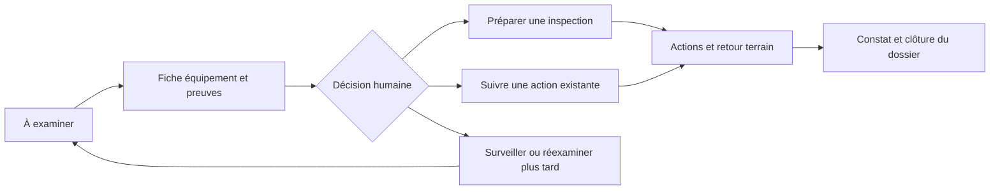

# Front de prévention des pannes : besoin, parcours et priorités

Cadrage du 10 octobre 2026, fondé sur le kit et l'audit local. Périmètre : prévention des pannes uniquement. Ce document définit le produit à construire ; il ne décrit pas un front déjà implémenté.

**L'application doit aider une équipe technique à choisir les équipements à examiner, vérifier les indices et organiser une action dont le résultat sera suivi.** Sa valeur se mesure au travail rendu plus simple et aux dossiers effectivement pris en charge.

## 1. Ce que leur métier demande réellement

Le kit présente In'li Sud-Ouest comme un bailleur gestionnaire de logements intermédiaires. Pour notre défi, le service attendu consiste à maintenir chauffage, eau chaude, ventilation et équipements collectifs disponibles pour les occupants. Les équipes doivent coordonner les prestataires, préparer les passages et retrouver les informations nécessaires pour agir avant un arrêt total.

L'unité de prédiction est l'équipement. La résidence et le bâtiment servent à retrouver le matériel et regrouper les interventions. Le locataire est bénéficiaire et source possible de symptômes ; le kit ne demande pas de construire un portail locataire.

Sources : [consignes originales](../DATA%202%20_le%20kit%20%C3%A9tudiants/BatIA_Kit_Hackathon/LISEZ-MOI_BatIA.pdf), pages 1-2 ; [document de contexte MBA](sources_lisibles/02_PHASE2_BatIA_INLISO.md), sections 2.1 et 8. Le dossier MBA réunit rénovation et maintenance : ses écrans par bâtiment et son scoring énergétique ne remplacent pas le contrat de prévention du kit.

### Faits, conséquences et hypothèses

| Élément documenté | Conséquence pour le front | Limite de connaissance |
| --- | --- | --- |
| Les pannes sont découvertes tard, en urgence | Donner une liste de dossiers à examiner et une prochaine action | Les délais et circuits d'urgence réels ne sont pas fournis |
| Les sources réelles sont relation client, GMAO des prestataires, ERP et rapports | Rassembler les éléments dans une fiche, conserver les références d'origine | Aucun éditeur ni API de leurs outils n'est confirmé |
| L'inventaire centralisé des équipements est indiqué « à constituer » | Localisation et identité du matériel doivent être vérifiables | Le kit fournit déjà une consolidation que le terrain n'a pas encore sous cette forme |
| Le score doit être explicable et la décision humaine | Montrer les facteurs disponibles, les preuves et enregistrer une décision | Un score seul ne permet pas d'expliquer ses causes de calcul |
| Les rapports sélectionnent certaines observations | Afficher la couverture et les éléments manquants | Absence d'alerte PDF ne signifie pas équipement sain |
| Le risque d'un outil perçu comme du contrôle est décrit dans le MBA | Faciliter le travail, permettre la correction et justifier les reports | Il ne s'agit pas d'une observation issue d'entretiens avec les utilisateurs |

Le [LISEZMOI du classeur](sources_lisibles/xlsx_LISEZMOI.csv) et le [dictionnaire](sources_lisibles/xlsx_DICTIONNAIRE.csv) donnent les équivalents des sources dans leurs outils. Ils permettent d'identifier une fragmentation de l'information ; ils ne prouvent pas des défauts précis comme une mauvaise recherche, une ergonomie vieillissante ou un délai de synchronisation donné. Ces points doivent être testés auprès du métier.

## 2. Utilisateurs et responsabilités proposées

| Utilisateur proposé | Question à résoudre | Parcours |
| --- | --- | --- |
| **Coordinateur ou gestionnaire technique, utilisateur principal** | Que dois-je examiner, pourquoi et quelle action préparer ? | Liste → fiche → décision → suivi |
| Technicien ou prestataire | Quel équipement contrôler, avec quels indices, et où renseigner le constat ? | Dossier d'inspection → retour de visite |
| Responsable technique | Quels dossiers restent sans prise en charge et où la charge s'accumule-t-elle ? | Liste des actions et synthèse de suivi |

Ces responsabilités sont une proposition de produit, pas un organigramme confirmé. Le référent RSE/Innovation cité dans le kit est un sponsor métier possible ; rien ne prouve qu'il soit l'utilisateur quotidien. Pour le hackathon, concevoir d'abord le parcours du coordinateur. Une vue mobile de retour terrain peut venir ensuite.

## 3. Le parcours central

Chaque dossier doit permettre de répondre à cinq questions : **quel équipement, pourquoi l'examiner, que sait-on vraiment, qui s'en occupe, quelle est la prochaine étape ?**

La proposition de navigation est : **À examiner · Actions · Équipements**. La fiche équipement s'ouvre depuis la liste et possède un lien direct partageable dans l'équipe. Les sources et réglages de données sont secondaires. Le pilotage agrégé constitue un ajout ultérieur.

## 4. Écran « À examiner » : la page d'accueil

L'accueil présente les dossiers sans décision, triés par risque décroissant, avec accès à tous les équipements scorés. Les équipements déjà pris en charge restent accessibles dans une vue dédiée. La file dépend du résultat du modèle et du suivi métier ; elle ne doit pas créer 1 285 notifications individuelles.

**En-tête produit :** identité Action Logement, nom du module et commandes utiles. Aucun bandeau « mode hackathon » ou « simulation hackathon », conformément à la préférence utilisateur du 10 octobre 2026. Un accès discret « Données » présente la date de référence, l'horizon du score, la couverture et la provenance du classement. La date réelle d'utilisation ne doit pas transformer l'horizon janvier–septembre 2026 en « neuf prochains mois ».

**Trois compteurs utiles :** dossiers à examiner, actions en attente de prise en charge, équipements non scorés ou avec informations à vérifier. Ce sont des états de l'application, pas des chiffres opérationnels présents dans le kit. Si aucun dossier métier n'a encore été créé, l'interface l'indique sans inventer un historique de travail.

**Liste principale :** cases de sélection ; équipement et famille ; résidence/bâtiment/logement ou parties communes ; rang de risque ; élément marquant du dossier ; état de prise en charge ; ouverture de la fiche. Les responsables et échéances peuvent apparaître dans la vue « Actions » pour éviter une table trop large.

**Filtres de départ :** résidence, famille, prestataire, individuel/collectif, état de prise en charge. Recherche par équipement, bâtiment ou logement. Filtres avancés pour la qualité des données. Les filtres sont visibles sous forme de libellés annulables ; leur état, le tri et la page sont conservés au retour de la fiche.

Le risque est un classement, distinct du statut d'intervention. Afficher par exemple « Rang 12 sur 1 285 » et, si utile, « Parmi les 10 % les plus à risque ». Un percentile décrit la place dans le classement, pas une probabilité de panne. Les catégories éventuelles doivent être accompagnées de leur règle ; éviter des seuils arbitraires de probabilité non validée.

Le groupe des 10 % est calculé sur le périmètre complet du résultat et ne change pas silencieusement quand on filtre une résidence. Le kit ne fixe pas l'arrondi : la convention de 129 équipements utilisée dans notre audit doit être déclarée.

Le tableau facilite recherche, tri et sélection ; le détail doit rester accessible séparément. Ce choix s'appuie sur les usages décrits par [Carbon Design System](https://www.carbondesignsystem.com/building-blocks/core/components/data-table/guidelines), puis est adapté ici aux tâches métier.

## 5. Fiche équipement : l'écran déterminant

La fiche doit rendre la décision possible sans relire tous les fichiers sources.

| Zone | Contenu | Décision facilitée |
| --- | --- | --- |
| Identité | Famille, références de localisation, prestataire, entretien sous contrat, date de pose et origine de cette date | Vérifier que l'on parle du bon matériel |
| Risque | Rang, date de référence, horizon et état du score | Comprendre ce que couvre la prédiction |
| Facteurs du modèle | Jusqu'à trois facteurs lisibles, seulement s'ils sont réellement fournis | Comprendre le classement |
| Faits du dossier | Incidents, anomalies et commentaires avec date et référence | Vérifier les indices indépendamment du score |
| Chronologie | Entretien, dépannage, remplacement, demandes liées et observations PDF | Distinguer récidive, usure et matériel remplacé |
| Prise en charge | Action existante, décision, responsable, prochaine étape | Éviter les doublons et les dossiers oubliés |

**La chronologie sépare les vies de l'appareil.** Un remplacement crée une frontière visible « Appareil remplacé ». Les incidents anciens restent consultables dans une section « Appareil précédent ». Ne pas afficher « 4 incidents sur cet appareil » si une partie concerne le matériel remplacé.

**Chaque preuve conserve sa provenance.** Une intervention a une référence et une date ; un passage du PDF a un document, un trimestre et une page ; une demande a son motif et un niveau de rattachement. Une source sans date d'événement précise reste identifiée comme telle. Un même épisode décrit dans plusieurs sources doit être présenté comme un épisode avec plusieurs preuves, pas comme plusieurs pannes.

Une demande rapprochée uniquement par logement porte « Rattachement à confirmer ». Les demandes de parties communes doivent être lues avec leur champ `parties`, même lorsqu'elles possèdent un logement dans le kit. L'[audit](AUDIT_DONNEES.md) et le [guide des jointures](GUIDE_DONNEES.md) expliquent ces pièges.

**Qualité de l'information :** libellés concrets comme « Date de pose estimée », « Rapport partiel », « Aucun constat récent disponible ». Ne pas inventer un indice « confiance IA 92 % » à partir de données manquantes. La complétude du dossier et l'incertitude statistique du modèle sont différentes.

**Action principale :** « Préparer une inspection ». Actions alternatives : « Rattacher à une action existante », « Réexaminer plus tard », « Signaler une information incorrecte ». Un remplacement peut être évoqué dans une source, mais le bouton ne doit pas ordonner un achat ou une rénovation sur la seule base du score.

Si les facteurs du modèle manquent, afficher « Explication du modèle non fournie » et conserver une section distincte « Historique disponible ». Ne pas présenter un résumé des incidents comme une explication du calcul.

## 6. Écran « Actions » : rendre la prévention réalisable

Pour le MVP, une liste par état est suffisante. Une vue calendrier et un tableau de colonnes pourront être ajoutés si les usages les justifient. Le dossier opérationnel reste séparé du score ; un recalcul ne doit pas effacer les décisions humaines ni rouvrir automatiquement les dossiers clôturés.

| État proposé | Sens | Informations nécessaires |
| --- | --- | --- |
| À examiner | Une décision doit être prise | Équipement et résultat de scoring associé |
| À préparer | Inspection retenue, organisation incomplète | Responsable et objectif du contrôle |
| Planifiée | Une date ou un créneau a été confirmé | Date confirmée, intervenant ; modalités d'accès si connues |
| Réalisée | Un passage est renseigné | Date réelle et constat |
| Clôturée | Le dossier a une conclusion et une décision finale | Conclusion, auteur et date |
| À réexaminer | L'action est différée ou une surveillance est retenue | Motif, responsable et date de réexamen |

Ces états sont notre proposition à valider. « Date souhaitée » et « rendez-vous confirmé » ne sont pas équivalents. Un dossier déjà suivi ailleurs est relié à sa référence ; il ne doit pas être recréé.

**Préparation d'inspection :** équipement, objectif, indices et sources sont préremplis. L'utilisateur complète le responsable, le prestataire proposé, la date souhaitée et les précisions nécessaires. Un récapitulatif permet de vérifier puis d'enregistrer le dossier. Le principe de relecture avant validation est décrit dans le [GOV.UK Design System](https://design-system.service.gov.uk/patterns/check-answers/).

**Préparer une campagne :** sélectionner un nombre compatible avec la capacité disponible, regrouper par résidence et prestataire, puis revoir la sélection avant création des dossiers. Le top 10 % du jury n'est pas une capacité d'inspection terrain. La préparation en lot est P1 ; le parcours unitaire est P0. Aucune disponibilité de technicien ni durée de passage n'est fournie : ne pas prétendre optimiser une tournée.

**Retour de visite :** RAS / anomalie constatée / réparation réalisée / second passage nécessaire / remplacement à étudier / visite non réalisée, avec date et commentaire. Enregistrer un nouvel événement sans écraser les sources importées. Un retour « RAS » ne classe pas automatiquement la prédiction comme fausse : une action peut changer la suite des événements.

**Continuité avec les outils :** exporter une fiche d'inspection ou un CSV de préparation contenant les références utiles. Avec ce kit, cela constitue un dossier à transmettre, pas un ordre de travail réellement créé dans une GMAO. Aucun message ni bon de commande n'est envoyé par l'application du prototype.

## 7. Équipements et suivi

La vue « Équipements » sert à rechercher un matériel, même s'il n'est pas prioritaire. Le périmètre scoré compte 1 285 équipements, tandis que l'inventaire complet en compte 4 217. Un équipement hors périmètre doit porter ce statut explicitement. La prise en charge des 2 932 autres matériels ne constitue pas le chantier du hackathon.

Les équipements collectifs sont repérables sans être automatiquement classés plus haut dans le score. Le nombre de logements du bâtiment peut fournir un contexte d'impact ; il ne prouve pas le nombre réellement desservi par l'installation. Le risque et l'impact doivent rester deux informations distinctes.

Le suivi P1 présente dossiers pris en charge, visites réalisées, constats, échéances dépassées et couverture des données, avec une période et un dénominateur. Les résultats historiques du modèle peuvent être consultés séparément avec leur période de test. Ne pas afficher des « pannes évitées », économies ou gains de disponibilité comme résultats acquis sans mesure terrain appropriée.

## 8. Priorités de construction

| Priorité | Fonctionnalités | Pourquoi |
| --- | --- | --- |
| **P0 : parcours complet** | Import d'un résultat, liste filtrable, fiche avec preuves et remplacements, décision humaine, dossier d'inspection, retour de visite, export et gestion des données manquantes | Démontrer la chaîne allant du classement au constat |
| **P1 : confort métier** | Sélection en lot, regroupement résidence/prestataire, recherches enregistrées, vue mobile du dossier, rappels de réexamen et synthèse opérationnelle | Réduire le travail répétitif après validation du parcours central |
| **P2 : extensions** | Connecteurs aux outils confirmés, planning avec disponibilités réelles, comparaison de versions du score, synthèse assistée avec sources | Dépendent d'accès, de données ou de besoins non confirmés |

Un portail locataire, une carte géographique, des capteurs temps réel, une gestion financière complète et les arbitrages de rénovation ajouteraient des chantiers indépendants. Le kit ne fournit ni adresses précises, ni géolocalisation, ni contacts locataires, ni disponibilités des prestataires. Le classement et la fiche sourcée constituent le premier investissement pertinent.

Un copilote peut expliquer ou reformuler un dossier en P1/P2. Son apport est utile s'il évite une lecture longue ; les questions suggérées doivent rester contextualisées, et les réponses pointer vers les faits. La génération ne doit pas ajouter de diagnostic, de date de panne ou de facteur de score absent des sorties du modèle.

## 9. Règles UI/UX transversales

- Interface web pensée d'abord pour le poste de travail du coordinateur ; fiche et formulaire utilisables sur téléphone.
- Présentation sobre : liste lisible, vocabulaire métier, dates explicites, boutons décrivant l'action. Les références techniques et détails du modèle restent secondaires.
- Distinguer visuellement score, faits observés et décision humaine. « Arrêt total constaté en juillet » est un fait historique, pas une panne actuellement en cours.
- Statuts exprimés par du texte, accompagnés de couleur et éventuellement d'une icône. Le [W3C explique pourquoi la couleur seule ne suffit pas](https://www.w3.org/WAI/WCAG22/Understanding/use-of-color.html).
- Prévoir navigation au clavier, focus visible, champs étiquetés et retour compréhensible après enregistrement. Tester le parcours, pas seulement les composants isolés.
- Conserver filtres et sélection au retour d'une fiche ; prévenir si un rafraîchissement modifierait une sélection en cours.
- « Aucun résultat pour ces filtres » offre une réinitialisation. « Modèle indisponible » conserve l'inventaire et montre la date du dernier résultat disponible. « Non scoré » ne devient jamais un risque nul.
- Une correction ou un report est daté et motivé ; il ne modifie pas directement le score calculé. L'autorisation de corriger une source doit être séparée de celle de donner un retour métier.
- Une relance liée à une visite non réalisée sert à organiser l'accès ; elle ne doit pas présenter l'occupant comme responsable de l'usure.
- Une panne en cours n'est affichée comme telle qu'à partir d'un constat actuel confirmé. La prédiction à neuf mois ne constitue pas un système de gestion des urgences.

## 10. Développer le front sans attendre le modèle

Le [contrat front / modèle](CONTRAT_FRONT_MODELE.md) sépare inventaire, résultats de scoring, preuves et dossiers d'action. L'interface peut utiliser un fichier de résultats puis une API ultérieure sans dépendre de l'algorithme retenu.

Commencer avec les références et faits du kit. Pour les scores, utiliser soit un résultat fourni par le collègue, soit notre baseline d'âge dont la méthode est indiquée dans les détails « Données ». Les décisions et visites ajoutées pour la démonstration conservent une provenance simulée consultable dans leur détail, sans bandeau « mode hackathon ». Leur suppression ou leur réinitialisation ne doit pas toucher les fichiers sources.

Ne pas fabriquer d'explications attribuées à EBM ou CatBoost. Prévoir dès le début les états « score disponible sans explication », « non scoré » et « donnée à vérifier ». Cette discipline permet de développer et de montrer les parcours avant l'entraînement final.

## 11. Valider le front sur des situations métier

Critères proposés pour les tests de prototype, à mener avec un utilisateur métier dès que possible :

1. Retrouver un équipement depuis son logement, ouvrir ses preuves et comprendre pourquoi il est prioritaire sans manipuler les CSV.
2. Voir une frontière de remplacement et distinguer les incidents du nouvel appareil de ceux de l'ancien.
3. Identifier une demande au rattachement incertain et corriger l'association sans changer le score.
4. Préparer une inspection, retrouver l'action enregistrée, puis renseigner un constat et une conclusion.
5. Reporter un dossier avec une date de réexamen et le retrouver dans les actions à reprendre.
6. Repérer une action déjà existante et la rattacher sans créer de doublon.
7. Comprendre un collectif, un non-scoré et un équipement hors périmètre sans les confondre avec un faible risque.
8. Réaliser les actions principales au clavier ; sur téléphone, lire la fiche et renseigner le retour sans tableau débordant.

Mesurer temps pour retrouver une preuve, nombre d'allers-retours, erreurs de localisation et compréhension du score. Les cibles de temps doivent être fixées après comparaison avec le fonctionnement réel, pas annoncées comme des gains acquis.

## 12. Les confirmations qui changeraient la conception

À demander au référent métier lors d'un échange : qui décide d'une inspection et qui l'organise ; quel outil reçoit aujourd'hui l'ordre de travail ; comment sont obtenus les rendez-vous et accès aux logements ; quelles données sont réellement mises à jour et à quelle fréquence ; quelles capacités de visite et quels délais utiles sont disponibles.

Ce cadrage permet déjà de construire le prototype. Ces réponses préciseront les libellés, responsabilités et connexions nécessaires pour une utilisation réelle.
