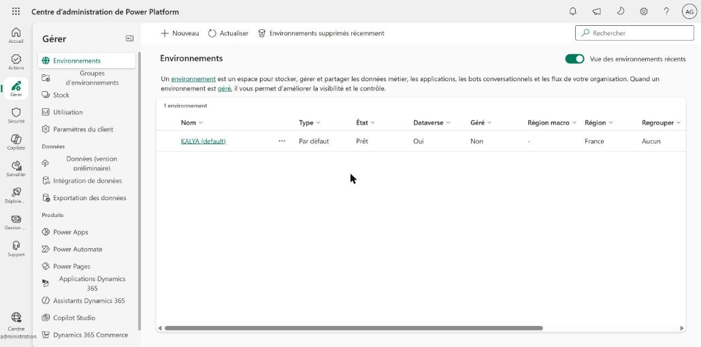
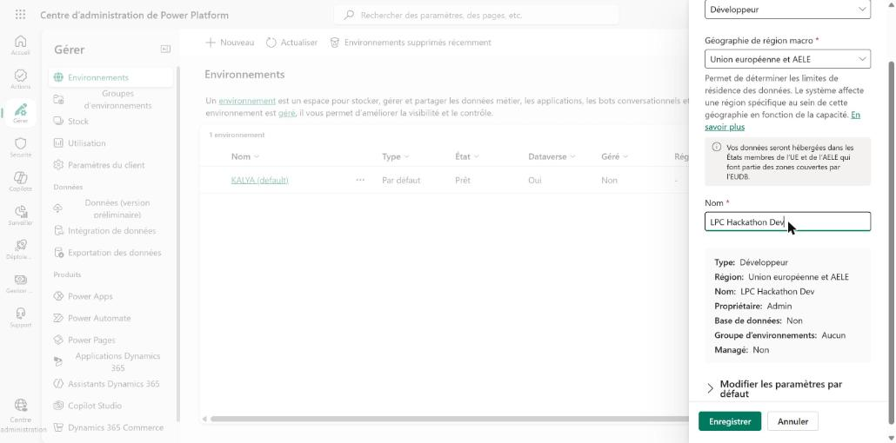
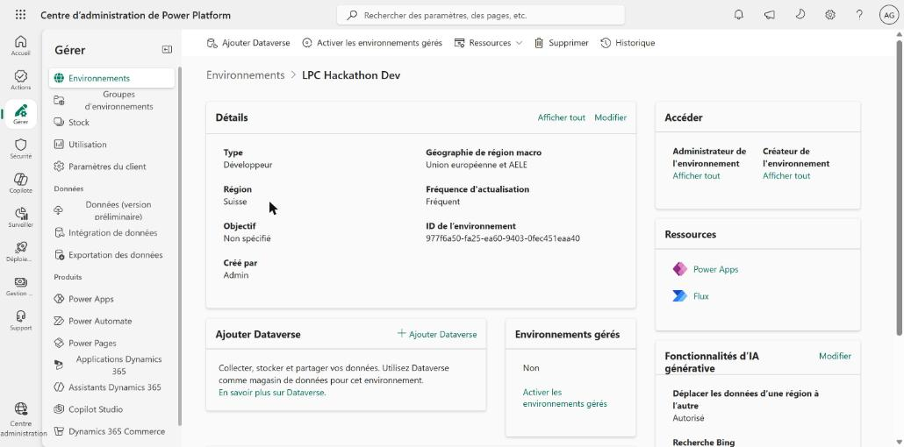
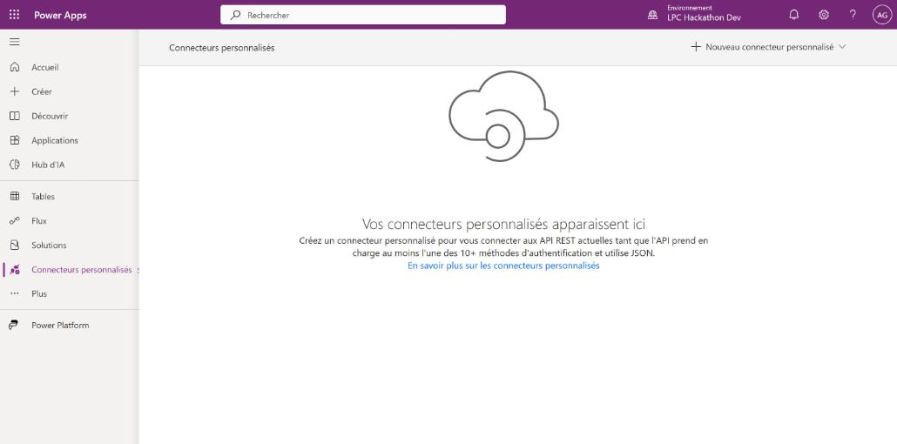
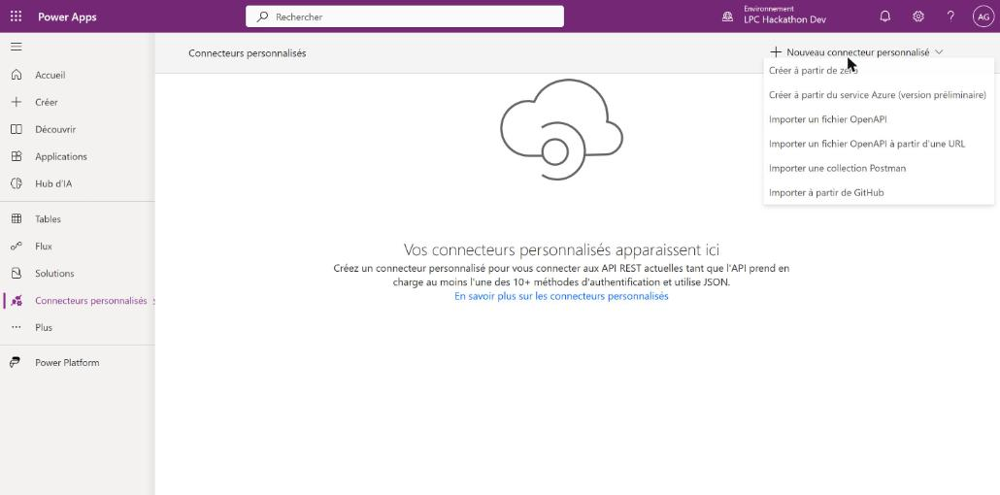
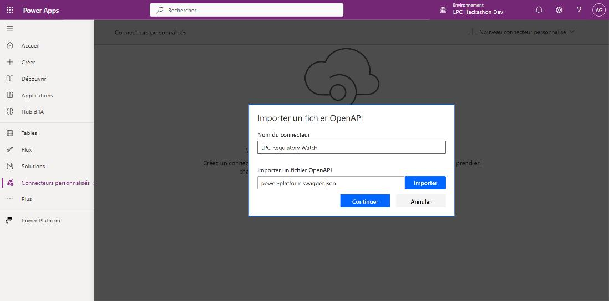
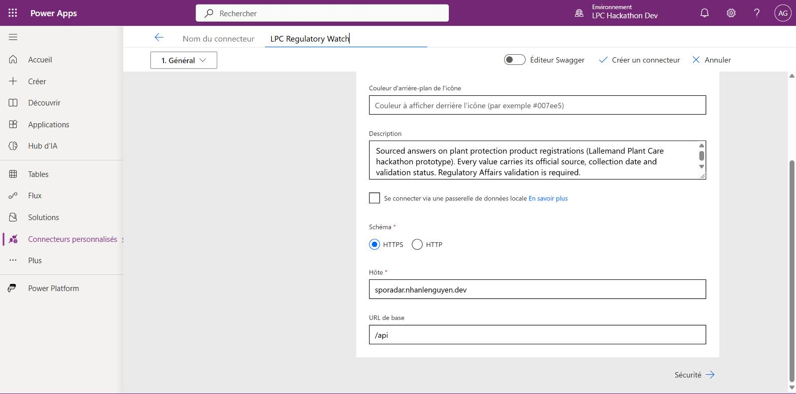
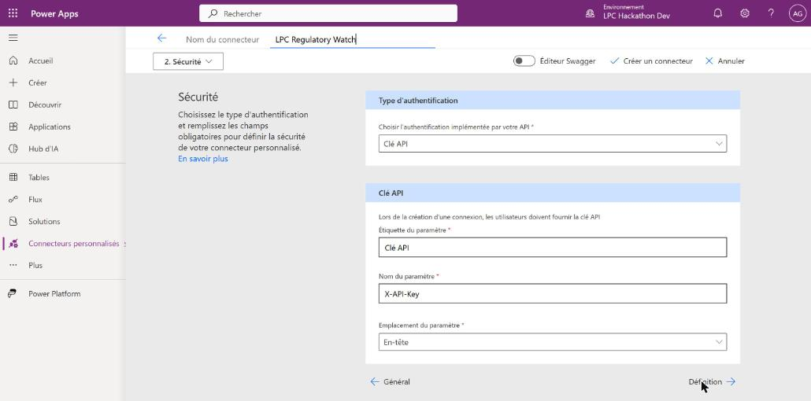
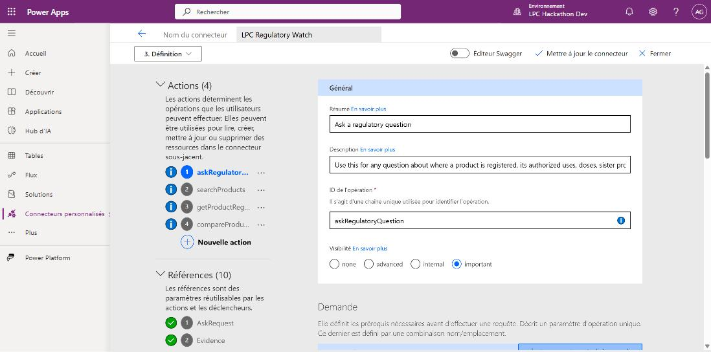
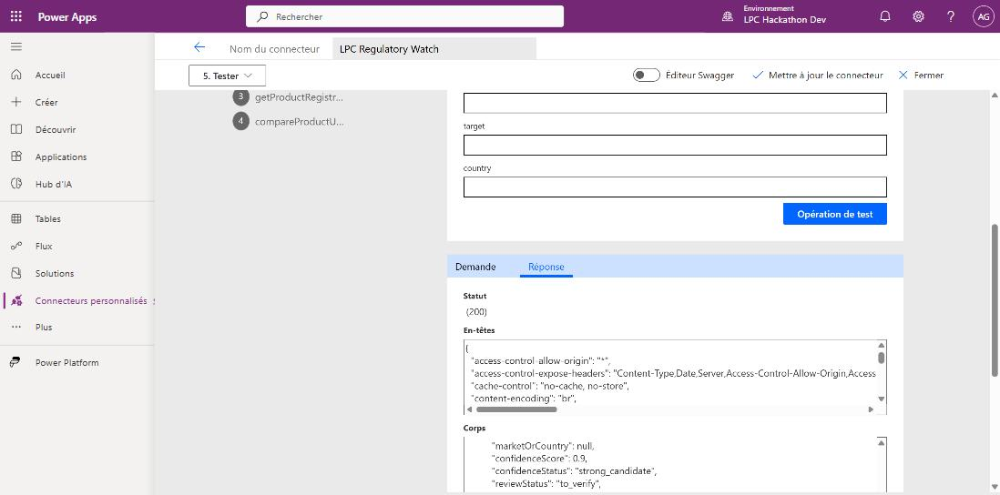

# Connecteur Power Platform (Copilot Studio + Power Automate)

Le connecteur personnalisé expose 4 opérations de l'API LPC. Power Platform n'accepte que du **Swagger 2.0** (pas l'OpenAPI 3.x) : on maintient donc `connector/power-platform.swagger.yaml` à la main et on en génère `connector/power-platform.swagger.json`, **le fichier à importer**.

| operationId | Route | Usage |
|---|---|---|
| `askRegulatoryQuestion` | `POST /ask` | Action principale de l'agent Copilot (langage naturel) |
| `searchProducts` | `GET /products` | Trouver un `productId` (nom, alias, souche, culture, pays) |
| `getProductRegistrations` | `GET /products/{productId}/registrations` | Homologations par pays avec preuves |
| `compareProductUses` | `GET /compare` | Comparer les usages entre pays |

Hôte : `https://sporadar.nhanlenguyen.dev/api` (base path `/api`). Authentification : clé API, en-tête `X-API-Key`. Le serveur tourne avec `API_KEY` vide : **n'importe quelle valeur** (ex. `demo`) est acceptée.

## 1. Hôte HTTPS

L'API est publiée en HTTPS sur `https://sporadar.nhanlenguyen.dev/api` (mise en place par Nhan). Power Platform et les politiques DLP des tenants refusent souvent le HTTP simple : ne pas pointer le connecteur sur `http://64.176.83.254:3000`. Contrôle : `curl https://sporadar.nhanlenguyen.dev/api/health` doit répondre `{"status":"ok"}`.

**Plan B : tunnel cloudflared** (si le domaine devient indisponible) :

```bash
docker run -d --name lpc-tunnel --network host --restart unless-stopped \
  cloudflare/cloudflared tunnel --url http://localhost:3000
docker logs lpc-tunnel 2>&1 | grep trycloudflare     # URL https://xxxx.trycloudflare.com
```

Puis, sur ton poste : `python scripts/build_connector.py --host xxxx.trycloudflare.com` et réimporter. L'URL change à chaque redémarrage du conteneur : ne plus y toucher avant la démo.

## 2. Créer l'environnement (si besoin) puis importer le connecteur

### 2.1 Un environnement Développeur

Dans notre cas, l'environnement par défaut du tenant (Dataverse) ne répondait plus : la page « Connecteurs personnalisés » affichait « Un problème est survenu » et la page Solutions restait sur son squelette de chargement. Un environnement **Développeur sans Dataverse** suffit pour un connecteur personnalisé et se crée en une minute.

1. https://admin.powerplatform.microsoft.com → **Gérer** → **Environnements** → **Nouveau**.
2. Type **Développeur**, géographie **Union européenne et AELE**, nom `LPC Hackathon Dev` → **Enregistrer**.




L'environnement passe à l'état « Prêt » en quelques secondes. Son identifiant est dans la page de détails (il sert dans l'URL de make.powerapps.com).



### 2.2 Importer le fichier

1. https://make.powerapps.com → sélectionner l'environnement `LPC Hackathon Dev` (en haut à droite) → **Connecteurs personnalisés** (menu de gauche, ou « Plus » si absent).
2. **Nouveau connecteur personnalisé** → **Importer un fichier OpenAPI**.




3. Nom : `LPC Regulatory Watch`. **Importer** → choisir `connector/power-platform.swagger.json` → **Continuer**.



4. **1. Général** : l'assistant a rempli le schéma `HTTPS`, l'hôte `sporadar.nhanlenguyen.dev` et l'URL de base `/api`. Rien à changer.



5. **2. Sécurité** : type **Clé API**, nom du paramètre `X-API-Key`, emplacement **En-tête**. Rien à changer.



6. **Créer un connecteur** (ce bouton devient **Mettre à jour le connecteur** après la première création). L'étape **3. Définition** montre les 4 actions (`askRegulatoryQuestion`, `searchProducts`, `getProductRegistrations`, `compareProductUses`) et leurs références.



### 2.3 Tester

1. Étape **5. Tester** → **Nouvelle connexion** → saisir `demo` comme clé API (le serveur a `API_KEY` vide : toute valeur passe) → **Créer la connexion**, puis revenir sur l'onglet Test.
2. `searchProducts` avec `q = M52` → **Opération de test** : statut **200** et des produits LALGUARD M52.



3. `askRegulatoryQuestion` avec `question = Où est homologué LALGUARD M52 OD ?` : le champ `answer` est rempli et `evidence` n'est pas vide.

Après un changement du YAML : `python scripts/build_connector.py`, puis dans le connecteur → **Mettre à jour le connecteur** avec le nouveau JSON. `pytest tests/test_connector.py` signale un JSON obsolète ou une construction refusée par Power Platform.

## 3. Copilot Studio

1. Agent → **Outils** → **Ajouter un outil** → **Connecteur** → `LPC Regulatory Watch` → `askRegulatoryQuestion`, avec la connexion créée plus haut.
2. Dans les **instructions** de l'agent, coller :

```
Tu aides les équipes Lallemand Plant Care à consulter les homologations de produits de protection des plantes.
Pour toute question sur un produit, un pays, une culture, une cible, une dose, une expiration ou une source,
appelle l'outil askRegulatoryQuestion avec la question de l'utilisateur, telle quelle.
Réponds avec le champ answer, en citant la source et le statut de validation de chaque donnée.
Ne dis JAMAIS qu'un produit « n'est pas homologué » quand le résultat est not_found : dis qu'il n'a pas été trouvé dans les sources consultées.
Termine par le disclaimer. N'invente aucune donnée absente de la réponse.
```

3. Questions de démo : `docs/demo_cases.md` (LALGUARD M52 OD multi-pays, G46 pour les produits sœurs).

## 4. Power Automate

Flow type « synthèse » :
1. Déclencheur : **Déclencher manuellement un flux** (entrée texte `Question`) ou **Périodicité**.
2. Action : `LPC Regulatory Watch` → **Ask a regulatory question**, `question` = l'entrée.
3. Action : **Envoyer un e-mail** ou **Publier un message dans Teams** avec `Answer` + `Disclaimer` + la liste `Evidence` (Source, Record URL).

Pour un tableau Excel : `searchProducts` (récupérer `productId`) → `compareProductUses` (`countries = FR,DE,CA`) → boucle sur `registrations` → **Ajouter une ligne dans un tableau** (Excel Online). L'export CSV complet (`/compare?format=csv`) n'est pas dans le connecteur : l'ouvrir dans le navigateur ou par une action HTTP.

## 5. Limites et dépannage

- **Réponses lourdes** : `/ask` ≈ 160 Ko, `getProductRegistrations` ≈ 1 Mo et `compareProductUses` ≈ 2 Mo pour LALGUARD M52. Toujours filtrer (`country`, `crop`, `target`) dans les flows ; préférer `askRegulatoryQuestion` pour Copilot.
- **Délai** : `/ask` ≈ 4 s avec le LLM. Limite d'une action de connecteur : 120 s.
- **Import refusé** : vérifier que c'est bien le `.json` généré (Swagger 2.0) et pas `openapi.proposed.yaml` (3.1). Fichier < 1 Mo.
- **401** : `API_KEY` a été activée sur le serveur. Saisir la vraie clé dans la connexion.
- **Erreur de certificat / hôte injoignable** : `curl https://sporadar.nhanlenguyen.dev/api/health` ; sinon plan B (section 1).
- **Environnement par défaut inutilisable** (« Un problème est survenu », Solutions qui ne charge pas) : créer un environnement Développeur (section 2.1).
- **Assistant de connecteur : un clic ne répond pas** : l'assistant est dans une iframe, recliquer ou passer par le menu déroulant d'étapes.
- **Accents illisibles dans un test curl sous Windows** : artefact de la console (cp1252). Power Platform envoie de l'UTF-8.
- **Rappel** : prototype, pas une source réglementaire officielle. Une absence de résultat n'est pas une preuve d'absence d'homologation. Validation Regulatory Affairs requise.
